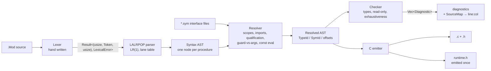

# Oberon-07 → C: front end and back end design

Target language: **Oberon-07 as defined by *The Programming Language Oberon*, N. Wirth,
revision 1.10.2013 / 3.5.2016** (`../books/Oberon07.Report.pdf`, cited below as *report §n*).
Paths in this document are relative to its own directory, the repository's
`oberon/` crate.

Parser generator: **LALRPOP** (0.23.1), used for the full concrete syntax.
Output: **C11**, one translation unit per Oberon module, compiled by the host `cc`.

The crate and the three suites below back the claims in this document and are
meant to be kept:

| Artefact | What it is | Status |
|---|---|---|
| `src/bin/obgen.rs`, `fuzz/` | **A random program generator used as a self-checking oracle**: it writes a module *and* the value every variable must have (its own interpreter, so no circularity), and a mismatch traps in the module itself | 25 seeds run, 0 survived: it found three defects in the emitted C that the hand-written suites had missed (§13 R20) |
| `.` (this crate) | Working front end: hand-written lexer, the LALRPOP grammar, the AST, the resolver **and checker** (scopes, type resolution, diagnostics), the interface-file codec, the type algebra and the constant folder, all with tests | builds, 50 tests pass, clippy clean |
| `csmoke/` | Every C emission rule of §9 that has a non-obvious semantic, compiled and executed | 67 cases pass, 1 bug in the test spec itself (R11) |
| `golden/` | The report's own procedures hand-lowered to C in the shape §9.6–9.8 prescribes, a two-module link model with command dispatch, and the constant table the folder is cross-checked against — **compiled against the runtime the compiler emits, not a copy of it**; run twice (plain and under ASan/UBSan) | 67 cases pass, 3 design corrections found (R12–R14) |
| `e2e/` | **The whole compiler, end to end**: five Oberon modules (including the report's own `Out` and a hello-world) compiled by this repository's compiler to C, that C compiled by the host `cc` with `-Werror`, the program run and compared with an independently computed expectation — and the same again through the `obc` driver | 26 checks pass; it found the emitter and checker bugs listed in §14 |

Everything marked **[design]** below is not yet implemented; everything marked
**[verified]** was executed in this repository (commands in §14).

---

## 1. Scope

**In scope**

* All of Oberon-07 proper: modules, imports, constants, types (basic, array,
  record with extension, pointer, procedure), variables, the four operator
  classes, all seven statement forms, procedures with VAR/value/open-array
  parameters, nested procedures, the 29 predeclared identifiers of report §10.2.
* One *compilation unit* at a time for the compiler proper: `Foo.Mod` is read
  together with the interface files of the modules it imports, and becomes
  `Foo.c` + `Foo.h` + `Foo.sym`. The *driver* (§9.9) resolves a whole program's
  import graph on top of that and runs the C compiler.
* Diagnostics with byte spans, resolved to line/column at print time.

**Out of scope (deliberate)**

* Module `SYSTEM` (report §11.1 is explicitly optional). Importing it is a hard
  error with a message that says so. See §13 risk R5 for the escape hatch.
* Optimisation of any kind. The C compiler does it. Our job is to emit boring,
  obviously-correct C.
* Garbage collection. `NEW` maps to `malloc` (§8.6). Oberon systems do have a
  tracing collector; the report does not promise one, and a collector is a
  project of its own. Program behaviour is unaffected; only long-running
  programs that allocate in a loop change character.
* Extensions that production Oberon compilers add beyond this report — which
  ones are worth adopting, and why most are not — are surveyed with sources in
  `PLAN.md` W8; Oberon-2 support specifically is considered there in W8.11, with
  a recommendation and the trigger that would change it. Nothing there is adopted
  until it appears in this section.
* **Oberon-2** and later dialects (`WITH`, `LOOP`, `EXIT`, type-bound
  procedures, `LEN(v, dim)`, multi-dimensional open arrays). Report §10.2 lists
  `LEN(v)` with one argument; we implement exactly that.

---

## 2. Toolchain

```toml
# crates/syntax/Cargo.toml
[build-dependencies]
lalrpop = "0.23.1"

[dependencies]
lalrpop-util = { version = "0.23.1", features = ["lexer", "unicode"] }
```

* `lalrpop` and `lalrpop-util` **must** be at the same version; LALRPOP's manual
  states that differing major/minor versions are unsupported. Pin both in one
  place (workspace `[workspace.dependencies]`).
* `build.rs` is `lalrpop::process_src().unwrap()`; the generated parser lands in
  `OUT_DIR` and is included with `lalrpop_mod!(pub oberon);`.
* We keep the **default** LR(1) construction (the lane-table algorithm). It
  accepts the grammar in `src/oberon.lalrpop` with **zero conflicts**
  **[verified]**. The alternatives are worth knowing:
  * `#[LALR]` + `LALRPOP_LANE_TABLE=disabled` → the legacy LALR(1) tables.
    Deprecated upstream; we do not use it.
  * `LALRPOP_LANE_TABLE=disabled` alone → the canonical LR(1) construction:
    identical language, much larger tables, and *materially better conflict
    diagnostics* (it prints a parse-tree-level explanation). We use it as a
    debugging switch, not in the normal build.

### Workspace layout

```
Cargo.toml                 # workspace, pins lalrpop/lalrpop-util
crates/syntax/             # lexer + grammar + syntax AST
  src/lexer.rs
  src/oberon.lalrpop
  src/ast.rs
crates/sema/               # resolver, type checker, constant evaluator
  src/sym.rs src/resolve.rs src/types.rs src/check.rs src/const_eval.rs
crates/cgen/               # C emitter + runtime header
  src/mangle.rs src/layout.rs src/emit.rs src/runtime.h
crates/obc/                # CLI driver: obc build/run/emit/check (DESIGN §9.9)
tests/corpus/              # *.Mod with expected diagnostics / expected stdout
```

The split is by *phase*, because each phase is testable on its own and the
interfaces between them are three plain data types (syntax AST → resolved AST →
C text). `crates/syntax` is the only crate that knows LALRPOP exists.

---

## 3. Pipeline



The parser never consults the symbol table, and the resolver never re-reads the
source text. Three facts about the report force the split, and each is a design
decision recorded in §5:

1. `a.b` is either a module-qualified name or a record field select.
2. `f(x)` is either a call with one argument or a type guard.
3. `WriteLn` is either a procedure value or the call of a parameterless
   procedure.

---

## 4. Lexer

**Decision: hand-written scanner, not LALRPOP's built-in regex lexer.**

The built-in lexer is a longest-match regex scanner with `match { ... }`
precedence blocks and regex `ignore` patterns. Two things make it unusable here:

* **Comments nest.** Report §3: "Comments … may be nested." A language
  `(* ( (* )* )*)`-balanced is not regular, and `ignore` patterns are regexes.
  The whitespace-language chapter of LALRPOP's manual reaches the same
  conclusion and falls back to a hand-written lexer.
* **`22X`, `100H` and `1..5`** would all need `match` rungs plus fixed-string
  precedence to come out right, and the result would be a regex puzzle nobody
  wants to maintain.

The scanner is 413 lines including documentation (`src/lexer.rs`
**[verified]**), emits `Result<(usize, Token<'input>, usize), LexicalError>` — the
`Spanned` shape LALRPOP expects from a custom lexer — and is plugged in with

```lalrpop
extern {
    type Location = usize;
    type Error = LexicalError;
    enum Token<'input> {
        "ident"   => Token::Ident(<&'input str>),
        "integer" => Token::Integer(<u32>),
        ...
    }
}
```

`Location` is a byte offset. Line/column is *not* tracked during lexing: a
`SourceMap` computes it from the source text when a diagnostic is printed, which
keeps three `usize`s out of every AST node.

### Lexical near-misses (all **[verified]** by `tests::lexer_near_misses`)

| Input | Tokens | Rule |
|---|---|---|
| `22X` | `CharLit(0x22)` | report §3 `string = digit {hexdigit} "X"`; `X` is not a hex digit, so it terminates the digit run |
| `100H`, `0FFH` | `Integer(256)`, `Integer(255)` | `integer = digit {hexDigit} "H"`; requires a leading digit, so `ABCH` stays an identifier |
| `1..5` | `Integer(1) DotDot Integer(5)` | `.` is only a decimal point when the next byte is not `.` |
| `1.5E3` | `Real(1500.0)` | `ScaleFactor = "E" ["+"\|"-"] digit {digit}`; `E` is consumed only if a digit follows |
| `IF` / `If` | keyword / identifier | report §3: keywords are all upper case and "cannot be used in the role of identifiers" |
| `(* a (* b *) c *)` | nothing | nested comment |
| `"A"` | `StrLit("A")` | no escape sequences in Oberon strings; a string always terminates with a NUL in our model |

Lexical errors (`IllegalCharacter`, `UnterminatedComment`, `UnterminatedString`)
carry the offending byte and are reported as `ParseError::User`; while they are
structurally parser errors, they are *not* recoverable by LALRPOP's `!`
mechanism, which is why §5 records the (deliberate) choice to fail fast in v1.

---

## 5. Grammar

`src/oberon.lalrpop` is a direct transcription of the report's appendix, with
five changes to its productions (D1–D5) plus two decisions that shape the
grammar without changing what it accepts as a correct program (D6, D7). Each
change exists because the report's own grammar is not LR(1) at that point; each
is stated with the evidence that forced it.

One decision here is about the grammar's *shape* rather than its content, and it
predates any dialect: **a dialect is a gated grammar, not a second grammar.**
LALRPOP chooses alternatives at build time, so accepting an extension with a flag
would mean a second grammar for every flag combination — double the parser
maintenance, and two grammars that can disagree about the report's own syntax.
Instead the grammar accepts the union and the checker rejects what the selected
dialect does not allow, with a diagnostic that names the reason. That is also why
extensions whose only benefit is a different spelling of existing syntax are not
worth taking (`WITH` in `PLAN.md` W8.11): they buy familiarity and cost a
reserved word.

### D1 — `statement` is factored into assignment vs. call **[verified]**

The report's `statement = [assignment | ProcedureCall | ...]` with
`assignment = designator ":=" expression` and `ProcedureCall = designator
[ActualParameters]` puts two productions with the same prefix in one context.
Replacing `designator` by a single nonterminal and letting the lookahead decide
is the standard fix:

```lalrpop
Statement: Option<Stmt> = {
    => None,                       // report §9: a statement may be empty
    <s:AssignStmt> => Some(s),
    <s:CallStmt>   => Some(s),
    ...
};
AssignStmt: Stmt = <lo:@L> <target:Designator> ":=" <value:Expr> <hi:@R> => …;
CallStmt:   Stmt = <lo:@L> <callee:Designator> <hi:@R> => …;
```

The reduce `CallStmt → Designator •` happens only on the tokens that can follow
a complete statement (`;`, `END`, `ELSE`, `ELSIF`, `UNTIL`, `|`, `.`), never on
`:=`, so the decision is made with one token of lookahead.

Empty statements are kept, so `BEGIN ; x := 1; ; END` is legal and the empty
slots simply contribute nothing to the AST **[verified]**
(`tests::empty_statements_are_legal`).

### D2 — `( ... )` after a designator is one production, split semantically **[verified]**

The report has a *type guard* `selector = … | "(" qualident ")"` **and**
`ActualParameters = "(" [ExpList] ")"`. Both are `(` … `)` after a designator, and
the report's own Chapter 8 example puts a guard in the *middle* of a designator:

```
t(CenterNode).subnode        (report §8.1)
```

So there is no "trailing parameter list" rule to hide behind. The grammar parses
one thing:

```lalrpop
Selector: Selector = {
    "." <name:Ident> => Selector::Field(name),
    "[" <index:ExprList> "]" => Selector::Index(index),
    "^" => Selector::Deref,
    "(" <args:ExprList?> ")" => Selector::Args(args),   // guard OR arguments
};
```

and the resolver decides. The rule that makes this total:

> A paren group is a **type guard** iff it is followed by at least one more
> selector, or its single element is a bare designator that denotes a *type*.
> Otherwise it is an argument list.

This is sound because types and variables share one namespace in Oberon (report
§4: "No identifier may denote more than one object within a given scope"), so an
identifier that denotes a type can never be a value argument. Consequences to
document for users:

* `f(x)` — call (unless `x` is a type name, which cannot be an argument).
* `p(T)` — guard when `T` is a type.
* `t(T).f`, `t(T)^` — guard followed by selectors.
* `f(x)(y)` parses but is rejected by the checker ("designator applied twice").
  The report does not define it either, so a diagnosed rejection is the honest
  behaviour.

The rule is implemented in `src/resolve.rs` and executed by
`tests::reclassify_splits_guards_calls_and_module_qualification`, which checks
all four shapes (`t(T)` guard, `g(1)` call, `t(T).f` guard-then-field, `INC(x)`
predeclared call) plus `tests::type_guard_and_call_share_one_production` and
`tests::type_guard_can_be_followed_by_selectors` for the parse side, and
`tests::reclassify_leaves_no_unresolved_selector_in_the_kitchen_sink`, which
asserts that a module using every construct of the report ends up with **zero**
unresolved `Selector::Args` **[verified]**. Only two name sets are needed for
this (visible type names, import aliases) — the callee's *signature* is not,
which is what makes the pass cheap and keeps it out of the checker.

### D3 — a designator starts with *one* identifier, not with `qualident` **[verified; found by conflict]**

This is the one place where the report's grammar is genuinely ambiguous, and we
found it by building rather than by reading. `designator = qualident {selector}`
with `qualident = [ident "."] ident` and `selector = "." ident | …` means the
input `a.b` has two parses: qualifier `a` + name `b`, or name `a` + field
selector `b`. LALRPOP (canonical LR(1) construction, which explains conflicts by
showing both parse trees) said:

```
The problem arises after having observed the following symbols in the input:
  Ident
At that point, if the next token is a `"."`, then the parser can proceed in two
different ways.
First, the parser could execute the production at oberon.lalrpop:494:21, which
would consume the top 1 token(s) from the stack and produce a `Qualident`. …
Alternatively, the parser could shift the `"."` token and later use it to
construct a `QualTail`. …
```

No amount of lookahead fixes this: `a.b.c` is `M.field.field` or
`module.name.field` depending on what `a` *means*. The resolution is the same one
the report's own implementors use — decide from the symbol table:

```lalrpop
Designator: Designator = <lo:@L> <base:Ident> <sels:Selector*> <hi:@R> => …;
```

`Qualident` (with its optional `.`) survives only where nothing can follow a
designator — type names, record base types, `IS`/guard targets, case labels,
formal types, result types. In those positions `(`/`.`-shaped continuations do
not exist, so no ambiguity arises. The resolver folds a leading `Selector::Field`
into `base` when the base identifier denotes an imported module; the fold and its
negative case (a base that is *not* a module keeps its field select) are both
executed **[verified]** in the same test as D2.

### D4 — a nullable non-terminal must not appear under `*` **[verified; found by conflict]**

The first draft wrote the procedure part of a declaration sequence as

```lalrpop
ProcSection: Vec<Proc> = { => Vec::new(), <ps:ProcDeclSemi*> => ps };  // WRONG
```

LALRPOP rejected it with *"Multiple productions for the same reduction … They
could be reduced using the production on line 181 `=> Vec::new()` … or using the
production on line 182 `<ps:ProcDeclSemi*> => ps`"*: `ProcSection` then has two
derivations of ε (`ProcSection → ε` and `ProcSection → ProcDeclSemi* → ε`). This
is a general rule, not a LALRPOP quirk: `X*` over a nullable `X` is ambiguous.
The fix is to let the star own the empty case:

```lalrpop
ProcSection: Vec<Proc> = <ps:ProcDeclSemi*> => ps;
```

The same reasoning is why `ConstSection`/`TypeSection`/`VarSection` are written
as `{ => Vec::new(), "CONST" ConstDeclSemi* => … }` — there the ε is a separate
production with a *non-nullable* right-hand side (it starts with the section
keyword), so no duplicate derivation exists.

### D5 — helper non-terminals for repetition

`IdentList`, `Qualident`, `ExprList`, `FieldLists`, `CaseLabels`, `SetElems`,
`StatementSequence` exist only so the star/tail idioms read uniformly; they have
no counterpart in the report and none in the AST.

### D6 — `RETURN` is not a statement **[verified]**

Report §9's `statement` list does **not** contain `RETURN`; §10 puts it at the
end of `ProcedureBody`:

```
ProcedureBody = DeclarationSequence [BEGIN StatementSequence] [RETURN expression] END.
```

We transcribe that literally. The prototype consequently *rejects* an Oberon
program that returns from the middle of a `CASE` **[verified]** — that is the
report's rule, not a bug, and it buys the back end a guarantee worth having:
**every procedure body has a single exit point**, so the C emitter never needs to
synthesise a result variable with multiple assignment sites.

### D7 — error handling and recovery **[implemented; limits found by conflict]**

Two properties are wanted, and they are independent:

1. **Every error is located.** A diagnostic carries a byte span, and the
   rendering (§10) turns it into `file:line:col`, echoes the source line, puts a
   caret under the span, and adds a note when the rule is not obvious. Message
   text is not pre-formatted in the parser or the checker: they produce
   `Diagnostic` values, and one function renders them, so syntax and semantic
   errors look alike.
2. **One run reports every error it can.** LALRPOP's `!` token plus

   ```lalrpop
   grammar<'input, 'err>(errors: &'err mut Vec<ErrorRecovery<usize, Token<'input>, LexicalError>>);
   ```

   resynchronises, and the recovery is *recorded* rather than swallowed, so the
   driver reports the syntax errors and the semantic errors found in the same
   run **[verified by `diag_tests` and by seven `e2e` checks]**.

Recovery is enabled in exactly one place — **the statement sequence**:

```lalrpop
Statement: Option<Stmt> = {
    => None,
    <s:AssignStmt> => Some(s),
    …
    <e:!> => { errors.push(e); None },
};
```

A statement the parser cannot accept becomes an empty one, the parser skips
input to the next `;`, and the rest of the body is still parsed. That is the
recovery that pays, because statements are where syntax errors cluster and where
recovery is cheap: the skipped tokens are the broken statement.

**Recovery in declaration sections is not attempted, and the reason is a
measured one.** Four shapes were tried — recovery on the `;` that ends a
declaration, recovery on the next section keyword, a nullable item under a
non-nullable list, and a `!` alternative inside the list rule — and LALRPOP
rejects all four with a *local ambiguity on the error token*: because the report
lets each declaration section be empty, the section's ε production and the error
token compete (end the section, or swallow the error?), and LALRPOP's LALR(1)
construction adds the error token to every lookahead set, so the ε-reduce is a
live alternative wherever the error can be shifted. The statement case escapes
this because `StatementSequence` is non-nullable and its single `!` sits in the
item rule — the same shape applied to declarations does not, because the sections
*are* nullable.

The consequence is bounded and acceptable: a declaration-level or module-level
syntax error is reported **once**, located and explained, and the file stops
there (§3's build order means the driver has nothing to emit anyway). Recovery
inside a `ProcedureBody` is capped the same way: a broken procedure declaration
is reported and the file stops, rather than resynchronising inside a body whose
declarations are then unusable.

Two entry points exist, deliberately:

* `parse_module` fails fast (used where a module is *required* to be well formed,
  such as reading a `.sym` interface), and
* `parse_with_diagnostics` / `check_module_recovering` recover.

A *fatal* error — a missing `END`, an unterminated comment, an illegal character
— is not absorbed by any recovery point, but it is still converted to a located
diagnostic rather than printed as a `ParseError` **[verified]**, so a reader
never sees a byte offset.

---

## 6. AST

**Design rule: the tree is organised per procedure.** There is no flat
declaration list with back-references and no arena of anonymous nodes. A `Proc`
owns everything that belongs to it:

```rust
pub struct Module<'input> { name, imports, decls: Decls<'input>, body: Vec<Stmt<'input>>, … }

pub struct Decls<'input> {           // exactly the report's DeclarationSequence order
    pub consts: Vec<ConstDecl<'input>>,
    pub types:  Vec<TypeDecl<'input>>,
    pub vars:   Vec<VarDecl<'input>>,
    pub procs:  Vec<Proc<'input>>,   // <- nested procedures, recursively
}

pub struct Proc<'input> {
    pub name: Ident<'input>, pub export: bool,
    pub params: Vec<Param<'input>>,  // one entry per FPSection
    pub result: Option<QIdent<'input>>,
    pub decls: Decls<'input>,        // its own constants/types/variables/procedures
    pub body: Vec<Stmt<'input>>,
    pub ret: Option<Expr<'input>>,   // the single trailing RETURN, if any
    pub end_name: Ident<'input>,     // repeated after END; must equal `name`
    pub span: Span,
}
```

Why this shape:

* The checker and the emitter both want to work "one procedure at a time": push
  a scope, declare parameters, walk the body, pop. Nesting is the tree, so
  **nothing is ever looked up by procedure name across a side table**.
* `end_name` is kept, not checked at parse time, because "end identifier must
  repeat the procedure identifier" is a report §10 rule with a *span* and a
  *message*, and belongs to the resolver.
* Span is `Span { lo: u32, hi: u32 }` — byte offsets, 4 GiB of source is enough
  (Oberon modules are kilobytes), and `u32` keeps the node small.
  `@L`/`@R` bind `usize`, which the actions narrow once.
* Every leaf takes its span from `@L`/`@R`; composite expressions derive theirs
  from their children (`Expr::binary` joins the two operand spans), so spans cost
  two `usize` writes per node and no bookkeeping.

**Lifetimes.** The prototype stores `String` for identifiers and string literals
(the mechanical form, proven end to end). Production should use `&'input str`
slices into the source text: the compiler handles one module at a time, the
source outlives every AST node and diagnostic, and this removes one allocation
per identifier occurrence. If profiling ever shows repeated string comparison in
the symbol table to be hot, intern to a `Symbol(u32)` — but that is a later,
purely local change, since no phase compares identifiers across the AST/resolved
boundary.

**Syntax AST vs. resolved AST.** The parser produces the syntax AST above, and
that stays the only tree: the semantic pass is *single walk* (a scope chain with
types built on the fly, like the reference compiler), so there is no second,
annotated tree. The few types the emitter will need — the `BYTE`/`INTEGER` and
string cases, open arrays, guards, type-`CASE` narrowings — come from a side
table keyed by span, which is the cheap equivalent of an annotation because
spans are unique. A second tree would be tidier to consume and twice the code;
the table below is what it would contain, and doubles as the description of the
rewrites the resolver performs in place:

| field | syntax AST | resolved AST |
|---|---|---|
| type references | `TypeExpr::Named(["M","T"])` | `TypeId` into the type interner |
| designator base | `["t"]` + selectors | `SymId` + constant offset chain |
| paren group | `Selector::Args(Option<Vec<Expr>>)` | `Selector::Call(SymId, Vec<Expr>)` or `Selector::Guard(TypeId)` |
| `ExprKind::Int(u32)` in a type/label context | literal | folded constant |
| everything else | identical | identical |

Keeping two types is deliberate: phases that only re-annotate cannot silently
change the tree, and the emitter can be written against a "nothing can fail"
interface. The first three rows of that table are the *only* rewrites the
resolver performs that change a node's shape, and they are all implemented in
`src/resolve.rs`; the remaining work is attaching `TypeId`/`SymId`, which
is annotation, not restructuring.

---

## 7. Resolver: names, scopes, imports **[implemented in `src/sema.rs`]**

Implemented, with the row numbers of §8.5 in each check's comments: the scope
chain and the declaration order, type resolution with the report's single
forward-reference rule, module-qualified lookup through interface files, the
`FOR` lock, the read-only rules and the import checks. Verified by
`check_tests::report_out_module_checks_clean` (the report's own `Out`, imports
and all, produces **no** diagnostics) and
`check_tests::kitchen_sink_checks_clean` (one module using every construct of
the report likewise).

### Scopes

One `Scope` per module and per procedure, with a parent link; the scope chain is
walked outward on lookup, exactly as report §4 defines visibility ("from the
point of the declaration to the end of the block to which the declaration
belongs").

Per scope, **two passes over the declaration part**:

1. *Declare*: insert every constant, type, variable, and procedure name with its
   kind. This is what makes `Tree = POINTER TO Node; Node = RECORD … END`
   legal (report §6.4: "the identifier `T` can be declared textually following
   the declaration of `P`"). Insertion reports the §4 duplicate-name error.
2. *Resolve*: type each declaration, check constant expressions, then walk
   procedure bodies. Because pass 1 completed for the whole scope, a pointer base
   never needs a second resolution round.

Forward references outside pointer bases are *not* allowed (report §4), and the
resolver enforces that by resolving in textual order: a type declaration that
names a not-yet-resolved *non-pointer* type in the same scope is an error. Since
all names are visible after pass 1, we track a per-scope "resolved up to"
watermark for this check rather than relying on the symbol table's contents.

### Imports

`IMPORT Texts, Oberon;` and `IMPORT M := Other;` (report §11) insert the alias as
a *module* symbol. A qualified reference `M.x` is resolved in two steps now that
qualification is semantic (D3): the resolver rewrites a leading
`Selector::Field(x)` into `base = ["M","x"]` when `M` denotes a module, then
looks `x` up in that module's interface and requires the export mark.

**An interface must name the modules its own types refer to.** This was not in
the first draft of the format, and its absence is a real hole: `Oberon`'s
interface says `VAR Log: Texts.Writer`, and a client that imports `Oberon` but
not `Texts` must still resolve that type. The format therefore carries an
`IMPORT` line, and the reader resolves qualified names in the *defining*
module's import list rather than in the importer's scope. Found by trying to
check the report's own `Out`; the alternative — rendering every imported type
structurally, as ETH's `.sym` files do — keeps interfaces self-contained but has
to serialise recursive structures, a much larger format.

Interface files (`<Module>.sym`) are text, one declaration per line, written by
the emitter companion and read by the resolver:

```
MODULE Out
IMPORT Texts, Oberon
PROC Write(ch: CHAR)
PROC WriteInt(x: INTEGER; n: INTEGER)
PROC WriteLn
VAR W: Texts.Writer            (* exported variables are read-only *)
CONST N = 100
TYPE Node = RECORD key: INTEGER; left, right: Tree END
```

Text rather than a packed binary blob: it is diffable, greppable and versionable,
and parsing it is trivial next to the compiler that writes it. The *rendered
types* on those lines are ordinary Oberon type syntax, so the reader parses them
with the very production the module parser uses (`pub RenderedType` in
`oberon.lalrpop`) instead of growing a second parser for its own output — which
also means an interface cannot drift into a syntax the compiler would not
accept.

Three details make the format unambiguous, and all three are exercised by the
prototype codec in `src/sym.rs` **[verified]**:

* a parameterless proper procedure is written `PROC WriteLn` with no
  parentheses at all, matching how the report lets it be called (report §9.2);
* a formal parameter's type is `{ARRAY OF} qualident` (report §10.1), so a
  parameter spec can never contain parentheses — the codec *rejects* an inline
  `PROCEDURE (…)` parameter type, which is what keeps the closing `)` of the
  parameter list unambiguous;
* render/parse is a round trip and render is a fixed point on the parsed result,
  so a written interface and a re-read interface cannot drift.

The codec prototypes only the *format*; resolving the parsed declarations into
the scope chain is the resolver's job.

### Read-only entities

Report §9.1 and §10.1 forbid assigning to: constants, imported variables,
value parameters of structured type, and the control variable of a `FOR` inside
its body. All four are the same check — `is_assignable(designator)` — applied at
one place in the assignment checker, with a message that names the reason.

---

## 8. Semantics

### 8.1 Type representation **[implemented in `src/types.rs`]**

Types are interned into a `TypeId` so that equality is `u32` comparison for the
structural kinds, and the report's *nominal* rules are implemented explicitly.
All of it is executed by `src/types.rs` **[verified]**, which is
deliberately AST-free — it takes `TypeId`s, so the checker, the folder and the
back end's layout pass share one implementation of the rules:

| kind | equality | extension |
|---|---|---|
| `INTEGER`, `BYTE`, `REAL`, `BOOLEAN`, `CHAR`, `SET` | by name | — (report §6.1: `BYTE` and `INTEGER` are compatible both ways) |
| `ARRAY len elem` | **structural**: same length *and* equal element type | — |
| `RECORD` | **nominal**: identical declaration | `T` extends `T0` if `T == T0` or `T`'s base extends `T0` (report §6.3) |
| `POINTER TO T` | **nominal** | inherits the base types' extension relation (report §6.4) |
| `PROCEDURE(params): result` | **structural**: identical parameter types/modes and result | — |
| `ARRAY OF T` (open) | only as a formal type | — |
| `NIL`, string literal | internal singleton types | — |
| `ErrorType` | poison, compatible with everything | — |

`ErrorType` exists so that one bad expression does not produce a cascade of
follow-on errors; every check returns it after reporting, which is why every
predicate in `types.rs` short-circuits on it.

The rules that are easy to get subtly wrong all have a test in `types.rs`, named
after the report section they come from: pointer identity *and* extension follow
the base (§6.4); record extension is reflexive, transitive and one-way (§6.3);
a field lookup walks the base chain, most-derived first (§6.3); the four
assignment exceptions of §9.1; the parameter-mode rules of §10.1, including "a
record formal may be a base type of the actual's" but "`VAR` needs identical, not
merely compatible"; the operand rules of §8.2.1-§8.2.4, including that the set
operators are spelled like the arithmetic ones; and the signatures of §10.2.

### 8.2 Assignment and parameter compatibility

The report §9.1 states the rule plus four exceptions, and §10.1 states the
parameter rule. Both are implemented as one `is_assignable(dst, src)` predicate
with a `why` output:

| case | allowed when |
|---|---|
| same type | always |
| `BYTE` ↔ `INTEGER` | both directions (report §6.1) |
| `NIL` → pointer or procedure type | always (report §9.1.1) |
| string → `ARRAY n OF CHAR` | `len(string) < n`; a NUL is appended (report §9.1.2) |
| 1-char string / `CHAR` | single-character string to `CHAR` |
| record → record, pointer → pointer | source type extends destination type (report §9.1.3; §6.4 gives pointer types the same relation through their base types) |
| open array → array of equal base type | equal element types (report §9.1.4) |
| VAR parameter | identical types, except formal record type may be a *base type* of the actual's (report §10.1) |
| value parameter of structured type | as assignment, and the formal is read-only in the callee |

Two consequences of the table are easy to get wrong in the back end, and both
are settled here:

* A string literal assigned to `ARRAY n OF CHAR` is *length-checked* (check 9)
  and zero-padded, so the result is NUL-terminated and `LEN`-consistent.
* An *array-to-array* `CHAR` assignment of equal length is a plain bounded copy:
  if the source has no NUL inside its length, neither does the destination.
  Oberon strings are NUL-terminated **by construction**, not by type, so the
  checker cannot rule this out — therefore the relational operators must not
  assume termination either, and they do not (see §9.5's `rt_charcmp`).

There is **no implicit `INTEGER`↔`REAL` conversion**: `x + i` with `x: REAL` and
`i: INTEGER` is an error, with the diagnostic suggesting `FLT(i)` (report §8.2.2
requires both operands of `+ - * /` to be of the same type). This is the check
most likely to annoy users coming from C, and the message says exactly what the
report says.

### 8.3 Constant evaluation **[implemented in `src/const_eval.rs`]**

`const_eval` folds over the *syntax* AST with a small value domain
(`Int(i32) | Real(f32) | Bool | Char | Str | Set(u32)`), and is used for exactly
four contexts: constant declarations (§5), array lengths (§6.2), `CASE` labels
(§9.5), and the `BY` increment of `FOR` (§9.8). Operands that reach it must be
constants (report §5: "can be evaluated by a mere textual scan without actually
executing the program"), so any designator must resolve to a constant; `LEN` of a
fixed-size array is folded by the checker, which knows lengths, and the folder
says so rather than guessing.

The folder implements the *same* arithmetic as the emitted C — floor `DIV`/`MOD`
including the `y == -1` case, shifts with the count reduced mod 32, `{a .. b}` as
`((1u << (b-a+1)) - 1u) << a`, set union/difference/intersection/symmetric
difference, and `INTEGER` arithmetic that wraps as `-fwrapv` does — and
`tests::agrees_with_the_emitted_c` checks that against a table of values produced
by the C side from its own runtime helpers **[verified]**. That test is the point
of the section: a folder that disagrees with the running program is a bug class
with no other detector.

Two consequences of the report's expression grammar that the folder pinned down,
and which the emitter inherits:

* `SimpleExpression = ["+"|"-"] term {AddOperator term}`, so a leading sign
  applies to the whole term: **`-7 DIV 3` is `-(7 DIV 3)` = `-2`**, not
  `(-7) DIV 3 = -3`. Parentheses are required for the latter.
* A single-character string is a `CHAR` value (§9.1.2), which is what makes the
  report's own `ORD("0")` (§10.1) work.

### 8.4 Predeclared environment

Inserted into the outermost scope before anything else, as report §10.2 defines:

| name | signature | note |
|---|---|---|
| `ABS(x)` | numeric → same type | |
| `ODD(x)` | INTEGER → BOOLEAN | |
| `LEN(v)` | array → INTEGER | |
| `LSL`, `ASR`, `ROR` | (INTEGER, INTEGER) → INTEGER | shift count mod 32 |
| `FLOOR(x)` | REAL → INTEGER | round down |
| `FLT(x)` | INTEGER → REAL | |
| `ORD(x)` | CHAR/BOOLEAN/SET → INTEGER | |
| `CHR(x)` | INTEGER → CHAR | |
| `INC`, `DEC` | (VAR INTEGER [, INTEGER]) | desugars to assignment |
| `INCL`, `EXCL` | (VAR SET, INTEGER) | set union / difference |
| `NEW(v)` | (VAR pointer) | allocation, §8.6 |
| `ASSERT(b)` | BOOLEAN | traps if false |
| `PACK`, `UNPK` | (VAR REAL, VAR INTEGER) | exponent packing |

`LEN` needs care: for a fixed-size array it folds to the declared length; for an
open array parameter it becomes the hidden length parameter (§8.7).

### 8.5 Type and semantic checks — catalogue

Each row is one diagnostic with one span. `E` = error, `W` = warning.

| # | check | source | kind |
|---|---|---|---|
| 1 | identifier used but not declared, and not predefined | §4 | E |
| 2 | identifier declared twice in one scope | §4 | E |
| 3 | qualifying module not in the import list | §11 | E |
| 4 | object referenced through a module qualifier is not exported | §11 | E |
| 5 | import alias declared twice / module imports itself | §11 | E |
| 6 | assignment to a read-only entity (constant, imported variable, structured value parameter, `FOR` control variable in its body) | §9.1, §10.1 | E |
| 7 | assignment type mismatch (table in §8.2) | §9.1 | E |
| 8 | `NIL` assigned to something that is not a pointer/procedure | §9.1.1 | E |
| 9 | string too long for the destination array | §9.1.2 | E |
| 10 | array index count ≠ array dimension count | §8.1 | E |
| 11 | index expression not `INTEGER` | §8.1 | E |
| 12 | `^` applied to a non-pointer | §8.1 | E |
| 13 | field selection on a non-record (or non-pointer-to-record) | §8.1 | E |
| 14 | unknown field; field is private and the access is from another module | §6.3 | E |
| 15 | type guard `v(T0)` where `T0` is not an extension of `v`'s declared type | §8.1 | E |
| 16 | type guard on something that is not a pointer or a VAR record parameter | §8.1 | E |
| 17 | `IS` with the same two conditions | §8.2.4 | E |
| 18 | arithmetic operand not numeric, or the two operands differ in type | §8.2.2 | E |
| 19 | `DIV`/`MOD` operand not `INTEGER` | §8.2.2 | E |
| 20 | logical operator operand not `BOOLEAN` | §8.2.1 | E |
| 21 | set operator operand not `SET` | §8.2.3 | E |
| 22 | relation not defined for the operand types | §8.2.4 | E |
| 23 | `x IN s`: `x` not `INTEGER`, or `s` not `SET` | §8.2.4 | E |
| 24 | `IF`/`WHILE`/`UNTIL` guard not `BOOLEAN` | §9.4, §9.6, §9.7 | E |
| 25 | call: wrong number of actuals | §9.2 | E |
| 26 | call: actual not compatible with its formal (table in §8.2) | §10.1 | E |
| 27 | VAR actual is not a designator denoting a variable | §9.2, §10.1 | E |
| 28 | calling something that is not a procedure (or calling a procedure value that is not of procedure type) | §9.2 | E |
| 29 | designator applied twice (`f(x)(y)`) | — (D2) | E |
| 30 | bare designator statement whose object is not a parameterless procedure | §9.2 | E |
| 31 | function procedure used as a statement without a call, or a proper procedure used in an expression | §9, §10 | E |
| 32 | `FOR` control variable is not an `INTEGER` variable, is read-only, or is assigned inside the body | §9.8 | E |
| 33 | `FOR` bounds not `INTEGER` | §9.8 | E |
| 34 | `BY` increment not a constant, or equal to zero, or not an integer constant | §9.8 | E |

**Status.** Rows 1-5 are the resolver's and 6-54 the checker's; both are
implemented in `src/sema.rs` and driven by
`check_tests::catalogue_rows_report_what_they_should`, which has a case per row
(each naming the row number, so a failure points at the rule). Four things are
*not* checked yet, listed here rather than implied: field **visibility** across
modules (rows 4 and 14's private-field halves — a field's `*` is accepted, but
who may read it is an interface-layer rule this pass does not model), the
locality half of row 50 when a procedure is passed as an *actual* (it is checked
on assignment), and row 54's unused-*procedure* half (only unused imports are
warned about).

Rows 1-5 are the resolver's; 6-54 are the checker's. The two *predicates* they
are built from — the type algebra above and the constant folder below — are
already implemented and tested, so the checker's remaining work is bookkeeping
around them rather than new rule invention.
| 35 | `CASE` label type does not match the case expression's type | §9.5 | E |
| 36 | duplicate `CASE` label, or overlapping ranges | §9.5 | E |
| 37 | type-`CASE` label that does not extend the case variable's type | §9.5 | E |
| 38 | type-`CASE` on something other than a pointer or VAR record parameter | §9.5 | E |
| 39 | type-`CASE` where the arms are not exhaustive and there is no default arm | §9.5 | W |
| 40 | constant expression expected (const decl, array length, case label, `BY`) but the expression is not constant | §5, §6.2, §9.5, §9.8 | E |
| 41 | array length not a positive constant | §6.2 | E |
| 42 | record base type (`RECORD (T)`) is not a record, or is a self/cyclic extension | §6.3 | E |
| 43 | field declared twice inside one record | §6.3 | E |
| 44 | pointer base type is not a record | §6.4 | E |
| 45 | procedure type/declaration with a record or array result type | §10.1 | E |
| 46 | `RETURN` in a proper procedure, or missing in a function procedure | §10 | E |
| 47 | procedure end identifier ≠ procedure name | §10 | E |
| 48 | export mark outside module scope, or on a formal parameter | §4 | E |
| 49 | procedure without parameters declared as `PROCEDURE F()` but called as `F(x)` (and vice versa) | §10.1 | E |
| 50 | local procedure assigned to / passed as a procedure variable | §6.5 | E |
| 51 | predeclared procedure used as a value | §6.5, §10.1 | E |
| 52 | `SET` element constant outside 0..31 | §10.2 | E |
| 53 | `IMPORT SYSTEM` | §11.1 | E (see R5) |
| 54 | unused import / unused local procedure | — | W |

### 8.6 Storage and allocation

`NEW(p)` on `p: P` where `P = POINTER TO T` (report §6.4) emits a heap block of
`sizeof(struct T)` **plus a descriptor pointer in front of it**, stores the
descriptor of the *static* type `T`, and assigns the payload address to `p`.
Failure of `malloc` yields `NIL`, which is exactly the report's specified
behaviour ("Failure of allocation results in `p` obtaining the value `NIL`").
There is no collector (see §1).

### 8.7 What the resolver hands the checker

The resolver's `Selector::Guard`/`Selector::Call` split, the folded constants,
and the `TypeId` on every expression mean the checker is a pure bottom-up walk
with no scope lookups of its own except for the read-only rules, and the emitter
can assume every node is well formed. This is the only place where phases are
entangled, and it is worth it: the alternative is that the C emitter repeats the
symbol table walk, which is where compilers grow their second, subtly different
type checker.

---

## 9. C back end

The back end is a syntax-directed emitter over the *resolved* AST: one C function
per `Proc` node in pre-order, one file-scope declaration set per module, one
`void <Module>__init(void)` for the module body. It performs no optimisation and
no reordering beyond what the C compiler requires.

### 9.1 Compilation model **[implemented in `src/cgen.rs`]**

```
cc -std=c11 -O2 -fwrapv -fno-strict-aliasing -Wall -Wextra -Werror \
   Foo.c Bar.c oberon_runtime.c -o program
```

`-fno-strict-aliasing` is required for the same kind of reason as `-fwrapv`: a
type `CASE` and a type guard view a record through a derived type
(`(Derived *)base`), and C's common-initial-sequence guarantee covers unions, not
a base struct as the first member. The alternative — giving up the `.base.`
layout — would cost every up-cast and every inherited field access an offset
computation, so the flag is the cheaper honesty.

`-fwrapv` is required, not cosmetic: Oberon's `INTEGER` is a 32-bit type whose
overflow behaviour the report leaves unspecified, and one of the two behaviours
we can choose from (C's undefined signed overflow, or two's-complement wrap) must
be chosen. Wrapping is what every Oberon implementation does and what
`INC(x)` around the largest `INTEGER` implies, so we pin it **[verified: the whole
`csmoke` suite is built with `-fwrapv`]**.

### 9.2 Type mapping **[verified; `csmoke` executes every row, `e2e` compiles and runs programs that use them]**

| Oberon | C |
|---|---|
| `INTEGER` | `int32_t` |
| `BYTE` | `uint8_t` |
| `REAL` | `float` |
| `BOOLEAN` | `int32_t` with values 0/1 (so `ORD(b)` is the C value) |
| `CHAR` | `char` (8-bit, plus `ORT`-style casts at the edges) |
| `SET` | `uint32_t` |
| `ARRAY n OF T` | `T name[n]` (inside a `struct` when it must be passed by value) |
| `RECORD … END` | `struct <Module>__<Name>` |
| `POINTER TO T` | `struct <Module>__<Name> *` (payload pointer; descriptor lives in the block header) |
| `PROCEDURE (…)` | function pointer `R (*name)(void *sl, …)` |
| `NIL` | `NULL` |
| `ARRAY OF T` (open formal) | `T *name, int32_t name__len` |

### 9.3 Records, extension, and type descriptors **[verified; `csmoke` for the layout and `rt_is`/`rt_rec_copy`, `e2e` for `IS`, guards and a type-`CASE` on a three-level extension, `golden` for the emitted shapes]**

Report §6.3/§6.4 make records extensible and pointers type-tested, so the layout
must support `IS`, guards, and `CASE` on a record/pointer variable:

```c
typedef struct ObDesc ObDesc;
struct ObDesc { const ObDesc *base; int32_t id; const char *name; };

typedef struct R  R;
typedef struct R0 R0;                 /* R0 extends R */
struct R  { const ObDesc *desc; int32_t x; };   /* the base-most record only */
struct R0 { R base; int32_t y; };               /* base is the FIRST member */
```

Rules:

* An extension's struct contains the base struct as its **first member**, and
  **only the base-most record of an extension chain declares the `desc` field**.
  The descriptor is therefore at offset 0 of every view of the object, so
  `*(ObDesc **)p` is the same word whether `p` is a `Base *`, a `Derived *` or the
  address of a record variable — which is exactly what `IS`, a guard and a type
  `CASE` read.
* Every record **variable** carries its static type's descriptor in that word,
  and so does a `NEW`-allocated object: the descriptor sits *inside* the record,
  not in a header in front of it, so `sizeof` a record is its Oberon size plus
  one pointer.
* Copying a record **preserves the destination's descriptor** (the emitter calls
  `rt_rec_copy`, never a bare C struct assignment): an up-cast `b := d` leaves `b`
  with its own static type, so a base variable can never advertise a derived
  dynamic type.
* `v IS T` and `v(T)` walk the `base` chain: `rt_is(desc(v), &TD_T)`
  **[verified in `csmoke`]**, and a failed guard calls `rt_trap` (report §8.1:
  the guard "aborts program execution, if it is not of type T0").
* A `CASE` over a record/pointer becomes `switch (RT_DESC(v)->id)` with one
  `case TD_Ti:` per label and an arm-local narrowing cast `(Ti *)v`
  (report §9.5 gives the case variable the label's type inside the arm). This
  needs no runtime helper and compiles to a jump table **[verified]** by the
  `typecase-id-*` cases: only the arm whose `id` matches runs, the cast reads
  the derived type's field correctly, and an `id` that is not listed falls
  through to the trapping `default`.

### 9.4 Memory and traps

```c
void *rt_new(int32_t size, ObDesc *d);   /* malloc header+payload; NIL on failure */
void  rt_trap(const char *);             /* bounds, NIL, case, ASSERT */
```

Runtime checks are on by default (`-Ochecks`) and compiled out with `-Ochecks=n`.
The trap payload is a message and the source position of the operation, so a
failing program says `foo.Mod:41: index 12 out of range 0..9`.

The complete set of helpers the emitter may reference — this is the whole runtime
interface. Every one of them has an executor in this repository
(`csmoke`, `golden`, or both), except `rt_new`, whose allocation the
fixtures stub out; `rt_trap` is exercised as a trap *counter* rather than a
process abort, which is what makes the trap rule testable at all.

| helper | signature | emitted for |
|---|---|---|
| `rt_div`, `rt_mod` | `int32_t (int32_t, int32_t)` | `DIV`, `MOD` |
| `rt_lsl`, `rt_asr`, `rt_ror` | `int32_t (int32_t, int32_t)` (`uint32_t` for `ror`) | the shifts |
| `rt_in` | `int32_t (uint32_t, int32_t)` | `x IN s` |
| `rt_set` | `uint32_t (int32_t, int32_t)` | `{a .. b}` |
| `rt_strcopy` | `void (char *dst, int32_t n, const char *src)` | string literal → `CHAR` array (pads) |
| | | *(`rt_charcopy` and `rt_charcmp` are executed in `golden`, the rest of the table in `csmoke`)* |
| `rt_charcopy` | `void (char *dst, int32_t n, const char *src, int32_t m)` | `CHAR` array → `CHAR` array (no padding) |
| `rt_charcmp` | `int32_t (const char *, int32_t, const char *, int32_t)` | `CHAR` array relations (bounded) |
| `rt_is` | `int32_t (const ObDesc *, const ObDesc *)` | `IS` |
| `rt_new` | `void *(int32_t, ObDesc *)` | `NEW` |
| `rt_trap` | `void (const char *)` | `ASSERT`, guards, bounds, `NIL`, a `CASE` default |
| `ob_register_commands`, `ob_run_command` | see §9.8 | module activation from the host |

### 9.5 Expressions **[every non-obvious rule verified in `csmoke`]**

| Oberon | emitted C |
|---|---|
| `x + y`, `x - y`, `x * y`, `x / y` | identical (same-typed operands are guaranteed by the checker) |
| `x DIV y` | `rt_div(x, y)` |
| `x MOD y` | `rt_mod(x, y)` |
| `x / y` on two integers | `rt_div(x, y)` — the folder defines integer `/` as `DIV`, and compile-time and run-time must agree |
| `c1 < c2` on two `CHAR` | `(unsigned char)` comparisons: a C `char` may be signed, and the report orders characters by ordinal |
| `p OR q`, `p & q`, `~p` | `(p \|\| q)`, `(p && q)`, `(!p)` |
| `s + t`, `s - t`, `s * t`, `s / t`, `-s` (sets) | `(s \| t)`, `(s & ~t)`, `(s & t)`, `(s ^ t)`, `(~s)` |
| `x IN s` | `(int32_t)((s >> (x & 31)) & 1u)` |
| `{a .. b}` | `rt_set(a, b)` = `((1u << (b-a+1)) - 1u) << a`, empty when `a > b`, width-32 case as `0xFFFFFFFFu << a` |
| `LSL(x,n)`, `ASR(x,n)`, `ROR(x,n)` | `rt_lsl`, `rt_asr`, `rt_ror`, count taken mod 32 |
| `a < b` on `CHAR` arrays | `rt_charcmp(a, na, b, nb) < 0` — compares up to `max(na, nb)` bytes, treating the byte *after* an operand's length as NUL, so a filled array and a terminated one with the same content compare equal and the result agrees with `strcmp` wherever both are terminated **[verified]**: agreement with `strcmp` on terminated operands (all 25 ordered pairs), operands filled with no NUL at all, antisymmetry over 121 pairs, and ASan proving no read past either operand |
| `x = NIL` on pointers | `x == NULL` |
| `v IS T` | `rt_is(RT_DESC(v), &TD_T)` |
| `v(T)` (a type guard) | `(rt_guard_is(rt_is(RT_DESC(v), &TD_T), "type guard failed at byte N"), <narrowed view>)` — one *expression*, so the check keeps its place inside a short-circuit operand, and the offset makes a failure locatable. A pointer spelling tests `v != NULL && rt_is(...)` first, so a `NIL` pointer is rejected before its descriptor is read |

`rt_div`/`rt_mod` implement **floor** division **[verified by brute force over
all `x, y ∈ [-64, 64] \ {0}`]**:

```c
int32_t q = x / y, r = x % y;
if (r != 0 && (r < 0) != (y < 0)) { q -= 1; r += y; }
```

which satisfies the report's `x = q*y + r, 0 <= r < y` for `y > 0` and extends it
consistently to `y < 0`. Two hazards were found and are handled:

* `INT32_MIN DIV -1` traps in the hardware on x86; both helpers special-case
  `y == -1` **[verified]**.
* `ASR` via C's `>>` on a signed value is implementation-defined. `csmoke` uses
  `x >> n` (gcc, clang: arithmetic); the portable form
  `(x < 0) ? ~(~(uint32_t)x >> n) : (uint32_t)x >> n` was verified separately
  over 7 cases **[verified]** and is what the emitter should ship.

### 9.6 Statements

| Oberon | emitted C |
|---|---|
| `d := e` | `d = e;`; for a `CHAR` array destination, `rt_strcopy(d, n, e)` from a string literal (length-checked, zero-padded) or `rt_charcopy(d, n, e, n)` from another array of the same length (no terminator implied) |
| procedure call | `f(&a, b, c);` — VAR actuals get `&`, structured value actuals get a caller-made copy |
| `IF … ELSIF … ELSE … END` | `if (…) { … } else if (…) { … } else { … }` |
| `WHILE g1 DO S1 ELSIF g2 DO S2 END` | `for (;;) { if (g1) {S1} else if (g2) {S2} else break; }` (report §9.6: repeat until no guard is true) |
| `REPEAT S UNTIL c` | `do { S } while (!(c));` |
| `FOR v := b TO e BY k DO S END` | `for (v = b; k > 0 ? v <= e : v >= e; v += k) { S }` — equal to the report's while-form for every `k != 0`, and `k == 0` is rejected by check 34 (`golden` checks all five range shapes against the desugared form) |
| `CASE c OF … END` (scalar) | `switch (c)` with one `case` per label and ranges flattened to consecutive labels |
| `CASE v OF T1: S1 \| … END` (type case) | `switch (RT_DESC(v)->id)` + arm-local cast |

The `FOR` header is exactly the report §9.8 equivalence, and its iteration counts
were checked against it for positive, negative, non-dividing and empty ranges
**[verified]**.

### 9.7 Procedures and calls

* **Naming:** `<Module>__<Name>` for module-level objects, and the lexical path
  for a nested procedure (`<Module>__<Outer>__<Inner>`). An *import alias* is
  resolved to the module it stands for, so `IMPORT O := Out; O.WriteLn` is
  `Out__WriteLn`. Locals, parameters and fields keep their Oberon name unless it
  is a C keyword (`int`, `while`, `restrict`, …), which is prefixed with `o_`.
  Nothing else needs escaping: an Oberon identifier cannot contain `__`, and the
  runtime's own names (`rt_`, `TD_`, `ob_`) never collide with `Module__Name`.
* **Parameters:**
  * value of basic type → C by value;
  * value of structured type (array/record) → the **caller** materialises a copy
    and passes a pointer, which gives the report's copy semantics and makes the
    read-only rule a compile-time matter rather than a C `const` accident
    **[verified]** for both a record (`value-param-*`) and an array
    (`array-value-param-*`): the callee sees the original and its writes are not
    visible to the caller;
  * `VAR x: T` → `T *x`, call site passes `&x`;
  * open array `ARRAY OF T` → `T *a, int32_t a__len`; `LEN(a)` is `a__len`
    **[verified]**;
  * procedure type → C function pointer;
  * nested procedures that reference enclosing locals get a hidden
    `void *<Module>__static_link` first parameter, and enclosing-frame access is
    `((Frame *)sl)->x`. This is sound because report §6.5 forbids a local
    procedure from being assigned to a procedure variable, so the only possible
    callers are lexical descendants. **[verified]** by the `nested-*` cases: a
    three-level nest mutates the outermost procedure's local by chaining frame
    pointers, a procedure that references nothing enclosing keeps the plain
    `void(*)(void)` signature (statically asserted with `_Generic`), and the
    address of a link-taking procedure is correspondingly *not* usable as a
    command pointer — which is exactly why the command table casts its entries.
* **Return:** the trailing `RETURN e` becomes `return e;`; a proper procedure
  ends with `return;`. Because `RETURN` cannot appear elsewhere (D6), there is
  never a second assignment site for a result.
* **Commands:** the module body can be activated from the host program, and
  report §11 defines what is callable that way — *"Individual (parameterless)
  procedures can thereafter be activated from the system, and these procedures
  serve as commands"*. So **the command table contains only parameterless
  procedures**, and the emitter simply does not register a parameterized one
  (registering `Write(ch: CHAR)` as a command would mean calling it through a
  `void (*)(void)` pointer, which is undefined behaviour):

  ```c
  /* only Out__WriteLn is parameterless, so only it is a command */
  static const ObCommand Out__commands[] = {
      { "WriteLn", Out__WriteLn },
      { NULL, NULL }
  };
  void Out__load(void) { Out__init(); ob_register_commands("Out", Out__commands); }
  ```  

  A host that wants to call an exported *parameterized* procedure links against
  `Out.h` and calls `Out__Write(ch)` directly, where the prototype gives it the
  right type. Verified end to end by the `command-*` cases in `golden`
  (dispatch by name for `WriteLn`, an unknown name and an unknown module both
  failing, and a parameterized procedure reached through `Out.h` rather than
  through the table).

### 9.8 Module initialisation and the exported interface

`Foo.c` contains the module body in `void Foo__init(void)`, which the emitter
records in `Foo.h` together with exported constants, types (as structs and
`typedef`s), exported variables (declared `extern`, assigned only from the
defining module), and exported procedure prototypes. Every module writes
`Foo.h` and `Foo.sym`; the `.h` is for the C compiler that links the program,
the `.sym` is for our own resolver (§7).

### 9.9 The driver **[implemented in `src/bin/obc.rs`]**

```
obc check Foo.mod [-I DIR]...                   diagnostics only
obc emit  Foo.mod [--out DIR] [-I DIR]...       .c / .h / .sym per module
obc build Foo.mod [-o EXE] [--out DIR] [-I DIR]... [--cc CC] [--cflags "…"]
obc run   Foo.mod [-I DIR]... [--command M.P] [--keep]
```

* **Module resolution.** Per `IMPORT M`, `M.mod` on the search path is compiled
  *depth first*, so a module's interface exists before the module that imports it
  is checked; otherwise `M.c` is taken as a hand-written implementation in the
  emitted shape, which is how the `Texts`/`Oberon` fixtures enter a build.
  `M.sym` must be findable either way — that is what the importer is checked
  against, and the reason §7 makes the format a first-class artefact.
* **The loader.** The driver generates `main`: it includes each module's header
  and calls `<M>__load()` in dependency order, then dispatches `--command M.P` if
  asked. Report §11's "the statements of a module are executed when the module is
  loaded" is exactly that call order, and dispatched commands are
  `ob_run_command` calls.
* **The C compiler.** Invoked with the flags §9.1 fixes, `-Werror` included, so a
  driver build is simultaneously the check that the emitted C is warning-free.
* **Build directories.** Temporary by default (so `run` leaves nothing behind);
  `--out DIR` and `--keep` keep the generated C for inspection.

---

## 10. Diagnostics

One `Diagnostic { span, severity, message, notes }` type, printed as

```
Bad.mod:4:3: error: cannot assign NIL to an INTEGER (report 9.1)
  |
4 |   x := NIL
  |   ^^^^^^^^
  = note: NIL may only be assigned to a pointer or a procedure variable (report 9.1)
```

and, for a syntax error, in the same shape:

```
Mix.mod:4:8: error: unexpected `;`
  |
4 |   x := ;
  |        ^
  = note: expected ident, integer, real, string, char or NIL (7 other token(s) would do as well)
```

* The span comes from the AST; `SourceMap::line_col(offset)` turns byte offsets
  into `line:column`, and the source line is echoed with a caret. No phase other
  than the printer needs line/column.
* Syntax errors go through the *same* path. `lalrpop_util::ParseError` is
  converted by `diagnostic_for_parse_error` into a `Diagnostic`, so a syntax error
  is rendered exactly like a semantic one — no phase prints its own format and no
  reader ever sees a byte offset **[verified by seven `e2e` checks and ten
  `diag_tests`]**. Three details that matter:
  * LALRPOP names terminals with its own quoting; the note strips it, so the
    reader sees `note: expected ; or END` rather than `Expected one of ";" or
    "END"`, and the list is trimmed to six names plus a count of the rest.
  * An unexpected-token or unexpected-end-of-file diagnostic gets the *expected*
    set as a note, and a recovered error additionally gets `the parser skipped N
    token(s) to carry on`, which is what tells the reader that a later message
    may be a consequence rather than a second mistake.
  * A lexical error (`LexicalError`) carries its offset and a note stating the
    vocabulary rule (`not part of Oberon's vocabulary (report 3)`), because its
    `Display` would otherwise be a bare byte offset.
* Notes **accumulate** (`Diagnostic::notes`): a recovered error carries two, and
  both matter — what would have fitted here, and what the recovery discarded.
  Rendering only the last one used to hide the expected-token note, which is how
  a missing `;` came to be answered with an operator list and no mention of `;`.
* The expected-token note **leads with `;`** when `;` would have fitted, because a
  missing separator is the commonest defect, and the recovery note **quotes the
  tokens it skipped** (``the parser skipped `y := 2` to carry on``) rather than
  only counting them: the statement the recovery discards is the innocent one,
  and its own errors are never reported, so the reader has to be told which text
  it was.
* Diagnostics are de-duplicated by *(span, severity, message)* and sorted by
  span, because the recovering parser and the checker can meet the same mistake:
  a call statement used to be looked up twice, so an unknown callee was reported
  twice **[found by `diag_tests::one_mistake_is_reported_once`, fixed, and
  verified]**.
* Every check in §8.5 emits at most one diagnostic per site, and `ErrorType`
  keeps a single error from cascading.

---

## 11. Testing strategy

| level | what it covers | how |
|---|---|---|
| lexer | the near-miss table in §4 | unit tests on token streams **[exists]** |
| parser | report examples, all statement/expression forms, guard/call unification, unqualified-vs-qualified names | parse tests asserting AST shape **[exists: 7 tests]** |
| parser (negative) | syntax errors, illegal characters, unterminated strings/comments, and the *report's own* restriction that `RETURN` is not a statement | `unwrap_err` assertions **[exists]** |
| diagnostic rendering | byte span → `line:col`, the source line, the caret, notes, warning vs. error, one message per mistake | `src/lib.rs::diag_tests` **[exists: 10 tests]** |
| error recovery | statement-level resynchronisation: several syntax errors in one run, syntax *and* semantic errors in one run; a fatal module-level error and a lexical error each reported once, with a location | `diag_tests` + `e2e` checks 10–13 **[exists]** |
| resolver — reclassification (D2/D3) | guard vs. call, module-qualification fold, unresolved-selector invariant, a bad record `CASE` label | unit tests in `src/lib.rs` **[exists: 3 tests]** |
| resolver + checker | one case per row of §8.5 (55 cases), plus the report's `Out` module and the kitchen sink checking clean | `src/lib.rs::check_tests` **[exists: 5 tests, 55 catalogue cases]** |
| diagnostic rendering | byte span → `line:col`, message text | `check_tests::diagnostics_carry_usable_spans` **[exists]** |
| constant folder | `DIV`/`MOD`/shifts/sets fold identically to the runtime helpers | `golden/constexpr.tsv` cross-check **[exists: 52 expressions]** |
| C emission | emitted C compiles with `-Wall -Wextra -Werror` and the program's stdout matches the expected output | `e2e` **[exists]** |
| type algebra | identity, extension, assignment, parameter modes, operators, predeclared signatures | `src/types.rs` **[exists: 12 tests]** |
| constant folder | all four folding contexts, plus agreement with the emitted C (`constexpr.tsv`, 52 expressions, produced by the C side from its own helpers) | `src/const_eval.rs` **[exists: 7 tests]** |
| runtime helpers | §9.5's tricky mappings, the type-`CASE` switch, static links, parameter modes | `csmoke` **[exists: 67 cases]** |\n| the *emitted* runtime | the same vectors, compiled against `src/oberon_h.inc` itself rather than a hand-copy | `golden/rt.h` includes it **[exists]** |
| whole-program shape | statement lowering of the report's procedures, module init, command table, exported interface, read-only exports | `golden` **[exists: 66 cases, plain + ASan/UBSan]** |
| regressions found by review | one output line per defect found in the code review: integer `/`, CHAR ordinal order, folded constants, `CASE` ranges and multi-labels, record-copy descriptors, a local record as a `VAR` record parameter, open-array forwarding, a call through a record field, `PACK`/`UNPK`, `NEW` on a recursive type | `e2e/Regress.mod` + `regress.expected.txt` **[exists: 11 lines]** |
| compile-only regressions | a recursive record type; Oberon identifiers that are C keywords; a *failing* guard Dtraps with its offset | `e2e/run.sh` checks 8 and 9 **[exists]** |
| the compiler itself | emit C for five modules (the report's `Out`, a hello-world, a language torture program, and a deliberately trapping one), compile that C with `-Werror`, run it, compare with an independent expectation, check that a trap names the source offset, and do it once more through the driver (`obc build`/`run`/`check`) | `bash e2e/run.sh` **[exists: 26 checks]** |
| interface format | round trip, fixed point, parameterless procedures, rejection of an illegal parameter type | unit tests in `src/sym.rs` **[exists: 3 tests]** |
| random programs | the generator's fragment: `INTEGER` arithmetic, the four shift builtins, `IF`/`WHILE`/`REPEAT`/`FOR`/`CASE`, procedures and recursion, each program carrying its own expected values | `bash fuzz/run.sh` **[exists: `src/bin/obgen.rs`; not in the gate until R20 is fixed]** |
| whole language | the report's example modules (`Out`'s `Write`/`WriteInt`/`WriteLn`, `log2`, `ReadInt`) compiled and executed against a `Texts`/`Oberon` stub | `e2e` + `golden` **[exists]** |

The two existing suites are kept as-is rather than rewritten: this crate keeps the
grammar honest during development, and `csmoke` is the specification of the
runtime helpers in executable form.

---

## 12. Milestones

| # | deliverable | acceptance |
|---|---|---|
| M0 | lexer + grammar + syntax AST | parses the report's example modules and a module exercising every construct; no LALRPOP conflicts; **done, 10 tests green** |
| M1 | resolver: scopes, imports, interface files, qualification fold, guard/args split, `end_name` | every well-formed module in the test corpus resolves; every §8.5 row in classes 1–5, 48 reported — **done**, `src/sema.rs`, with the report's `Out` module checking clean |
| M2 | checker + constant folder | all §8.5 rows implemented, each with a matching negative test — **done** except the four explicitly listed gaps in §8.5 (field visibility, one half of row 50, row 54's procedure half) |
| M3 | C emitter for types, declarations, expressions, and the four control constructs; runtime header | `Out.Mod` compiles to C, compiles with `cc -Wall -Wextra -Werror`, and prints the same as a hand-written reference — **done**, `src/cgen.rs` + `e2e` |
| M4 | procedures, nested procedures, parameter modes, open arrays, `NEW`, `IS`/guards, type `CASE` | a corpus module with dynamic dispatch by `IS` runs correctly — **done**: `e2e/Torture.mod` exercises all of it, including a three-level nested procedure reaching an enclosing local |
| M5 | modules, imports, commands, exported interface files | two-module program compiles and runs; the report's `Out`/client split works — **done**: the e2e suite compiles `Texts`, `Oberon`, the report's `Out` and `Torture`, and the compiler writes and reads the `.sym` files between them |
| M6 | diagnostics pass, `-Ochecks`, golden tests | compiler is usable on a few thousand lines of Oberon-07 |
| M7 | driver: import-graph resolution, loader generation, C invocation, run | `obc run Hello.mod` produces a runnable program; `obc run Torture.mod --command Torture.Run` matches the expected output — **done**, `src/bin/obc.rs` |

The open work is itemised in `PLAN.md`, in the order it is worth doing, with the
section or risk each item comes from.

---

## 13. Risks and open questions

| # | risk | state / mitigation |
|---|---|---|
| R1 | The report's grammar is not LR(1) in three places. | **Found and resolved**, not papered over: D2 and D3 move two decisions to the resolver; D1 is a local factoring. Evidence in §5. |
| R2 | Type guard vs. call argument list is decided by a *semantic* rule. | Sound (types and variables share one namespace), pinned by tests. The residual case `f(x)(y)` is diagnosed rather than mis-parsed. |
| R3 | No garbage collector. | Documented deviation (§1). `NEW` failures yield `NIL`, which is specified. A mark-sweep collector can replace `rt_new` without touching generated code. |
| R4 | Signed overflow: C's UB vs. Oberon's unspecified wrap. | `-fwrapv` in the documented compile line **[verified]**; the emitted code never relies on the C compiler's optimiser reasoning about overflow. |
| R5 | `SYSTEM` (§11.1) is not implemented. | Importing it is a hard error in v1. If needed later, `ADR`, `SIZE`, `VAL`, `BIT` are intrinsics and `GET`/`PUT`/`COPY` are `memcpy`-shaped; the design reserves the `ob_sys_` prefix for them. |
| R6 | `FOR` loops that end at the largest `INTEGER`: `v += k` wraps and the guard is re-tested against a wrapped value. | Same shape as the report's own equivalence and as ETH's compiler; with `-fwrapv` the behaviour is defined and matches the report's while-loop desugaring. Worth a note in the manual, and a `-Ochecks` trap is possible if it ever matters. |
| R7 | Nested procedures need a static link. | Only emitted when the nested body actually references an enclosing local; procedure *variables* cannot hold local procedures (report §6.5), so the link is always valid where it is used. **Verified** in `csmoke` (three-level nest, chained frame pointers, plain-signature case). |
| R8 | `CASE` exhaustiveness on records is only a warning. | The report does not require it; Wirth's compilers report it. We warn, and the emitter always emits a trap for the no-match case **[verified]**. |
| R9 | `LEN(v)` is defined for one-dimensional open arrays only. | Report §10.2 defines exactly that. Multi-dimensional open arrays are Oberon-2. |
| R10 | Char classification of `BYTE` ↔ `INTEGER`. | Implemented as a two-way compatibility in `is_assignable`, per report §6.1; it is the only implicit conversion in the language. |
| R11 | The `csmoke` spec itself contained an error: it asserted `ROR(0x80000000u,1) == 1`, which is `ROL`. | **Found and corrected** by the smoke run; the design uses true right-rotation. This is why the spec was executed rather than trusted. |
| R12 | Registering a *parameterized* exported procedure in the command table would invoke it through a `void (*)(void)` pointer — undefined behaviour. | **Found** by the `golden` link model and fixed in §9.8: only parameterless procedures are registered, which is what report §11 defines a command to be. |
| R13 | With `BY = 0` the emitted `FOR` header and the report's while-desugaring disagree (infinite loop vs. zero iterations). | Unreachable: check 34 rejects `BY = 0`. The equivalence in §9.6 is therefore stated for `k != 0` only, which is every program the checker accepts; `golden` compares the two forms on all five range shapes. |
| R14 | `rt_strcopy` leaves no NUL when the source exactly fills the destination, and a later `strcmp`-style comparison would read past the array. Reachable via a same-length `ARRAY n OF CHAR` array assignment, which §8.2 permits. | **Found** by `golden` and fixed in two places: §9.6 distinguishes the padded string-literal copy from the bounded array-to-array copy, and §9.5 compares `CHAR` arrays with `rt_charcmp`, which is bounded by the shorter operand and stops at a NUL in either — it never assumes termination. |
| R15 | A **failing** guard written with the *record* spelling reads past the object by construction (`p(S).b` where `p` points at an `R`), and the C compiler can see that statically: `-Warray-bounds`/`-Wmaybe-uninitialized` then reject the program under `-Werror`, even though the guard's test traps first. | Accepted and documented rather than silenced: the pointer spelling (`p(Q)`) has no such read and is what the e2e suite uses for the trap case. A program that *tests* for a type it does not hold is expected to use the pointer spelling, which is also the one §9.5's own example uses. |
| R16 | A structured **value** argument inside a short-circuit operand is copied into its caller-side temporary eagerly, because a temporary is a statement. Guards are no longer affected (§9.5 lowers them as expressions), so this is now limited to a record argument whose *index* expressions contain calls, inside `OR`/`&`. | Documented deviation: the copy happens one step earlier than the operator would evaluate it. Oberon's only side-effecting expressions are calls, and this needs one inside a record actual's index inside a short-circuit operand. |
| R17 | `resolve.rs` classifies guards and module qualification with *module-wide* name sets, because the prototype's reclassification pass runs before the checker builds scopes. A local variable that shadows an import alias, or a nested type name, is therefore classified by the wrong scope. | Documented limitation of the prototype's pass order, not of the design: the production resolver performs the same classification with the scope chain it is building anyway (§7). A program that shadows an import alias with a local of the same name is affected. |
| R18 | `--cflags "…"` is split on whitespace, so a single flag whose own argument contains a space cannot be written that way. | Mitigated by `--cflag ARG`, which appends one argument verbatim and is repeatable; both are in the driver's usage. A path with spaces is passed correctly as a *file* argument, because the driver never goes through a shell. |
| R19 | Declaration-level and module-level syntax errors get no recovery: every shape that would express it is rejected by LALRPOP with a local ambiguity on the error token, because the report lets each declaration section be empty and the section's ε production then competes with the error token. | **Measured**, not assumed: four shapes were tried, all four rejected (D7). The outcome is one located diagnostic instead of a cascade, and statement-level recovery covers the common case. |
| R20 | The emitted C is not warning-clean for *legal* programs: a constant subexpression that overflows (106 messages), a parameter the body never reads (13), and a comparison of two constants (1) all trip the documented `-Werror` build line, so a program the checker accepts can fail to build. | **Found by the generator on its first run** (25/25 seeds, none of them rejected by the front end — see PLAN.md W6.2 for the fixes and the seeds). The value C computes is right in the overflow case, so this is a contract violation rather than a miscompile; the e2e suite uses that build line as its guarantee, which is why it has to be fixed rather than documented. |
| R21 | A plain pointer dereference is not `NIL`-checked: `p := NIL; p.x := 1` emits `Mem3__p->x = 1` and dies of SIGSEGV with no message, although the emitted runtime header lists `NIL` among `rt_trap`'s reasons and the *guard* path does test `v != NULL` first. | **Found while auditing memory safety** (PLAN.md W7.1), with a three-line program as evidence. Every other violation of the same class reports a located trap, so this is a hole in the guarantee §9.4 states rather than a design choice; the fix and the decision it needs (check every dereference, or none) are itemised there. |

Decisions taken during implementation, recorded because the report is silent
or self-inconsistent and a compiler has to choose once and then be consistent:

1. **How a guard or a type-`CASE` label names its type.** The report states the
   rule as "T is an extension of the declared type T0 of v" (report §8.1,
   §8.2.4) but spells T two ways for a *pointer* `v`: §8.1's own example is
   `t(CenterNode)` — a **record** name, CenterNode extending the pointer's base
   type — while §9.5's is `CASE p OF P0` with **pointer** names. Both spellings
   are accepted, and the guard's type is the type named, which is what makes
   §8.1's `t(CenterNode).subnode` come out as `Tree`. Implemented in
   `Sema::guard_type`;
   the alternative (pointer names only, Oberon-2 style) would reject the
   report's own example.
2. **The `FOR` control variable's scope.** The report only says it is an integer
   variable; the first draft of this design added "of the current scope", which
   the report does not say and which rejects perfectly ordinary programs that
   count with a module-level variable. Any visible `INTEGER` variable is
   accepted, provided it is not read-only (which covers imported variables) and
   is not assigned inside the body.
3. **A field's `*` is legal** (report §6.3: public fields are marked,
   unmarked fields are private). An earlier draft rejected it.

4. **`x / y` on two integers is `DIV`.** The report says `/` applies to numeric
   types with the result having the operands' type, and defines `DIV`/`MOD`
   precisely, but never says how `/` rounds; the reference compilers use the same
   code for both, so we do too. (The alternative — rejecting `/` on integers and
   forcing `DIV` — is gratuitously incompatible.)
5. **`CHR(x)` truncates** (`(x & 0xFF)`) rather than rejecting an ordinal above
   255, so the folder cannot disagree with the emitted `(CHAR)x`.
6. **`ORD` of a `SET` is not folded.** Report §10.2 lists `SET` among `ORD`'s
   argument types, but a set has no single ordinal number, so no constant exists
   to produce; the folder reports that rather than inventing one.
7. **Oberon-2 is not supported, and the reason is recorded rather than
   assumed.** Everything in `PLAN.md` W8 turned out to be a piece of Oberon-2, so
   the question "are we becoming an Oberon-2 compiler?" was answered explicitly:
   the additive pieces (`CASE … ELSE`, `EXIT`, early `RETURN`, `MIN`/`MAX`) are
   taken on their own merits, while numeric *inclusion* (which would replace this
   document's explicit no-implicit-conversion rule), type-bound procedures with
   their dispatch tables, and heap/nested open arrays are declined until a
   *named* program needs them. `PLAN.md` W8.11 holds the delta table, the
   mechanism (a gated grammar, §5), the scope boundary — the language only, since
   ETH's library and system modules are a separate port — and the trigger that
   would change the answer.
8. **A field may hide an inherited field's name, with a warning.** Report §6.3
   permits it (a derived record may declare a field whose name the base already
   has), and rejecting it would reject legal programs; but `x.f` then means the
   derived field silently, so the checker warns. Implemented in the record
   declaration path, per field name.
9. **`ARRAY 0 OF T` is an error** — an implementation restriction, not a report
   rule: a zero-length array has no legal index, so every access to it would trap
   (report §6.2 is silent; ETH's compilers reject it). Pinned by catalogue row 41.
10. **Unused imports are warnings, on by default.** A warning that is off by
   default is a warning nobody sees; the CLI prints it, it does not change the
   exit code, and the suites' clean modules import nothing unused.
11. **A single-character string is usable where a `CHAR` is expected** (`ORD("0")`,
   and assignment per §9.1.2), but is not an integer operand.

---

## 14. Evidence appendix

Commands are run in this directory.

```
$ cargo test
test diag_tests::a_lexical_error_names_the_character_and_what_to_do ... ok
test diag_tests::a_missing_end_is_reported_where_the_module_gives_out ... ok
test diag_tests::a_syntax_error_is_located_explained_and_underlined ... ok
test diag_tests::a_warning_is_rendered_as_a_warning ... ok
test diag_tests::one_mistake_is_reported_once ... ok
test diag_tests::recovery_reports_later_errors_in_the_same_run ... ok
test diag_tests::semantic_errors_accumulate_with_their_own_locations ... ok
test diag_tests::several_syntax_errors_are_reported_in_one_run ... ok
test diag_tests::the_common_mistakes_explain_themselves ... ok
test diag_tests::the_source_line_is_echoed_even_when_the_span_is_at_the_end ... ok
test tests::type_guard_and_call_share_one_production ... ok
test sym::tests::round_trips_every_item_kind ... ok
test result: ok. 47 passed; 0 failed
```

* The semantic pass is checked on **valid** programs first: the report's own
  `Out` module (whose imports resolve through interface files) and a module
  using every construct of the report both produce zero diagnostics, and the
  second produces exactly the two unused-import warnings it should. Bugs found
  this way, before any negative case was written: a forward `POINTER TO Node`
  captured an empty record placeholder instead of the defined record; a
  non-record type referenced before its declaration was reported as "not
  declared" instead of naming the forward-reference rule; `ORD("0")` and
  `ch <= "9"` (the report's own code) were rejected because a one-character
  string was not treated as a `CHAR`; read-only-ness was lost when selecting a
  field of a read-only parameter, so `v.x := 1` on a structured value parameter
  slipped through; a record field's `*` was rejected although report §6.3
  defines it; and the `FOR` control variable was required to be in the current
  scope, which the report does not say (all six fixed, all six now covered by a
  case).
* `check_tests::catalogue_rows_report_what_they_should` carries one case per row
  of §8.5, each naming its row number, plus an absence case (a public field
  mark is *not* an error).

* The interface codec is exercised on the exact `Out.sym` example written out in
  §7, on a round trip covering all four item kinds, and on four malformed inputs
  (declaration before `MODULE`, duplicate `MODULE`, `CONST` without `=`, `PROC`
  without `)`, and an inline `PROCEDURE (…)` parameter type).

* The type algebra (`src/types.rs`, 12 tests) is where the report's
  wording is densest, so each test is named after the rule it pins: pointer
  identity and extension following the base, record extension being reflexive,
  transitive and one-way, the four §9.1 assignment exceptions, the §10.1
  parameter modes (including `VAR` requiring *identical* while a record formal
  may be a *base* of the actual's), the operand rules of §8.2.1-§8.2.4, and the
  §10.2 signatures.

* The constant folder (`src/const_eval.rs`, 7 tests) is checked twice: once
  against hand-written expectations, and once against the C back end's own
  helpers via `golden/constexpr.tsv` — 52 expressions whose values the C
  side computes with `rt_div`, `rt_mod`, `rt_lsl`, `rt_asr`, `rt_ror`, `rt_set`,
  `rt_in`, `rt_floor`, `rt_flt`, `rt_ord`. **The Rust folder and the emitted C
  agree on every one**, which is the design's claim in §8.3, executed. Building
  this table also caught two of my own arithmetic slips in the *test
  expectations* (the precedence of a leading sign, and a symmetric-difference
  set value), which is the other reason to have two independent implementations.

* The reclassification tests are what turn decision D2 and D3 from "argued" into
  "executed": they assert the four guard/call shapes, the module-qualification
  fold, that `t.f` stays a field select when `t` is not a module, that a module
  using every report construct ends with no unresolved `Selector::Args`, and that
  a record `CASE` label which is neither a declared type nor a module is
  rejected with a span.

* Zero LALRPOP conflicts with both constructions: the default lane-table LR(1)
  (`cargo test`) and the canonical LR(1) builder
  (`std::env::set_var("LALRPOP_LANE_TABLE", "disabled")` in `build.rs`).
  Conflicts are hard errors in LALRPOP, so a successful build *is* the evidence.
* The two conflict transcripts quoted in D3 and D4 were produced by the
  canonical LR(1) builder, which prints the competing parses.
* `src/lib.rs::tests::parses_kitchen_sink` parses one module containing
  every construct of the report: all four declaration sections, all six type
  forms, all seven statement forms, sets with ranges, typed and scalar `CASE`,
  guards, `IS`, strings, hex integers, character constants, `VAR`/value/open-array
  parameters, nested declarations, and imports with aliasing.
* `tests::reports_syntax_errors_without_panicking` shows that both a syntax error
  and an unterminated comment produce a parse error rather than a panic.
* `golden` (`bash golden/run.sh`) hand-writes the C that §9.6–9.8
  prescribe for the report's own `log2`, `WriteInt` and `ReadInt`, for a
  `WHILE … ELSIF` loop, five `FOR` shapes checked against the report's
  desugaring, an `IF`/`ELSIF`/`ELSE` chain, a `REPEAT`, a range `CASE` with a
  body-less default, and a two-module program with `Out__init`/`Out__load`, a
  command table and exported prototypes. **66 cases pass**, and the whole suite
  is run a second time under `-fsanitize=address,undefined
  -fno-sanitize-recover=all` with leak detection on, so the bounded comparisons
  and copies are proved not to read past their operands. It found three
  corrections, all folded back into this document: R12 (command arity), R13
  (`BY = 0`) and R14 (unterminated `CHAR` arrays, which turned `CHAR` array
  comparison into a bounded `rt_charcmp` — itself now pinned by 12 cases,
  including `charcmp-adjacent-struct-sentinel`, where an unbounded compare reads
  the neighbouring byte and answers the wrong way).
* **`e2e` — the whole compiler, end to end.** Five Oberon modules (the
  report's own `Out`, a hello-world, a language torture program and a
  deliberately trapping one, plus `Texts`/`Oberon` as hand-written runtime
  fixtures in the emitted shape) are compiled by this repository's compiler into
  C, that C is
  compiled by the host `cc` under `-std=c11 -O2 -fwrapv -fno-strict-aliasing
  -Wall -Wextra -Werror`, the program runs, and its output is compared with
  `expected.txt` — which is computed from the report's semantics, not copied from
  a run. A second module deliberately indexes out of bounds to show that a trap
  names the source offset.

  The driver is exercised there too: `obc build`/`obc run` resolve the import
  graph (`Torture` → `Out` → `Texts`, `Oberon`), generate the loader, invoke the C
  compiler, and the resulting program's output is compared with `expected.txt`;
  `obc check` on a broken module must produce a located diagnostic. `obc run
  Hello.mod` is the hello-world of the whole system: one command, a runnable
  program.

  This is where most of the design's mistakes were found, and it is worth listing
  them because each one is a rule that looked obviously right when written down:

  *emitter*

  1. user procedures were called with no arguments (the emitter had no symbol for
     them, so `call_parts` fell through to an empty list);
  2. every declaration resolved to `TypeId(0)`, because type *expressions* were
     not recorded by span — and, later, because a record body is built on a path
     that bypasses `type_expr`;
  3. `()` instead of `(void)` for an empty parameter list;
  4. the command table was emitted before the prototypes it names;
  5. the typedefs were emitted in both the header and the translation unit, and
     the header had no include guard;
  6. an imported type was re-declared locally, giving two incompatible C types
     for one Oberon type (now the defining module's header wins);
  7. a module-qualified call lost its name and arguments;
  8. `ORD("0")` cast a string literal to an integer;
  9. a procedure-typed variable was declared `int32_t (*)(int32_t) f;`, which is
     not a declaration at all;
  10. a `VAR` parameter was used without the deref its C type requires;
  11. an open-array parameter was indexed with the fixed-array `.e[]` form, and
      `A[i, j]` descended one level instead of two;
  12. **set arithmetic was emitted as C arithmetic** — `s * t` became a 32-bit
      multiply rather than an intersection, a silent miscompile;
  13. an inherited field needed its `.base.` path;
  14. a derived record was given the *base* type's descriptor, and every record
      declared its own `desc` field, so a derived record's first word was NULL
      and the type `CASE` segfaulted — the layout rule is that only the base-most
      record of a chain declares the descriptor;
  15. a nested procedure was emitted *inside* its parent's body, so the parent's
      body never ran;
  16. the static-link walk was off by one (`sl` already points at the parent's
      frame);
  17. a type `CASE` could emit two `default:` labels;
  18. a variable of record type was never given its descriptor, so a `VAR` record
      parameter carried no dynamic type.

  *checker and grammar*

  19. `IS` reused its operand's span, so the test's own `BOOLEAN` type hid the
      operand's type in the emitter's side table (fixed in the grammar);
  20. a `VAR` record parameter lost the guard/`CASE` flag when the read-only rules
      were split;
  21. `A[i, j]` was typed one level down instead of two;
  22. an imported variable was rejected as a `VAR` actual — the report's own
      `Out` passes `Oberon.Log` to `Texts.Append(VAR w: Writer; …)`;
  23. an interface rendering of `ARRAY OF CHAR` was not parseable, because a
      formal type is `{ARRAY OF} qualident` rather than an ordinary type;
  24. a record field's `*` (report §6.3's *public* field) was rejected;
  25. `rt_charcmp`'s tail rule made a filled array and an equal-content
      terminated one compare unequal, which contradicted `strcmp`.

  A second round of e2e coverage — type guards in both spellings, type `CASE`
  arm narrowing, `INCL`/`EXCL`, `PACK`/`UNPK`, a record value parameter, `CHAR`
  `CASE` labels, an open array of `CHAR`, and `NEW` on a *derived* pointer's type
  — found five more:

  26. **an assignment between two pointer types where the source extends the
      destination was rejected.** The §9.1 extension exception had been applied
      to records only, although §6.4 gives pointers the same relation — so
      `p := q` with `q: POINTER TO Derived` and `p: POINTER TO Base` failed, which
      is ordinary Oberon;
  27. the *checker* did not give the case variable the label's type inside a type
      `CASE` arm, so a derived field was unreachable there (report §9.5). The
      emitter rebinds that name and the checker did not — the two halves of one
      rule, drifted apart;
  28. a cast followed by a member access needs its own parentheses
      (`((T *)p)->f`, not `(T *)p->f`, which C reads as `(T *)(p->f)`); two sites
      emitted the second form;
  29. a *record* value parameter was declared **by value** in the callee while the
      caller passed a pointer to the copy it had made — the two halves of §9.7's
      convention, again drifted apart;
  30. the caller's copy for a record value parameter was initialised with a plain
      C assignment, which does not accept a derived actual for a base-typed
      formal.


  Each of those is now pinned by a test: the emitter's by the e2e output, the
  checker's by the catalogue cases, and the runtime's by `golden`.

* **The review round.** A full read of the code (every file under ``) found
  34 defects, 21 of them high. They are fixed and pinned; the ones worth naming
  are the silent-miscompile class, because each of them compiled and ran:
  constants were re-folded by the emitter with its own partial rules
  (`CONST B = A + 1` emitted `0 + 1`, `7 DIV 3` emitted `0`); a recursive record
  type made the compiler recurse until its stack died; a `CASE` with a range or a
  multi-label arm emitted unbalanced braces; an up-cast `b := d` copied the
  *source's* descriptor, so a base variable could advertise a derived dynamic
  type and a type `CASE` then read past its allocation; a failing guard written
  with the pointer spelling performed no check at all; a module-qualified read
  dropped its selectors (`M.r.f` became `M__r`); a call through a procedure-valued
  field called the wrong function; forwarding an open array took the address of
  the parameter; integer `/` used C's division while the folder used `DIV`;
  `CHAR` order depended on whether C's `char` is signed; `PACK` modified its
  exponent and `UNPK` was `PACK`; procedure locals and frame locals were never given
  descriptors; and a record-valued field declared by a *base* type was skipped by
  the descriptor walk (which then reset the outer descriptor). Two of the
  findings were in the *design*, not the code: the documented ABI put the
  descriptor "in front of the payload" (it is the base-most record's first word)
  and claimed every emitted identifier was prefixed (locals and fields are not,
  except for C keywords).
* **The fixture that had drifted.** `golden` used to carry a private copy of
  the runtime helpers, and its `rt_charcmp` had already diverged from the emitted
  one — exactly the failure mode the review predicted. `rt.h` now *includes*
  `src/oberon_h.inc`, so those vectors test the runtime the compiler ships; the
  divergence showed up immediately as two failing cases, which is how it was
  found.
* `csmoke` (`bash csmoke/run.sh`) covers the C rules of §9.5, §9.3
  and §9.7: `DIV`/`MOD` by brute force, set literal and operator semantics,
  the `FOR` header's iteration counts, `CHAR` array copy/compare, descriptor
  chain walks with a guard trap, shifts, open-array `LEN`, value vs `VAR`
  parameter visibility, `FLOOR`/`FLT`/`ORD`; plus the three rules that had no runtime evidence before:
nested procedures through a hidden static link (three levels deep), the
descriptor-`id` type `CASE` with a trapping `default`, and caller-side copying
for `ARRAY` value parameters. 67 cases pass under
  `gcc -std=c11 -O2 -fwrapv -Wall -Wextra -Werror`; the one FAIL line is the
  documented `ROR` spec bug (R11), not a mapping failure.
