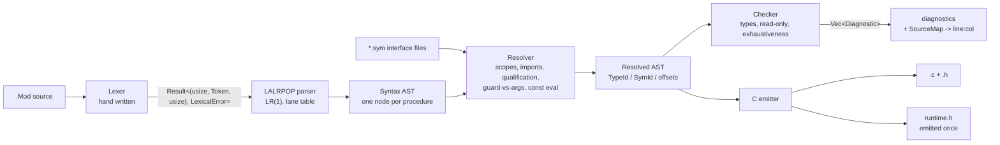

# Oberon-07 -> C: front end and back end design

The compiler targets **Oberon-07**, as defined in *The Programming Language Oberon*
by N. Wirth, revision 1.10.2013 / 3.5.2016 (`../books/Oberon07.Report.pdf`,
cited below as *report section n*).
Paths in this document are relative to its own directory, the repository's
`oberon/` crate.

Parser generator: **LALRPOP** (0.23.1), used for the full concrete syntax.
Output: **C11**, one translation unit per Oberon module, compiled by the host `cc`.

The crate and the three suites below back the claims in this document and are
meant to be kept:

| Artefact | What it is | Status |
|---|---|---|
| `crates/obc/src/bin/obgen.rs`, `fuzz/` | **A random program generator used as a self-checking oracle**: it writes a module, then supplies the value every variable must have using its own interpreter to avoid circularity. A mismatch traps in the module itself | 25 seeds run, 0 survived: it found three defects in the emitted C that the hand-written suites had missed (section 13, R20) |
| `.` (the five compiler crates) | The front end: hand-written lexer, the LALRPOP grammar, the AST, the resolver **and checker** (scopes, type resolution, diagnostics), the interface-file codec, the type algebra and the constant folder, all with tests | builds, 81 tests pass, clippy clean |
| `csmoke/` | Every C emission rule of section 9 with a non-obvious semantic, compiled and executed | 88 checks, 0 failures, 1 bug in the test spec itself (R11) |
| `golden/` | The report's own procedures hand-lowered to C in the shape prescribed by sections 9.6-9.8, a two-module link model with command dispatch, and the constant table used to cross-check the folder. **The tests use the compiler's runtime, not a copy**: `golden/Ob.h` and `golden/rt.h` `#include "../crates/cgen/src/oberon_h.inc"`, and `cgen.rs` also `include_str!`s the file. Run twice (plain and under ASan/UBSan) | 67 cases pass, and tests found 3 design corrections (R12-R14) |
| `e2e/` | **The whole compiler, end to end**: five Oberon modules (including the report's own `Out` and a hello-world) go through this repository's compiler to C. The host `cc` compiles the C with `-Werror`; the program's output is compared with an independently computed expectation, then the same checks run through the `obc` driver | 131 checks pass on both back ends: every row the C path passes also passes on Cranelift (section 16); it found the emitter and checker bugs listed in section 14 |

Everything marked **[design]** below is not yet implemented. Everything marked
**[verified]** was executed in this repository (commands in section 14).

---

## 1. Scope

**In scope**

* All of Oberon-07 proper: modules, imports, constants, types (basic, array,
  record with extension, pointer, procedure), variables, the four operator
  classes, all seven statement forms, procedures with VAR/value/open-array
  parameters, nested procedures, the 29 predeclared identifiers of report section 10.2.
* One *compilation unit* at a time for the compiler proper: `Foo.Mod` is read
  together with the interface files of the modules it imports, and becomes
  `Foo.c` + `Foo.h` + `Foo.sym`. The *driver* (section 9.9) resolves a whole program's
  import graph on top of that and runs the C compiler.
* Diagnostics with byte spans, resolved to line/column at print time.
* Module `SYSTEM` (report section 11.1, explicitly optional): the six portable entries
  of its table are lowered in place and the non-portable extras are
  refused by name (section 9.10, `PLAN.md` W4.1).

**Out of scope (deliberate)**

* Optimisation of any kind. The C compiler does it. Our job is to emit boring,
  obviously-correct C.
* Garbage collection. `NEW` maps to `malloc` (section 8.6). Oberon systems do have a
  tracing collector; the report does not promise one, and a collector is a
  project of its own. Program behaviour is unaffected; only long-running
  programs that allocate in a loop change character.
* Extensions that production Oberon compilers add beyond this report are surveyed
  with sources in `PLAN.md` W8.11, including which ones are worth adopting and
  why most are not. That section considers Oberon-2 support and gives a
  recommendation and the trigger that would change it. Nothing there is adopted
  until it appears in this section.
* **Oberon-2** and later dialects (`WITH`, `LOOP`, `EXIT`, type-bound
  procedures, `LEN(v, dim)`, multi-dimensional open arrays). Report section 10.2 lists
  `LEN(v)` with one argument. We use exactly that.

---

## 2. Toolchain

```toml
# crates/syntax/Cargo.toml
[build-dependencies]
lalrpop = "0.23.1"

[dependencies]
lalrpop-util = { version = "0.23.1", features = ["lexer", "unicode"] }
```

* `lalrpop` and `lalrpop-util` **must** be at the same version; LALRPOP's manual
  states that differing major/minor versions are unsupported. Pin both in one
  place (workspace `[workspace.dependencies]`).
* `build.rs` is `lalrpop::process_src().unwrap()`. The generated parser is written to
  `OUT_DIR` and included with `lalrpop_mod!(pub oberon);`.
* We keep the **default** LR(1) construction (the lane-table algorithm). It
  accepts the grammar in `crates/syntax/src/oberon.lalrpop` with **zero conflicts**
  **[verified]**. The alternatives are worth knowing:
  * `#[LALR]` + `LALRPOP_LANE_TABLE=disabled` -> the legacy LALR(1) tables.
  * `LALRPOP_LANE_TABLE=disabled` alone -> the canonical LR(1) construction:
    identical language, much larger tables, and better conflict diagnostics
    (it prints a parse-tree-level explanation). We use it as a debugging switch,
    not in the normal build.

### Workspace layout

```
Cargo.toml                 # workspace, pins lalrpop/lalrpop-util and the cranelift crates
crates/syntax/             # lexer + grammar + syntax AST + diagnostics
  src/{lib.rs,lexer.rs,ast.rs,diag.rs,oberon.lalrpop}  build.rs
crates/sema/               # resolver, type checker, constant evaluator
  src/{lib.rs,sym.rs,resolve.rs,types.rs,sema.rs,const_eval.rs}
crates/cgen/               # the C emitter and the runtime it emits
  src/{lib.rs,cgen.rs,oberon_h.inc,oberon_runtime.inc}
crates/clif/               # the Cranelift back end (section 16) and the ABI layout table
  src/{lib.rs,clif.rs,layout.rs}
crates/obc/                # the driver and the generator: obc build/run/emit/check
  src/lib.rs  src/bin/{obc.rs,obgen.rs,oberon-front.rs}
tests/corpus/              # *.Mod with expected diagnostics / expected stdout
```

The second back end has its own crate. `cgen` contains only the C back end, and
`clif` contains the Cranelift back end. `clif` depends on `cgen` for symbol
mangling and the `Checks` type. Since objects from either back end can link
against a translation unit from the other, both must use the same names.
`cgen` does not depend on `clif`. A module named after its crate can shadow the
crate name (`use x::{x, ...}`). Path-based module references avoid that trap.

The files differ from the earlier sketch. The checker is `sema.rs` (not
`check.rs`), the C emitter is `cgen.rs` (not `emit.rs`; `mangle.rs` is folded
into it). The runtime is `oberon_h.inc`/`oberon_runtime.inc` (not `runtime.h`).
The second back end is `clif.rs`. The phase split remains as sketched.
PLAN.md W4.3 records these naming differences.

The split is by *phase*, because each phase is testable on its own and the
interfaces between them are three plain data types (syntax AST -> resolved AST ->
C text). `crates/syntax` is the only crate that knows LALRPOP exists.

---

## 3. Pipeline



The parser never consults the symbol table, and the resolver never re-reads the
source text. Report details force the split, and each is a design
decision recorded in section 5:

1. `a.b` is either a module-qualified name or a record field select.
2. `f(x)` is either a call with one argument or a type guard.
3. `WriteLn` is either a procedure value or the call of a parameterless
   procedure.

---

## 4. Lexer

**Decision: hand-written scanner, not LALRPOP's built-in regex lexer.**

The built-in lexer is a longest-match regex scanner with `match { ... }`
precedence blocks and regex `ignore` patterns. They fail here for two reasons:

* **Comments nest.** Report section 3 says, "Comments ... may be nested." A language
  balanced like `(* ( (* )* )*)` is not regular, and `ignore` patterns are regexes.
  LALRPOP's whitespace-language chapter reaches the same conclusion and uses a
  hand-written lexer.
* **`22X`, `100H` and `1..5`** need `match` rungs and fixed-string precedence
  to tokenize correctly. The resulting regex puzzle would be hard to maintain.

The scanner is 413 lines including documentation (`crates/syntax/src/lexer.rs`
**[verified]**). It emits `Result<(usize, Token<'input>, usize), LexicalError>`,
the `Spanned` shape LALRPOP expects from a custom lexer, and is plugged in with

```lalrpop
extern {
    type Location = usize;
    type Error = LexicalError;
    enum Token<'input> {
        "ident"   => Token::Ident(<&'input str>),
        "integer" => Token::Integer(<u32>),
        ...
    }
}
```

`Location` is a byte offset. Lexing does not track line and column. A `SourceMap`
computes them from the source text when it prints a diagnostic, keeping three
`usize`s out of each AST node.

### Lexical near-misses (all **[verified]** by `tests::lexer_near_misses`)

| Input | Tokens | Rule |
|---|---|---|
| `22X` | `CharLit(0x22)` | report section 3 `string = digit {hexdigit} "X"`; `X` is not a hex digit, so it ends the digit run |
| `100H`, `0FFH` | `Integer(256)`, `Integer(255)` | `integer = digit {hexDigit} "H"`; requires a leading digit, so `ABCH` stays an identifier |
| `1..5` | `Integer(1) DotDot Integer(5)` | `.` is only a decimal point when the next byte is not `.` |
| `1.5E3` | `Real(1500.0)` | `ScaleFactor = "E" ["+"\|"-"] digit {digit}`; `E` is consumed only if a digit follows |
| `IF` / `If` | keyword / identifier | report section 3: keywords are all upper case and "cannot be used in the role of identifiers" |
| `(* a (* b *) c *)` | nothing | nested comment |
| `"A"` | `StrLit("A")` | Oberon strings have no escape sequences; each string ends with a NUL in our model |

Lexical errors (`IllegalCharacter`, `UnterminatedComment`, `UnterminatedString`)
include the offending byte and are reported as `ParseError::User`. LALRPOP cannot
recover these structural parser errors with its `!` mechanism. Section 5 records
the deliberate choice to fail fast in v1.

### The one dialect the lexer has: `-Odialect=lower` **[implemented, `PLAN.md` W8.10]**

The `IF` / `If` row above changes. A dialect that folds reserved-word case
accepts `if`, `If`, `iF`. It uses `eq_ignore_ascii_case` for the comparison,
while identifiers remain case-sensitive, so `Foo` and `foo` are distinct.

This extension needed a switch rather than being additive (section 13 decision 13):
the report makes capital and lower-case letters distinct, so a *report* program
may write `var Begin: INTEGER` with `Begin` as a variable. Folding would turn it
into the reserved word `BEGIN`, and the program would stop compiling.
`CASE ... ELSE`, `EXIT`, a `RETURN` statement and `MIN`/`MAX` cannot do that.

The diagnostic should explain the collision. A reader who wrote `var begin: INTEGER`
would otherwise meet "unexpected `BEGIN`" without an explanation. It notes the
dialect and folded reserved word (`W8.10`). For upper-case `BEGIN`, it omits the
note because the dialect does not explain the error.
* **Predeclared identifiers are not folded with keywords.**
  `INTEGER`, `CHAR`, `TRUE`, `NIL` and the section 10.2 procedure names are predeclared
  names rather than keywords. `integer` is a *different name* a program may
  declare. W8.10 records lower-case aliases as a separate additive decision.
  This switch does not include them.
* **The interface records the dialect.** A non-default dialect is written into
  the interface header as `DIALECT <name>`. A reader that does not know the name
  refuses the file rather than guessing. The dialect is recorded, not enforced:
  interface names remain case-sensitive, so clients can use the interface without
  sharing its dialect. A report-mode interface remains byte-identical.

---

## 5. Grammar

`crates/syntax/src/oberon.lalrpop` transcribes the report's appendix, with five
production changes (D1-D5) and three grammar-shape decisions (D6-D8). The report's
grammar is not LR(1) at these points. The evidence for each change follows.

One decision concerns the grammar's shape, not its content, and predates any
dialect: **all dialects use one gated grammar.** LALRPOP chooses alternatives at
build time, so a flag for an extension would require a grammar for every flag
combination. That would double parser maintenance and let the grammars disagree
about report syntax. Instead, the grammar accepts the union and the checker
rejects constructs the selected dialect disallows, with a diagnostic that names
the reason. This also rules out extensions that only spell existing syntax
differently (`WITH` in `PLAN.md` W8.11): they add a reserved word for familiarity.

### D1: `statement` is factored into assignment vs. call **[verified]**

The report's `statement = [assignment | ProcedureCall | ...]` with
`assignment = designator ":=" expression` and `ProcedureCall = designator
[ActualParameters]` puts two productions with the same prefix in one context.
Replacing `designator` with one nonterminal and using lookahead to choose
between them is the standard fix:

```lalrpop
Statement: Option<Stmt> = {
    => None,                       // report section 9: a statement may be empty
    <s:AssignStmt> => Some(s),
    <s:CallStmt>   => Some(s),
    ...
};
AssignStmt: Stmt = <lo:@L> <target:Designator> ":=" <value:Expr> <hi:@R> => ...;
CallStmt:   Stmt = <lo:@L> <callee:Designator> <hi:@R> => ...;
```

The `CallStmt -> Designator` reduction occurs only when the following token can follow
a complete statement (`;`, `END`, `ELSE`, `ELSIF`, `UNTIL`, `|`, `.`), not on
`:=`. One token of lookahead decides.

Empty statements remain legal. `BEGIN ; x := 1; ; END` contributes empty slots
that add nothing to the AST **[verified]** (`tests::empty_statements_are_legal`).

### D2: `( ... )` after a designator is one production, split semantically **[verified]**

The report defines a *type guard* as `selector = ... | "(" qualident ")"` and
`ActualParameters = "(" [ExpList] ")"`. Both forms follow a designator. Chapter 8
shows a guard in the *middle* of a designator:

```
t(CenterNode).subnode        (report section 8.1)
```

The grammar has no "trailing parameter list" rule to hide behind. It parses
one thing:

```lalrpop
Selector: Selector = {
    "." <name:Ident> => Selector::Field(name),
    "[" <index:ExprList> "]" => Selector::Index(index),
    "^" => Selector::Deref,
    "(" <args:ExprList?> ")" => Selector::Args(args),   // guard OR arguments
};
```

The resolver decides what the group means. A paren group is a **type guard** if
another selector follows, or if its single element is a bare designator denoting
a *type*. Otherwise it is an argument list.

Types and variables share one namespace in Oberon (report section 4: "No identifier
may denote more than one object within a scope"). A type name cannot be a value
argument. User-visible consequences:
* `f(x)`: a call unless `x` names a type (which cannot be an argument).
* `p(T)`: a guard when `T` names a type.
* `t(T).f`, `t(T)^`: a guard followed by selectors.
* `f(x)(y)` parses but is rejected by the checker ("designator applied twice").
* The rule misclassifies a legal shape: guarding a `VAR` record parameter whose
  type is imported (`PROCEDURE P(VAR b: M.Base); ... b(M.Ext).x ...`) is treated as
  a call, then rejected as "applied twice". A parameter with a type declared in
  the same module is reclassified correctly. The gap is imported types (PLAN.md
  W7.2). The report does not define this case, so the rejection is explicit.

The rule is implemented in `crates/sema/src/resolve.rs` and executed by
`tests::reclassify_splits_guards_calls_and_module_qualification`, which checks
all four shapes (`t(T)` guard, `g(1)` call, `t(T).f` guard-then-field, `INC(x)`
predeclared call) plus `tests::type_guard_and_call_share_one_production` and
`tests::type_guard_can_be_followed_by_selectors` for the parse side, and
`tests::reclassify_leaves_no_unresolved_selector_in_the_kitchen_sink`, which
asserts that a module using every construct of the report ends up with **zero**
unresolved `Selector::Args` **[verified]**. The pass needs only visible type
names and import aliases. That keeps the pass cheap and separate from the checker.
The callee's *signature* is not needed.

### D3: a designator starts with *one* identifier, not with `qualident` **[verified; found by conflict]**

The report's grammar is ambiguous here. Building the parser exposed the conflict.
`designator = qualident {selector}`, with `qualident = [ident "."] ident` and
`selector = "." ident | ...`, gives `a.b` two parses: qualifier `a` + name `b`,
or name `a` + field selector `b`. LALRPOP's canonical LR(1) construction shows
both parse trees. Its report began:

```
The problem arises after having observed the following symbols in the input:
  Ident
At that point, if the next token is a `"."`, then the parser can proceed in two
different ways.
First, the parser could execute the production at oberon.lalrpop:494:21, which
would consume the top 1 token(s) from the stack and produce a `Qualident`. ...
Alternatively, the parser could shift the `"."` token and later use it to
construct a `QualTail`. ...
```

Lookahead cannot resolve this: `a.b.c` is `M.field.field` or
`module.name.field` depending on the meaning of `a`. The report's implementors
resolve it from the symbol table:

```lalrpop
Designator: Designator = <lo:@L> <base:Ident> <sels:Selector*> <hi:@R> => ...;
```

`Qualident` (with its optional `.`) remains only where nothing can follow a
designator: type names, record base types, `IS`/guard targets, case labels and
formal or result types. No `(`/`.`-shaped continuation exists there, so there is
no ambiguity. The resolver folds a leading `Selector::Field` into `base` when
the base identifier denotes an imported module. The D2 test verifies that fold
and its negative case, where a non-module base keeps its field select.

### D4: a nullable non-terminal must not appear under `*` **[verified; found by conflict]**

The first draft wrote the procedure part of a declaration sequence as

```lalrpop
ProcSection: Vec<Proc> = { => Vec::new(), <ps:ProcDeclSemi*> => ps };  // WRONG
```

LALRPOP rejected it with *"Multiple productions for the same reduction ... They
could be reduced using the production on line 181 `=> Vec::new()` ... or using
the production on line 182 `<ps:ProcDeclSemi*> => ps`"*: `ProcSection` then has
two derivations of epsilon (`ProcSection -> epsilon` and `ProcSection -> ProcDeclSemi* -> epsilon`).
This is a general rule: `X*` over nullable `X` is ambiguous.

```lalrpop
ProcSection: Vec<Proc> = <ps:ProcDeclSemi*> => ps;
```

The same reasoning explains why `ConstSection`/`TypeSection`/`VarSection` use
`{ => Vec::new(), "CONST" ConstDeclSemi* => ... }`. Their epsilon production has a
non-nullable right-hand side because it starts with the section keyword, so no
duplicate derivation exists.

### D5: helper non-terminals for repetition

`IdentList`, `Qualident`, `ExprList`, `FieldLists`, `CaseLabels`, `SetElems`,
`StatementSequence` exist only so the star/tail idioms read uniformly; they have
no counterpart in the report and none in the AST.

### D6: `RETURN` is a statement, and every return leaves by one door **[revised in W8.4]**
Report section 9's `statement` list does not contain `RETURN`; section 10 puts it
at the end of `ProcedureBody`:

```
ProcedureBody = DeclarationSequence [BEGIN StatementSequence] [RETURN expression] END.
```

The first transcription followed the report literally and promised **one exit
point per procedure body**. But a procedure could not return from inside a
`CASE`, and that guarantee was the only benefit of the literal reading.
`RETURN [Expr]` is now a statement (PLAN.md W8.4). The emitter preserves the
guarantee: functions use an accumulator (`ret__acc`, zero-initialised so a path
without a return yields a defined value) and one exit (`ret: return ret__acc;`).
Each `RETURN` assigns `ret__acc` and jumps to `ret`. In a proper procedure,
`RETURN` jumps to a bare `return`. The grammar no longer has the report's tail
clause, the only place lookahead could distinguish the forms.

The check follows suit. A function must contain a `RETURN` with a value. A proper
procedure may not return a value, and a naked `RETURN` in a function is an error.
The emitter preserves the single-exit property.

### D7: error handling and recovery **[implemented; limits found by conflict, closed at declaration level by W5.1]**

1. **Errors have locations.** Diagnostics include byte spans. Rendering (section
   10) turns each span into `file:line:col`, echoes the source line, marks the
   span with a caret, and adds a note when the rule is not obvious. The parser and
   checker produce `Diagnostic` values instead of formatting messages. One
   function renders syntax and semantic errors consistently.
2. **One run reports every error it can.** LALRPOP's `!` token plus

   ```lalrpop
   grammar<'input, 'err>(errors: &'err mut Vec<ErrorRecovery<usize, Token<'input>, LexicalError>>);
   ```
   resynchronises, and records rather than swallows the recovery. The driver then
   reports syntax and semantic errors found in the same run **[verified by
   `diag_tests` and seven `e2e` checks]**.

Recovery is enabled only in the **statement sequence**:

```lalrpop
Statement: Option<Stmt> = {
    => None,
    <s:AssignStmt> => Some(s),
    ...
    <e:!> => { errors.push(e); None },
};
```

A failed statement becomes empty. The parser skips input to the next `;` and
continues parsing the body. This recovery helps because syntax errors cluster in
statements, and skipped tokens belong to the broken statement.

**Declaration-section recovery is unsupported for a measured reason.** LALRPOP
rejected recovery on the declaration-ending `;`, on the next section keyword,
with a nullable item under a non-nullable list, and with a `!` alternative inside
the list rule. Each led to a *local ambiguity on the error token*: since sections
may be empty, the section's epsilon production competes with the error token
(end the section or swallow the error?). LALRPOP's LALR(1) construction adds the
error token to every lookahead set, so epsilon-reduce stays live wherever the
error can be shifted. Statement recovery avoids this because `StatementSequence`
is non-nullable and its `!` sits in the item rule. Declaration sections are
nullable, so that pattern fails there.

A declaration- or module-level syntax error is reported **once**, located and
explained, then parsing stops. Section 3's build order leaves the driver with
nothing to emit. Recovery inside a `ProcedureBody` also stops there: a broken
procedure declaration ends parsing instead of attempting recovery inside a body
whose declarations are unusable.

The parser offers two entry points:

* `parse_module` fails fast (used where a module is *required* to be well formed,
  such as reading a `.sym` interface), and
* `parse_with_diagnostics` / `check_module_recovering` recover.

A *fatal* error (missing `END`, unterminated comment, or illegal character) is
not absorbed by a recovery point. It is still converted to a located diagnostic
rather than printed as a `ParseError` **[verified]**, so a reader never sees a
byte offset.

#### Declarations recover outside the grammar **[implemented, PLAN.md W5.1]**

Statement-level recovery lets the parser skip a broken statement and continue.
Declaration sections are nullable, so the same method fails with a local
ambiguity on the error token. A missing `;` between constants hid later errors.

The grammar exposes each declaration as an entry point (`ConstDecl`, `TypeDecl`,
`VarDecl`). The driver reads a broken section chunk by chunk. It lexes the section
and splits declarations at `;` at nesting depth zero, so a `;` inside a `RECORD`
or parentheses is not a separator. It parses each chunk. Valid chunks produce no
message. If the only mistake is a missing `;`, the compiler reports each broken
declaration. This runs only after the module parser reports an error. Clean parses
do not incur extra work. The process reports diagnostics, not an AST. A missing
`;` is fatal to the module parse, so later code is not type-checked. This avoids a
second declaration parser (item 2 in the plan). An incomplete chunk is reported
as "this declaration is incomplete", not "unexpected end of file", since the
file continues.

### D8: the `CASE` default arm uses `ELSE S` **[decided, `ELSE` added in W8.1]**

The report's `case = [CaseLabelList ":" StatementSequence]` puts the label list
and colon in one optional group, so a default arm is a bare statement sequence,
`| S`. Our grammar parses `CaseArm = labels? body?` with
`body = ":" StatementSequence`. Both are optional. A default arm is `| : S`
(empty labels followed by the colon), and bare `|` means a default with no
statements. The grammar rejects the report's `| S` spelling and reports what it
expected: `error: unexpected \`:=\` ... = note: expected END, ., .., ,, : or |`,
pointing at the missing colon.

The grammar rejects bare `| S` because statement sequences and label lists share
a first set: a call statement starts with the same qualident as a constant label.
Distinguishing `| k := 2` from `| k: ...` needs two tokens of lookahead, which
LALR(1) lacks but the reference compiler's recursive descent supports. `ELSE`
provides the default arm (PLAN.md W8.1). It is already a report keyword and uses
the same node as a label-less `|` arm, which the checker and emitter treat as the
default. Row 63 rejects two defaults in one `CASE`. The accepted `| : S` spelling
remains, preserving programs that already use it. `ELSE` adds a spelling absent
from the report grammar.

---

## 6. AST

**Design rule: the tree is organised per procedure.** There is no flat
declaration list with back-references and no arena of anonymous nodes. A `Proc`
owns everything that belongs to it:

```rust
pub struct Module<'input> { name, imports, decls: Decls<'input>, body: Vec<Stmt<'input>>, ... }

pub struct Decls<'input> {           // exactly the report's DeclarationSequence order
    pub consts: Vec<ConstDecl<'input>>,
    pub types:  Vec<TypeDecl<'input>>,
    pub vars:   Vec<VarDecl<'input>>,
    pub procs:  Vec<Proc<'input>>,   // <- nested procedures, recursively
}

pub struct Proc<'input> {
    pub name: Ident<'input>, pub export: bool,
    pub params: Vec<Param<'input>>,  // one entry per FPSection
    pub result: Option<QIdent<'input>>,
    pub decls: Decls<'input>,        // its own constants/types/variables/procedures
    pub body: Vec<Stmt<'input>>,
    pub ret: Option<Expr<'input>>,   // the single trailing RETURN, if any
    pub end_name: Ident<'input>,     // repeated after END; must equal `name`
    pub span: Span,
}
```

The tree shape keeps each procedure's declarations and body together:

* The checker and emitter process one procedure at a time: push a scope, declare
  parameters, walk the body, then pop. Nesting is represented directly by the tree,
  so procedure names are never looked up through a side table.
* `end_name` is kept for the resolver rather than checked during parsing. The
  report's section 10 rule requires the repeated procedure identifier, and the
  resolver can attach a span and message to a mismatch.
* Span is `Span { lo: u32, hi: u32 }`, two byte offsets. Four GiB of source is
  enough for Oberon modules, which are kilobytes, and `u32` keeps each node small.
  `@L`/`@R` bind `usize`. The actions narrow those values once.
* Each leaf takes its span from `@L`/`@R`. Composite expressions derive theirs
  from their children (`Expr::binary` joins the operand spans), so span tracking
  needs two `usize` writes per node and no additional bookkeeping.

**Lifetimes.** The prototype stores `String` values for identifiers and string
literals, a form proven end to end. Production should use `&'input str` slices
into the source text. The compiler handles one module at a time, and the source
outlives every AST node and diagnostic, so slices remove one allocation per
identifier occurrence. If profiling shows repeated string comparison in the
symbol table is costly, intern names as `Symbol(u32)`. This is a local change:
no phase compares identifiers across the AST/resolved boundary.

**Syntax AST vs. resolved AST.** The parser produces the syntax AST above, and
the semantic pass keeps it as the only tree. The pass makes one walk, building
types as it follows the scope chain, like the reference compiler. The emitter's
needed types (`BYTE`/`INTEGER` and string cases, open arrays, guards, and
type-`CASE` narrowings) come from a side table keyed by span. Since spans are
unique, this table provides the annotations without a second tree. A second tree
would be tidier to consume and double the code; the table below shows its fields
and describes the resolver's in-place rewrites:

| field | syntax AST | resolved AST |
|---|---|---|
| type references | `TypeExpr::Named(["M","T"])` | `TypeId` into the type interner |
| designator base | `["t"]` + selectors | `SymId` + constant offset chain |
| paren group | `Selector::Args(Option<Vec<Expr>>)` | `Selector::Call(SymId, Vec<Expr>)` or `Selector::Guard(TypeId)` |
| `ExprKind::Int(u32)` in a type/label context | literal | folded constant |
| everything else | identical | identical |

Keeping two types is deliberate: phases that only re-annotate cannot silently
change the tree, and the emitter can be written against a "nothing can fail"
interface. The first three rows of that table are the *only* rewrites the
resolver performs that change a node's shape, and they are all implemented in
`crates/sema/src/resolve.rs`; the remaining work is attaching `TypeId`/`SymId`, which
is annotation, not restructuring.

---

## 7. Resolver: names, scopes, imports **[implemented in `crates/sema/src/sema.rs`]**

Implemented checks include the scope chain and declaration order, type
resolution with the report's single forward-reference rule, module-qualified
lookup through interface files, the `FOR` lock, read-only rules, and import
checks. `check_tests::report_out_module_checks_clean` verifies the report's own
`Out` module, including its imports, with no diagnostics.
`check_tests::kitchen_sink_checks_clean` checks a module using every construct
in the report.

### Scopes

Each module and procedure has a `Scope` with a parent link. Lookup walks the
scope chain outward, as report section 4 defines visibility: "from the point of
the declaration to the end of the block to which the declaration belongs."

Each scope processes declarations in two passes:

1. *Declare*: insert each constant, type, variable, and procedure name with its
   kind. This permits `Tree = POINTER TO Node; Node = RECORD ... END` (report
   section 6.4: "the identifier `T` can be declared textually following the
   declaration of `P`"). Insertion reports duplicate names under section 4.
2. *Resolve*: determine each declaration's type, check constant expressions,
   then walk procedure bodies. Because the first pass covers the whole scope,
   the resolver can resolve pointer bases in the same pass.

Forward references outside pointer bases are disallowed (report section 4). The
resolver processes declarations in textual order, so a type that names an
unresolved non-pointer type in the same scope is an error. All names are already
visible after the first pass, so the resolver tracks a per-scope "resolved up
to" watermark instead of relying on symbol table contents.

### Imports

`IMPORT Texts, Oberon;` and `IMPORT M := Other;` (report section 11) insert the
alias as a module symbol. Because qualification is semantic (D3), the resolver
rewrites a leading `Selector::Field(x)` into `base = ["M","x"]` when `M` names
a module. It then looks up `x` in that module's interface and requires the
export mark.

**An interface must name the modules referenced by its types.** A client that
imports `Oberon` but not `Texts` must still resolve `VAR Log: Texts.Writer` from
`Oberon`'s interface. The format includes an `IMPORT` line, and the reader
resolves qualified names using the defining module's import list rather than
the importer's scope. This requirement came from checking the report's own
`Out`. An alternative is to render every imported type structurally, as ETH's
`.sym` files do. That keeps interfaces self-contained but requires serializing
recursive structures, making the format much larger.

Interface files (`<Module>.sym`) are text, one declaration per line, written by
the emitter companion and read by the resolver:

```
MODULE Out
VERSION 1
IMPORT Texts, Oberon
PROC Write(ch: CHAR)
PROC WriteInt(x: INTEGER; n: INTEGER)
PROC WriteLn
VAR W: Texts.Writer            (* exported variables are read-only *)
CONST N = 100
TYPE Node = RECORD key: INTEGER; left, right: Tree END
```

Text is diffable, greppable, and versionable. Parsing it is straightforward
alongside the compiler that writes it. The rendered types use ordinary Oberon
type syntax, so the reader uses the same production as the module parser
(`pub RenderedType` in `oberon.lalrpop`). The compiler rejects syntax that
an interface parser would not accept.

The prototype codec in `crates/sema/src/sym.rs` exercises these format details
**[verified]**:

* A parameterless proper procedure is written `PROC WriteLn` without
  parentheses, matching the report's call syntax (section 9.2).
* A formal parameter's type is `{ARRAY OF} qualident` (section 10.1), so a
  parameter spec cannot contain parentheses. The codec rejects an inline
  `PROCEDURE (...)` parameter type, keeping the closing `)` unambiguous.
* Render/parse is a round trip, and rendering the parsed result is a fixed point.
  A written interface remains unchanged when read and rendered again.

The codec prototypes only the format. Resolving parsed declarations into the
scope chain is the resolver's job.

### Read-only entities

Report sections 9.1 and 10.1 forbid assignment to constants, imported
variables, structured value parameters, and a `FOR` control variable inside its
body. The assignment checker applies the same
`is_assignable(designator)` check to all four and names the reason in its
message.

---

## 8. Semantics

### 8.1 Type representation **[implemented in `crates/sema/src/types.rs`]**

Types are interned as `TypeId`s. Structural equality is a `u32` comparison,
and nominal rules are explicit. The AST-free code in
`crates/sema/src/types.rs` **[verified]** takes `TypeId`s. The checker and
constant folder use this code, as does the back-end layout pass:

| kind | equality | extension |
|---|---|---|
| `INTEGER`, `BYTE`, `REAL`, `BOOLEAN`, `CHAR`, `SET` | by name | none (report section 6.1: `BYTE` and `INTEGER` are compatible both ways) |
| `ARRAY len elem` | **structural**: same length and equal element type | none |
| `RECORD` | **nominal**: identical declaration | `T` extends `T0` if `T == T0` or `T`'s base extends `T0` (report section 6.3) |
| `POINTER TO T` | **nominal** | inherits the base types' extension relation (report section 6.4) |
| `PROCEDURE(params): result` | **structural**: identical parameter types/modes and result | none |
| `ARRAY OF T` (open) | only as a formal type | none |
| `NIL`, string literal | internal singleton types | none |
| `ErrorType` | poison, compatible with everything | none |

`ErrorType` prevents one bad expression from causing follow-on errors. Each
check returns it after reporting, so every predicate in `types.rs` stops when it
sees this type.

Tests in `types.rs` cover rules that are easy to get wrong, named for their
report sections: pointer identity and extension follow the base (section 6.4);
record extension is reflexive, transitive, and one-way (section 6.3); field
lookup walks the base chain, most-derived first (section 6.3); and the four
assignment exceptions (section 9.1). Other tests cover parameter modes from
section 10.1, including "a record formal may be a base type of the actual's" but
"`VAR` needs identical, not merely compatible." They also cover operand rules
from sections 8.2.1-8.2.4, including set operators spelled like arithmetic
operators, and signatures from section 10.2.

### 8.2 Assignment and parameter compatibility
Report section 9.1 gives the assignment rule and four exceptions. Section 10.1
gives the parameter rule. Both use the `is_assignable(dst, src)` predicate,
which also returns a `why` value:

| case | allowed when |
|---|---|
| same type | always |
| `BYTE` / `INTEGER` | both directions (report section 6.1) |
| `NIL` -> pointer or procedure type | always (report section 9.1.1) |
| string -> `ARRAY n OF CHAR` | `len(string) < n`. Appends a NUL (report section 9.1.2) |
| 1-char string / `CHAR` | single-character string to `CHAR` |
| record -> record, pointer -> pointer | source type extends destination type (report sections 9.1.3 and 6.4) |
| open array -> array of equal base type | equal element types (report section 9.1.4) |
| VAR parameter | identical types, except formal record type may be a *base type* of the actual's (report section 10.1) |
| value parameter of structured type | as assignment, and the formal is read-only in the callee |

The back end must account for two consequences:

* A string literal assigned to `ARRAY n OF CHAR` is length-checked (check 9)
  and zero-padded. It ends with NUL. `LEN` still returns the declared array length.
* Assigning between equal-length `CHAR` arrays is a bounded copy. If the source
  contains no NUL within its length, neither does the destination. Oberon strings
  end with NUL by construction, not by type. The checker cannot guarantee
  termination, so relational operators cannot assume it either (see `rt_charcmp`
  in section 9.5).

There is no implicit `INTEGER`-to-`REAL` conversion. `x + i`, where `x: REAL`
and `i: INTEGER`, is an error; the diagnostic suggests `FLT(i)`. Report section
8.2.2 requires both operands of `+ - * /` to have the same type. The diagnostic
states that rule.

### 8.3 Constant evaluation **[implemented in `crates/sema/src/const_eval.rs`]**

`const_eval` folds the *syntax* AST into a small value domain
(`Int(i32) | Real(f32) | Bool | Char | Str | Set(u32)`). It handles constant
declarations (section 5), array lengths (section 6.2), `CASE` labels (section
9.5), and the `BY` increment of `FOR` (section 9.8). Its operands must be
constants. The report says they "can be evaluated by a textual scan without
actually executing the program." A designator must resolve to a constant. The
checker folds `LEN` of a fixed-size array because it knows the length. The
folder reports that case rather than guessing.

The folder follows the emitted C's arithmetic: floor `DIV`/`MOD`, including
`y == -1`; the report's shifts (`x * 2^n` and `x DIV 2^n`); rotation mod 32
(R22); `{a .. b}` as `((1u << (b-a+1)) - 1u) << a`; set union, difference,
intersection, and symmetric difference. `INTEGER` wraparound follows `-fwrapv`.
`tests::agrees_with_the_emitted_c` compares these with values from the C runtime
helpers **[verified]**. This test detects disagreements between the folder and
the running program.

The report's expression grammar also determines two cases inherited by the
emitter:

* `SimpleExpression = ["+"|"-"] term {AddOperator term}`, so a leading sign
  applies to the whole term: **`-7 DIV 3` is `-(7 DIV 3)` = `-2`**, not
  `(-7) DIV 3 = -3`. Parentheses are required for the latter.
* A single-character string is a `CHAR` value (section 9.1.2), as in the
  report's `ORD("0")` (section 10.1).


### 8.4 Predeclared environment

The predeclared names go into the outermost scope, as report section 10.2 defines:

| name | signature | note |
|---|---|---|
| `ABS(x)` | numeric -> same type | |
| `ODD(x)` | INTEGER -> BOOLEAN | |
| `LEN(v)` | array -> INTEGER | |
| `LSL`, `ASR`, `ROR` | (INTEGER, INTEGER) -> INTEGER | `x * 2^n`, `x DIV 2^n`, rotate right by n (report section 8.2.2); a negative count is undefined and is masked |
| `FLOOR(x)` | REAL -> INTEGER | round down |
| `FLT(x)` | INTEGER -> REAL | |
| `ORD(x)` | CHAR/BOOLEAN/SET -> INTEGER | |
| `CHR(x)` | INTEGER -> CHAR | |
| `INC`, `DEC` | (VAR INTEGER [, INTEGER]) | desugars to assignment |
| `INCL`, `EXCL` | (VAR SET, INTEGER) | set union / difference |
| `NEW(v)` | (VAR pointer) | allocation, section 8.6 |
| `ASSERT(b)` | BOOLEAN | traps if false |
| `PACK`, `UNPK` | (VAR REAL, VAR INTEGER) | exponent packing |

For a fixed-size array, `LEN` folds to the declared length. For an open-array
parameter, it becomes the hidden length parameter (section 8.7).

Report section 11.1's `SYSTEM` is a module imported like any other (section 11),
not a predeclared entry. The checker dispatches its entries by name. `ADR`, `GET`,
and `PUT` each take a variable. `SIZE` takes a type. The compiler handles these
entries without five separate signatures (section 9.10, `PLAN.md` W4.1).

### 8.5 Type and semantic checks: catalogue

Each row is one diagnostic with one span. `E` = error, `W` = warning.

| # | check | source | kind |
|---|---|---|---|
| 1 | identifier used but not declared, and not predefined | section 4 | E |
| 2 | identifier declared twice in one scope | section 4 | E |
| 2b | a declaration in an *inner* scope hides an outer declaration. Predefined identifiers occupy the outermost scope (section 10.2), so a module or procedure may declare `ABS` to hide the predefined one | section 4 | - |
| 3 | qualifying module not in the import list | section 11 | E |
| 4 | object referenced through a module qualifier is not exported | section 11 | E |
| 5 | import alias declared twice / module imports itself | section 11 | E |
| 6 | assignment to a read-only entity (constant, imported variable, structured value parameter, `FOR` control variable in its body) | section 9.1, section 10.1 | E |
| 7 | assignment type mismatch (table in section 8.2) | section 9.1 | E |
| 8 | `NIL` assigned to something that is not a pointer/procedure | section 9.1.1 | E |
| 9 | string too long for the destination array | section 9.1.2 | E |
| 10 | array index count != array dimension count | section 8.1 | E |
| 11 | index expression not `INTEGER` | section 8.1 | E |
| 12 | `^` applied to a non-pointer | section 8.1 | E |
| 13 | field selection on a non-record (or non-pointer-to-record) | section 8.1 | E |
| 14 | unknown field; field is private and the access is from another module | section 6.3 | E |
| 15 | type guard `v(T0)` where `T0` is not an extension of `v`'s declared type | section 8.1 | E |
| 16 | type guard on something that is not a pointer or a VAR record parameter | section 8.1 | E |
| 17 | `IS` with the same two conditions | section 8.2.4 | E |
| 18 | arithmetic operand not numeric, or the two operands differ in type | section 8.2.2 | E |
| 19 | `DIV`/`MOD` operand not `INTEGER` | section 8.2.2 | E |
| 20 | logical operator operand not `BOOLEAN` | section 8.2.1 | E |
| 21 | set operator operand not `SET` | section 8.2.3 | E |
| 22 | relation not defined for the operand types | section 8.2.4 | E |
| 23 | `x IN s`: `x` not `INTEGER`, or `s` not `SET` | section 8.2.4 | E |
| 24 | `IF`/`WHILE`/`UNTIL` guard not `BOOLEAN` | section 9.4, section 9.6, section 9.7 | E |
| 25 | call: wrong number of actuals | section 9.2 | E |
| 26 | call: actual not compatible with its formal (table in section 8.2) | section 10.1 | E |
| 27 | VAR actual is not a designator denoting a variable | section 9.2, section 10.1 | E |
| 28 | calling something that is not a procedure (or calling a procedure value that is not of procedure type) | section 9.2 | E |
| 29 | designator applied twice (`f(x)(y)`) | - (D2) | E |
| 30 | bare designator statement whose object is not a parameterless procedure | section 9.2 | E |
| 31 | function procedure used as a statement without a call, or a proper procedure used in an expression | section 9, section 10 | E |
| 32 | `FOR` control variable is non-`INTEGER`, read-only, or assigned inside its body | section 9.8 | E |
| 33 | `FOR` bounds not `INTEGER` | section 9.8 | E |
| 34 | `BY` increment not a constant, or equal to zero, or not an integer constant | section 9.8 | E |

**Status.** Rows 1-5 belong to the resolver, and rows 6-60 belong to the checker. Both are
implemented in `crates/sema/src/sema.rs` and driven by
`check_tests::catalogue_rows_report_what_they_should`. That test has a case for
each row and names it, so a failure points to the rule. Rows with two shapes
have two cases.

The test covers field visibility across modules (the private-field halves of
rows 4 and 14). The interface preserves a field's own `*`. Naming an
unmarked field of an imported record is an error, while a module's own unmarked
fields remain private to it. Row 50 covers both cases: assigning a *local*
procedure to a procedure variable is an error, as is passing one as an actual.
The unused-*procedure* half of row 54 is also checked. A procedure declared in
this unit but never used raises a warning. Use is recorded when a designator
resolves to a procedure. Calls, use as a value, and export all count. A
self-recursive procedure counts as used, which is the one imprecision.

Rows 1-5 belong to the resolver, and rows 6-60 belong to the checker. The type
algebra and constant folder that support the checks are already implemented
and tested. The checker's remaining work is bookkeeping, not new rule
invention. Rows 55-60 describe the report's section 11.1 module and belong to
the escape hatch's item, `PLAN.md` W4.1. The argument rules are covered by
`check_tests::catalogue_rows_report_what_they_should`. The by-name refusals and
located messages are covered by `e2e`'s `system-*` rows. `csmoke`'s `system-*`
assertions and `e2e`'s `system-emits-the-same-c-under--Ochecks=n` assert that
row 60 adds or removes nothing under `-Ochecks`.

| 35 | `CASE` label type does not match the case expression's type | section 9.5 | E |
| 36 | duplicate `CASE` label, or overlapping ranges | section 9.5 | E |
| 37 | type-`CASE` label that does not extend the case variable's type | section 9.5 | E |
| 38 | type-`CASE` on something other than a pointer or VAR record parameter | section 9.5 | E |
| 39 | scalar or type `CASE` without a default arm, where a value matching no label traps (W2.5). Report section 9.5 is silent on this case, so the design uses a located trap for undefined behavior | section 9.5 | W |
| 40 | constant expression expected (const decl, array length, case label, `BY`) but the expression is not constant | section 5, section 6.2, section 9.5, section 9.8 | E |
| 41 | array length not a positive constant | section 6.2 | E |
| 42 | invalid `RECORD (T)` base type: `T` is not a record or forms a self/cyclic extension | section 6.3 | E |
| 43 | field declared twice inside one record | section 6.3 | E |
| 44 | pointer base type is not a record | section 6.4 | E |
| 45 | procedure type/declaration result is a record or array | section 10.1 | E |
| 46 | `RETURN` with a value in a proper procedure, a naked `RETURN` in a function, or a function whose body contains no `RETURN` at all (W8.4) | section 10 | E |
| 64 | `EXIT` outside any loop, which has no loop to leave (W8.5) | W8.5 | E |
| 47 | procedure end identifier != procedure name | section 10 | E |
| 48 | export mark outside module scope, or on a formal parameter | section 4 | E |
| 49 | procedure without parameters declared as `PROCEDURE F()` but called as `F(x)` (and vice versa) | section 10.1 | E |
| 50 | local procedure assigned to / passed as a procedure variable | section 6.5 | E |
| 51 | predeclared procedure used as a value | section 6.5, section 10.1 | E |
| 52 | `SET` element constant outside 0..31 | section 10.2 | E |
| 53 | `SYSTEM.<entry>` where the entry is not one defined in the report's section 11.1 table, including the RISC-specific extras (`VAL`, `ADC`, `SBC`, `UML`, `COND`, `LED`), refused by name, never silently | section 11.1 | E |
| 54 | unused import / unused local procedure | - | W |
| 55 | `SYSTEM.SIZE`'s argument is not a type name | section 11.1 | E |
| 56 | `SYSTEM.ADR`'s argument is not a designator whose address exists (a constant, a structured value parameter, a procedure) | section 11.1 | E |
| 57 | `SYSTEM.GET`'s variable, or `SYSTEM.PUT`'s value, is not of a basic type | section 11.1 | E |
| 58 | `SYSTEM.GET`'s variable is not writable, for the reasons in row 6, since `GET` writes it | section 11.1, section 9.1 | E |
| 59 | a `SYSTEM` entry used with the wrong number of arguments (the entries have no formal parameter list for row 25 to check) | section 11.1 | E |
| 60 | not a check but a rule the lowering states: `SYSTEM.COPY`'s count is in *words* and `SIZE(T)` is the byte size including padding (section 9.10), and no `-Ochecks` setting adds or removes anything for `SYSTEM` | section 11.1 | - |
| 61 | `MIN`/`MAX`'s argument is not a *type name* | W8.2 | E |
| 62 | `MIN`/`MAX` of a type that has no extreme (`REAL`, `SET`, `BOOLEAN`, or a structured type), named rather than given a zero | W8.2 | E |
| 63 | a `CASE` with two default arms (`ELSE` and a label-less `\|` arm) | W8.1, section 9.5 | E |

### 8.6 Storage and allocation

`NEW(p)` on `p: P` where `P = POINTER TO T` (report section 6.4) emits a heap block of
`sizeof(struct T)` **plus a descriptor pointer in front of it**, stores the
descriptor of the *static* type `T`, and assigns the payload address to `p`.
Failure of `malloc` yields `NIL`, which is exactly the report's specified
behaviour ("Failure of allocation results in `p` obtaining the value `NIL`").
There is no collector (see section 1).

### 8.7 Resolver output for the checker

The resolver splits `Selector::Guard` from `Selector::Call` and folds constants.
It also assigns a `TypeId` to each expression. The checker can then walk
bottom-up without its own scope lookups, except for the read-only rules. The
emitter can assume every node is well formed. This is the only entangled phase
boundary, and the tradeoff keeps the C emitter from repeating the symbol-table
walk. Repeating that walk could create a second, subtly different type checker.

---

## 9. C back end

The back end emits C from the *resolved* AST. It emits one C function per `Proc`
node in pre-order, a file-scope declaration set per module, and
`void <Module>__init(void)` for the module body. It leaves optimisation and
reordering to the C compiler.

### 9.1 Compilation model **[implemented in `crates/cgen/src/cgen.rs`]**

```
cc -std=c11 -O2 -fwrapv -fno-strict-aliasing -Wall -Wextra -Werror \
   -Wno-overflow Foo.c Bar.c oberon_runtime.c -o program
```

`-fno-strict-aliasing` matters for the same reason as `-fwrapv`. A type `CASE`
and a type guard view a record through a derived type (`(Derived *)base`). C's
common-initial-sequence guarantee covers unions, not a base struct as the first
member. Giving up the `.base.` layout would add an offset computation to every
up-cast and inherited field access, so the flag is the simpler choice.

`-Wno-overflow` addresses a related warning. gcc may report an expression as
"integer overflow in expression ... results in -2" after folding a symbolic
cancellation such as `(MAX - m2) + (MAX + m2)`, even when `m2` is a variable.
With `-fwrapv`, this result matches the chosen wrapping behaviour. The front end
folds constant subexpressions (section 8.3), so the warning is silenced only
when the language's answer is the value we want. The generated `fuzz` and `e2e`
corpus checks the results.
**[verified: generator seed 30 shows that no value fold can reach a symbolic
cancellation.]**

`-fwrapv` is required. Oberon's `INTEGER` is a 32-bit type, and the report leaves
overflow behaviour unspecified. C offers undefined signed overflow or
two's-complement wrap. Oberon compilers wrap, as does `INC(x)` around the largest
`INTEGER`, so we pin the flag **[verified: the whole `csmoke` suite is built with
`-fwrapv`]**.

### 9.2 Type mapping **[verified; `csmoke` executes every row, `e2e` compiles and runs programs that use them]**

| Oberon | C |
|---|---|
| `INTEGER` | `int32_t` |
| `BYTE` | `uint8_t` |
| `REAL` | `float` |
| `BOOLEAN` | `int32_t` with values 0/1 (so `ORD(b)` is the C value) |
| `CHAR` | `char` (8-bit, plus `ORT`-style casts at the edges) |
| `SET` | `uint32_t` |
| `ARRAY n OF T` | `T name[n]` (inside a `struct` when it must be passed by value) |
| `RECORD ... END` | `struct <Module>__<Name>` |
| `POINTER TO T` | `struct <Module>__<Name> *` (payload pointer; descriptor lives in the block header) |
| `PROCEDURE (...)` | function pointer `R (*name)(void *sl, ...)` |
| `NIL` | `NULL` |
| `ARRAY OF T` (open formal) | `T *name, int32_t name__len` |

### 9.3 Records, extension, and type descriptors **[verified; `csmoke` for the layout and `rt_is`/`rt_rec_copy`, `e2e` for `IS`, guards and a type-`CASE` on a three-level extension, `golden` for the emitted shapes]**

Report sections 6.3 and 6.4 allow record extension and pointer type tests. The
layout must support `IS`, guards, and `CASE` on a record or pointer variable:

```c
typedef struct ObDesc ObDesc;
struct ObDesc { const ObDesc *base; int32_t id; const char *name; };

typedef struct R  R;
typedef struct R0 R0;                 /* R0 extends R */
struct R  { const ObDesc *desc; int32_t x; };   /* the base-most record only */
struct R0 { R base; int32_t y; };               /* base is the FIRST member */
```

Rules:

* An extension's struct contains the base struct as its **first member**, and
  **only the base-most record of an extension chain declares the `desc` field**.
  This puts the descriptor at offset 0 in every view of the object.
  `*(ObDesc **)p` then reads the same word through a `Base *`, a `Derived *`, or
  the address of a record variable. `IS`, guards, and type `CASE` use that word.
* A descriptor is emitted as `extern const ObDesc TD_M;` followed by its definition,
  which gives it the external linkage promised by the header. A bare `const`
  definition has *internal* linkage in C, while `extern const ... = { ... }` on one
  line is rejected by `-Werror`. An importing module also needs the descriptor.
  `e2e`'s `mixed-backend-*` rows compare it with `nm`.
* Every record **variable** and `NEW`-allocated object stores its static type's
  descriptor inside the record, not in a header in front of it. Its `sizeof` is
  the Oberon size plus one pointer.
* Copying a record **preserves the destination's descriptor**. The emitter calls
  `rt_rec_copy`, not a bare C struct assignment. An up-cast `b := d` leaves `b`
  with its own static type, so a base variable cannot report a derived type.
* `v IS T` and `v(T)` walk the `base` chain: `rt_is(desc(v), &TD_T)`
  **[verified in `csmoke`]**. A failed guard calls `rt_trap` (report section 8.1:
  the guard "aborts program execution, if it is not of type T0").
* A `CASE` over a record or pointer becomes `switch (RT_DESC(v)->id)` with one
  `case TD_Ti:` per label and an arm-local narrowing cast `(Ti *)v`
  (report section 9.5 gives the case variable the label's type inside the arm). No
  runtime helper is needed. The `typecase-id-*` tests verify the jump table:
  only the matching arm runs, its cast reads the derived field correctly, and an
  unlisted `id` reaches the trapping `default`.

### 9.4 Memory and traps

```c
void *rt_new(int32_t size, ObDesc *d);   /* malloc header+payload; NIL on failure */
void  rt_trap(const char *);             /* bounds, NIL, case, ASSERT */
```

**The address model** (report section 11.1's `SYSTEM`, section 9.10): the report's
`mem[a]` is an array of *words*. Here an address is a **byte** address held in
an `INTEGER`: `ADR(v)` is `&v`, and `COPY`'s `n` counts words, or `n * 4` bytes.
An `ADR` expression itself is as wide as the host's pointers (R31).

**Memory access safety.** Emitted memory accesses are either provably in bounds
by the type system or guarded by a visible check in the C. `SYSTEM` (section 9.10)
is the deliberate escape. The table audits each access (PLAN.md W7.3), and the
last column names the test for that row.

| access | safe because | test |
|---|---|---|
| array index, fixed array | `rt_index(i, n, at)` traps with the offset | `e2e/Trap.mod` (a constant index out of range), `diag_tests::a_constant_index_out_of_range_warns_and_still_traps` (the warning plus five emitted checks) |
| array index, open-array parameter | `rt_index(i, name__len, at)` checks against the hidden length passed by the caller | `e2e`'s `trap-index-in-open-array` (added in W7.4; before then, this row was *false*: an open-array index had no check, and the parameter was dereferenced as if it pointed to the array) |
| record field | the emitter computes the layout, so every field offset is in bounds by construction | `csmoke` (descriptors and layouts), `golden` (the emitted shapes) |
| pointer dereference (`p.f`, `p^`) | `rt_nil(p, at)` traps with the offset | `e2e`'s `nil-field-dereference-traps` and `nil-caret-dereference-traps`, `fuzz`'s adversarial mode (a dereference of a zeroed pointer variable), `emit_tests::a_pointer_access_is_checked_for_nil`. **Exception**: if the operand has a side effect (an index expression containing a call), the check is omitted because `rt_nil` reads it twice (R26) |
| failed type guard `v(T)` | `rt_guard_is` traps | `e2e`'s `failed-guard-traps` (pointer spelling) and `fuzz`'s adversarial mode (a guard asking for the extension while the object is the base); the record spelling is R15 |
| type-`CASE` with no matching label | `rt_trap_pos("CASE: no matching type", subject)` traps with the offset | `csmoke` (the descriptor-id switch), `e2e`'s `trap-case-no-match` (asserts the exact line) |
| whole-array and whole-record copy | `rt_rec_copy` / `rt_strcopy` / `memcpy` use the length given by the types | `golden` (R14's exact-length string case), `csmoke` |
| string literal initialisation | a bounded copy into the target array | `golden` (R14) |
| frame and static link | the emitter lays them out; it emits a link only where the body reaches an enclosing local | `csmoke` (three-level nesting, R7) |
| `NEW` | `rt_new` allocates header plus payload and returns `NIL` on failure (report section 6.4's failure case); this is the only route to the heap | `e2e`'s `a-failing-new-yields-nil`, which forces failure with `OB_ALLOC_FAIL_AT` (added in W7.4), and `fuzz` (which allocates through it) |
| descriptor read (`p.desc`) | the descriptor is at offset 0 of every view of a record, by the layout rule of section 9.3 | `csmoke` (type-`CASE` and `IS`), `e2e`'s three-level extension |
| the trap report | writes to `stderr` and aborts without reading program data | `e2e`'s trap matrix: each row checks the exact message and source offset, then confirms the process aborted |

Every emitted check reports a source location, not only memory checks (W7.7).
`DIV by zero`, `MOD by zero`, `assertion failed`, and `CASE: no matching type`
report `(at byte N of the source)`, like the index and `NIL` checks. Each call
site gives the runtime the offset. The two-argument
`rt_div`/`rt_mod`/`rt_guard` wrappers remain for `golden`'s hand-written fixtures,
which call them without an offset.

The `rt_new` failure path has no test, and the pointer row names the one access
without a check. Both exceptions are itemised (W7.4, R26).

Runtime checks are on by default (`-Ochecks`) and narrowed with `-Ochecks=<list>`
(W3.1, refined by W8.3): `none` or `n` removes every check, and `all` is the
default. The names are `index`, `nil`, `guard`, and `case`, so a build can retain
only the checks relevant to a test. An unknown name produces a diagnostic.
The flag removes the index bounds check, the `NIL` check on pointer access, a type
guard's tag test, and the type-`CASE` fallback trap for an unmatched label.
Without these checks, violations are the program's responsibility.
Divisor checks remain because they keep arithmetic defined, consistent with R4's
rule that emitted C relies on no undefined behaviour. `ASSERT` is a language
statement and remains enabled. `-Ochecks=n` removes the emitted C calls to
`rt_index`/`rt_nil`/`rt_guard_is`, as the suite verifies.
The trap payload is a message and the source position of the operation, so a
failing program says `foo.Mod:41: index 12 out of range 0..9`.

This table lists every helper the emitter may reference. `csmoke`, `golden`, or
both execute every helper except `rt_new`, whose allocation the fixtures stub
out. They test `rt_trap` with a trap counter rather than a process abort, making
the trap rule testable.

| helper | signature | emitted for |
|---|---|---|
| `rt_div`, `rt_mod` | `int32_t (int32_t, int32_t)` | `DIV`, `MOD` |
| `rt_lsl`, `rt_asr`, `rt_ror` | `int32_t (int32_t, int32_t)` (`uint32_t` for `ror`) | the shifts |
| `rt_in` | `int32_t (uint32_t, int32_t)` | `x IN s` |
| `rt_set` | `uint32_t (int32_t, int32_t)` | `{a .. b}` |
| `rt_strcopy` | `void (char *dst, int32_t n, const char *src)` | string literal -> `CHAR` array (pads) |
| | | *(`rt_charcmp` is executed in `golden`, the rest of the table in `csmoke`)* |
| `rt_charcmp` | `int32_t (const char *, int32_t, const char *, int32_t)` | `CHAR` array relations (bounded) |

The table once listed `rt_charcopy`, but that helper does not exist. Copying a
same-length `CHAR` array is a full-length byte copy, which the emitter writes as
a C struct assignment. W9.2c found the stale row when the second back end tried
to call the function and failed to link.
| `rt_is` | `int32_t (const ObDesc *, const ObDesc *)` | `IS` |
| `rt_new` | `void *(int32_t, ObDesc *)` | `NEW` |
| `rt_trap` | `void (const char *)` | `ASSERT`, guards, bounds, `NIL`, a `CASE` default |
| `ob_register_commands`, `ob_run_command` | see section 9.8 | module activation from the host |

### 9.5 Expressions **[every non-obvious rule verified in `csmoke`]**

| Oberon | emitted C |
|---|---|
| `x + y`, `x - y`, `x * y`, `x / y` | identical (same-typed operands are guaranteed by the checker) |
| `x DIV y` | `rt_div(x, y)` |
| `x MOD y` | `rt_mod(x, y)` |
| `x / y` on two integers | `rt_div(x, y)`. The folder defines integer `/` as `DIV`, so compile-time and run-time results must agree |
| `c1 < c2` on two `CHAR` | `(unsigned char)` comparisons: a C `char` may be signed, and the report orders characters by ordinal |
| `p OR q`, `p & q`, `~p` | `(p \|\| q)`, `(p && q)`, `(!p)` |
| `s + t`, `s - t`, `s * t`, `s / t`, `-s` (sets) | `(s \| t)`, `(s & ~t)`, `(s & t)`, `(s ^ t)`, `(~s)` |
| `x IN s` | `(int32_t)((s >> (x & 31)) & 1u)` |
| `{a .. b}` | `rt_set(a, b)` = `((1u << (b-a+1)) - 1u) << a`, empty when `a > b`, width-32 case as `0xFFFFFFFFu << a` |
| `LSL(x,n)`, `ASR(x,n)`, `ROR(x,n)` | `rt_lsl`, `rt_asr`, `rt_ror`; `LSL`/`ASR` follow the report definition, so a count of 32 or more is 0 (or -1), and only `ROR` masks (R22) |
| `a < b` on `CHAR` arrays | `rt_charcmp(a, na, b, nb) < 0`. It compares up to `max(na, nb)` bytes and treats the byte after an operand's length as NUL. A filled array compares equal to one with the same content followed by a NUL. **[verified]** The result agrees with `strcmp` when both operands contain a NUL (all 25 ordered pairs). ASan verified operands with no NUL and proved neither read passes its operand's end; antisymmetry was checked over 121 pairs |
| `x = NIL` on pointers | `x == NULL` |
| `v IS T` | `rt_is(RT_DESC(v), &TD_T)` |
| `v(T)` (a type guard) | `(rt_guard_is(rt_is(RT_DESC(v), &TD_T), "type guard failed at byte N"), <narrowed view>)`. This expression keeps the check inside a short-circuit operand and makes a failure locatable. A pointer spelling tests `v != NULL && rt_is(...)` first, rejecting a `NIL` pointer before reading its descriptor |

`rt_div`/`rt_mod` use **floor** division **[verified by brute force over
all integer pairs `x, y` in `[-64, 64]` with `y != 0`]**:

```c
int32_t q = x / y, r = x % y;
if (r != 0 && (r < 0) != (y < 0)) { q -= 1; r += y; }
```

This satisfies the report's `x = q*y + r, 0 <= r < y` for `y > 0` and extends
consistently to `y < 0`. The edge cases are handled:

* `INT32_MIN DIV -1` traps in the hardware on x86. Both helpers special-case
  `y == -1` **[verified]**.
* C leaves the result of `>>` on a signed value to the compiler. `csmoke` uses
  `x >> n` (gcc, clang: arithmetic). We separately verified the portable form
  `(x < 0) ? ~(~(uint32_t)x >> n) : (uint32_t)x >> n` over 7 cases **[verified]**.
  This is the form the emitter should use.

**`MIN(T)`/`MAX(T)`** (W8.2) are constants produced by the checker. It reads the
type's extreme and records the value. The emitter lowers the call to that value,
so the back end does not see a call. A constant context folds them like a
constant (section 8.5 rows 61-62). `MIN`/`MAX` are *predeclared*, so a program's
own declaration shadows them. The checker keys the recorded value by the call's
span, so no further check is needed.

**Evaluation order.** Oberon's reference compilers read left to right, but C
leaves the order of the operands of `+`, `*`, `/` and a call's *arguments*
unspecified. A call can also write a value read by another operand (R23).
Whenever an operator's operands other than `&&`/`||`, or any *value* actual,
may have side effects, the emitter stores them in temporaries in source order.
Inside a `&&`/`||` operand, only the *declaration* is hoisted; the assignment
stays in a comma expression because C must not evaluate an unreached operand.
C sequences `&&` and `||` itself, so the emitter doesn't need extra handling for them.
A *record* value actual follows the same rule: inside such an operand, its
declaration is hoisted and its copy becomes a comma expression whose value is
the copy's address (R16).

A `VAR` actual remains an address rather than being materialised. Also, a
comparison whose operands are the same call-free, trap-free tree folds to a
constant, structurally and up to commutativity of `+`, `*`, `&` and `|`.
Otherwise gcc proves the tautology and rejects the C (R20).
`SYSTEM.ADR` also stays in place: it has no side effect, and its value is wider
than an `INTEGER` temporary of its type (section 9.10, R31).

### 9.6 Statements

| Oberon | emitted C |
|---|---|
| `d := e` | `d = e;`; for a `CHAR` array destination, `rt_strcopy(d, n, e)` copies a string literal (length-checked, zero-padded); assignment from an array of the same length copies its bytes (no terminator implied) |
| procedure call | `f(&a, b, c);`; `VAR` actuals get `&`, and structured value actuals get a copy made by the caller |
| `IF ... ELSIF ... ELSE ... END` | `if (...) { ... } else if (...) { ... } else { ... }` |
| `WHILE g1 DO S1 ELSIF g2 DO S2 END` | `for (;;) { if (g1) {S1} else if (g2) {S2} else break; }` (report section 9.6: repeat until no guard is true) |
| `REPEAT S UNTIL c` | `for (;;) { S if (c) break; }`; the emitter uses this form so it can recreate a guard temporary inside the loop |
| `FOR v := b TO e BY k DO S END` | `for (v = b; k > 0 ? v <= e : v >= e; v += k) { S }`. Check 34 rejects `k == 0`. For every other `k`, this matches the report's while-form, as `golden` verifies for all five range shapes |
| `CASE c OF ... END` (scalar) | `switch (c)` with a `case` per label and ranges flattened to consecutive labels; if the program has no default arm, `default: rt_trap_pos("CASE: no matching label", <subject>)` matches type-`CASE` behavior (W2.5), controlled by `-Ochecks=case` |
| `CASE v OF T1: S1 | ... END` (type case) | `switch (RT_DESC(v)->id)` plus an arm-local cast |

The `FOR` header follows the report section 9.8 equivalence. Tests checked its
iteration counts for positive, negative, non-dividing, and empty ranges **[verified]**.

### 9.7 Procedures and calls

* **Naming:** `<Module>__<Name>` for module-level objects, and the lexical path
  for a nested procedure (`<Module>__<Outer>__<Inner>`). An *import alias* is
  resolved to its module, so `IMPORT O := Out; O.WriteLn` becomes
  `Out__WriteLn`. Locals, parameters, and fields keep their Oberon name unless it
  is a C keyword (`int`, `while`, `restrict`, ...), which gets the `o_` prefix.
  Oberon identifiers cannot contain `__`, so you don't need to escape those
  names. The runtime's names (`rt_`, `TD_`, `ob_`) cannot collide with `Module__Name`.
* **Parameters:**
  * value of basic type -> C by value;
  * value of structured type (array/record) -> the **caller** makes a copy and
    passes a pointer. This gives the report's copy semantics and makes the
    read-only rule a compile-time matter, not a C `const` accident
    **[verified]** for both a record (`value-param-*`) and an array
    (`array-value-param-*`): the callee sees the copy, and its writes are not
    visible to the caller;
  * `VAR x: T` -> `T *x`, call site passes `&x`;
  * open array `ARRAY OF T` -> `T *a, int32_t a__len`; `LEN(a)` is `a__len`
    **[verified]**;
  * procedure type -> C function pointer;
  * nested procedures that reference enclosing locals get a hidden
    `void *<Module>__static_link` as their first parameter, and access enclosing
    frames with `((Frame *)sl)->x`. Report section 6.5 forbids assigning a local
    procedure to a procedure variable, so only lexical descendants can call it.
    **[verified]** by the `nested-*` cases: a three-level nest mutates the
    outermost procedure's local through the frame pointers. A procedure with no
    enclosing references keeps the plain `void(*)(void)` signature (statically
    asserted with `_Generic`). The command table casts link-taking entries
    because a link-taking procedure address cannot serve as a command pointer.
* **Return:** the trailing `RETURN e` becomes `return e;`; a proper procedure
  ends with `return;`. Because `RETURN` cannot appear elsewhere (D6), there is
  never a second assignment site for a result.
* **Commands:** the module body can be activated from the host program. Report
  section 11 defines the callable procedures as *"Individual (parameterless)
  procedures can thereafter be activated from the system, and these procedures
  serve as commands"*. The command table contains only parameterless
  procedures, and the emitter does not register parameterized ones. Registering
  `Write(ch: CHAR)` as a command would call it through a `void (*)(void)` pointer,
  which is undefined behaviour:

  ```c
  /* only Out__WriteLn is parameterless, so only it is a command */
  static const ObCommand Out__commands[] = {
      { "WriteLn", Out__WriteLn },
      { NULL, NULL }
  };
  void Out__load(void) { Out__init(); ob_register_commands("Out", Out__commands); }
  ```  

  A host can call an exported *parameterized* procedure by linking against
  `Out.h` and calling `Out__Write(ch)` directly; its prototype gives the right
  type. The `command-*` cases in `golden` verify dispatch by name for `WriteLn`,
  failures for unknown names and modules, and a parameterized call through
  `Out.h` rather than the table.

### 9.8 Module initialisation and the exported interface

`Foo.c` contains the module body in `void Foo__init(void)`, recorded in `Foo.h`
along with exported constants, types (as structs and `typedef`s), exported
variables (declared `extern` and assigned only by the defining module), and
exported procedure prototypes. Every module writes `Foo.h` and `Foo.sym`.
The `.h` is for the C compiler that links the program; the `.sym` is for our
resolver (section 7).
### 9.9 The driver **[implemented in `crates/obc/src/bin/obc.rs`]**

```
obc check Foo.mod [-I DIR]...                   diagnostics only
obc emit  Foo.mod [--out DIR] [-I DIR]...       .c / .h / .sym per module
obc build Foo.mod [-o EXE] [--out DIR] [-I DIR]... [--cc CC] [--cflags "..."]
obc run   Foo.mod [-I DIR]... [--command M.P] [--keep]
```

* **Module resolution.** For each `IMPORT M`, `M.mod` on the search path is
  compiled *depth first*, so its interface exists before the importing module
  is checked. Otherwise, the driver uses `M.c` as a hand-written module in the
  emitted shape, as with the `Texts`/`Oberon` fixtures. `M.sym` must be available
  in either case. The importer checks this interface, as required by section 7.
* **The loader.** The driver generates `main`: it includes each module's header
  and calls `<M>__load()` in dependency order, then dispatches `--command M.P` if
  requested. This follows report section 11: "the statements of a module are
  executed when the module is loaded". Dispatched commands call
  `ob_run_command`.
* **The C compiler.** The driver invokes it with the flags from section 9.1,
  including `-Werror`, so each driver build also checks that emitted C has no
  warnings.
* **Build directories.** Temporary by default, so `run` leaves nothing behind.
  `--out DIR` and `--keep` preserve the generated C for inspection.
* **C source mapping.** `--line-directives` on `emit`, `build`, or `run` asks the
  C back end to emit `#line` before each source statement, using the module's
  input path and AST byte span. C compiler diagnostics then refer to the Oberon
  source. Without the option, generated C is unchanged. The option does not
  apply to `check` or `--backend=clif`.

### 9.10 Report section 11.1's SYSTEM **[implemented in `crates/cgen/src/cgen.rs`/`crates/sema/src/sema.rs`; `e2e`'s `system-*` rows run every entry, `csmoke`'s `system-*` cases execute the snippets]**

`IMPORT SYSTEM;` resolves to a **builtin** module (R5, `PLAN.md` W4.1). The
compiler supplies report section 11.1's entries without reading `SYSTEM.sym` or
compiling `SYSTEM.mod`. It ignores a `SYSTEM` module on the search path, because
an imported module named `SYSTEM` must use the report's entries. The driver skips
this import in the graph (`crates/obc/src/bin/obc.rs`), and the emitter writes no
`#include "SYSTEM.h"`. The emitted `.sym` retains the import, so clients can see
that the module depends on `SYSTEM`. `IMPORT S := SYSTEM` works as an alias.
**[verified]** by `e2e`'s `system-on-the-search-path-is-shadowed` (a broken
`SYSTEM.mod`/`SYSTEM.sym` pair does not affect the build, which writes no
`SYSTEM.*`) and `check_tests::system_import_is_not_an_interface_lookup`.

The report's six table entries are lowered **in place**. They share the
`ob_sys_` namespace, and none calls a runtime helper:

| Oberon | emitted C |
|---|---|
| `ADR(v)` | `(intptr_t)(uintptr_t)&v` |
| `SIZE(T)` | `(int32_t)sizeof(<C type of T>)` |
| `BIT(a, n)` | `((*(const uint32_t *)(uintptr_t)a >> ((uint32_t)n & 31u)) & 1u) != 0` |
| `GET(a, v)` | `v = <the word read through the address, in v's type>` |
| `PUT(a, x)` | `<a word store through the address, masking x to its own width>` |
| `COPY(src, dst, n)` | `memcpy((void *)(uintptr_t)dst, (const void *)(uintptr_t)src, (size_t)n * 4u)` |

**Address model.** Report section 11.1's `mem[a]` is an array of *words* on a
machine whose addresses are words. Here an address is a host-width byte address:
`ADR(v)` is `&v`, represented as `intptr_t` in the emitted expression.
`INTEGER` is 32-bit, so storing or passing an address through an `INTEGER` can
truncate it on a 64-bit host. `COPY`'s `n` counts words (`n * 4` bytes). `SIZE(T)`
is the byte size *including padding*, the extent used to build record descriptors
and the size passed to `rt_new`. `SIZE(R) DIV 4` gives the words in a record's
full image, including its descriptor word.
`COPY`'s `n` and address `a` are `INTEGER`s. `SIZE` folds in C as a `sizeof`,
not as an Oberon constant, so it cannot appear in a `CONST` declaration (row 40).

The type of an operand determines the width used by a word access, following
the report's signatures. `GET(a, v)` names the destination, so it narrows the
load to `v`'s type (`CHAR` keeps its low byte; `REAL` keeps the word as its bit
pattern). `PUT(a, x)` names the value, so the store masks to `x`'s width. A
`CHAR` contributes its low byte and zeroes the rest of the word. A mismatched
pair such as `PUT(ADR(r), i)` stores the word occupied by the value, matching
the unchecked `mem[a] := x`.

**`ADR` uses the host pointer width (R31).** The report gives `ADR` an
`INTEGER` result and defines 32-bit addresses, matching its target machine. On a
64-bit host, `int32_t` cannot hold a stack or `mmap` address. The prescribed
round trip, an `int32_t` truncation followed by `(uint32_t *)(uintptr_t)a`,
sign-extends the truncated value and dereferences a *different* address.
So the expression keeps the host width (`intptr_t`) and narrows only
where the program's own `INTEGER` requires it: an assignment to an `INTEGER`,
an `INTEGER` parameter, or an arithmetic result the emitter puts in a temporary.
An `ADR` call is the only expression whose C type differs from its Oberon type.
The emitter leaves it out of operand sequencing because it has no side effect,
and a temporary of its Oberon type would truncate it. **[verified]** by
`e2e/Sys.mod`, which takes addresses of procedure locals and module statics and
round-trips a word through each, and by `csmoke`'s `system-*` cases. R31 records
the measurement: the plan's `(int32_t)` form dies with SIGSEGV, while
`(intptr_t)` round-trips `0x7ffff0686248` exactly.

**Other `SYSTEM` accesses are unchecked.** They have no bounds or type check and
do not promise alignment. `-Ochecks` does not affect them: `SYSTEM` is the
escape hatch (section 9.4), so compiling checks out leaves its C byte-identical.
**[verified]** by `e2e`'s `system-emits-the-same-c-under--Ochecks=n` (a module
whose only memory accesses use `SYSTEM`) and by `csmoke`. The checker still
enforces each entry's arguments (rows 55-59): `SIZE` takes a type name, `ADR`
takes a variable with an address, `GET`/`PUT` take a basic type, `GET` takes a
writable variable, and each entry has a fixed argument count. The report lists
`VAL`, `ADC`, `SBC`, `UML`, `COND`, and `LED` are optional report entries with
system-specific definitions. The compiler refuses them *by name* (row 53:
`SYSTEM.ADC is not implemented`) and refuses other entries absent from its table.
The report defines whole-word accessors, not sized forms such as `GET8`...`PUT32`
(PLAN.md W8.7). This byte-address model does not require another entry.

---

## 10. Diagnostics

One `Diagnostic { span, severity, message, notes }` type, printed as

```
Bad.mod:4:3: error: cannot assign NIL to an INTEGER (report 9.1)
  |
4 |   x := NIL
  |   ^^^^^^^^
  = note: NIL may only be assigned to a pointer or a procedure variable (report 9.1)
```

and, for a syntax error, in the same shape:

```
Mix.mod:4:8: error: unexpected `;`
  |
4 |   x := ;
  |        ^
  = note: expected ident, integer, real, string, char or NIL (7 other token(s) would do as well)
```

* The span comes from the AST. `SourceMap::line_col(offset)` turns the byte
  offset into `line:column`, and the printer echoes the source line with a caret.
  No other phase needs line and column information.
* Syntax errors use the same path: `diagnostic_for_parse_error` converts
  `lalrpop_util::ParseError` into a `Diagnostic`. The printer renders syntax and
  semantic errors alike, so readers never see a byte offset **[verified by seven
  `e2e` checks and ten `diag_tests`]**.
  * LALRPOP quotes terminal names. The note removes that quoting, so the reader
    sees `note: expected ; or END` rather than `Expected one of ";" or "END"`.
    It lists up to six names and counts the rest.
  * An unexpected token or end-of-file error includes the *expected* set as a
    note. A recovered error also says `the parser skipped N token(s) to carry
    on`, telling the reader that a later message may follow from the first error.
  * A lexical error (`LexicalError`) includes its offset and a note with the
    vocabulary rule (`not part of Oberon's vocabulary (report 3)`). Without the
    note, `Display` would show only a byte offset.
* `Diagnostic::notes` accumulates notes. A recovered error has two useful
  notes: what would have fitted and what recovery discarded. Rendering only the
  last note once hid the expected-token note, so a missing `;` was answered with
  an operator list that omitted `;`.
* The expected-token note starts with `;` when a semicolon would fit, since a
  missing separator is common. The recovery note quotes skipped tokens
  (``the parser skipped `y := 2` to carry on``), not just their count. Recovery
  discards that statement and suppresses its own errors, so readers need to know
  which text was skipped.
* **A name is reported once.** Repeated uses of one undeclared name produce one
  mistake: the first use has the message and a count of the rest
  (``= note: 2 further uses of `Zz` are suppressed``), as in a C compiler.
  Two *different* names still produce two diagnostics.
* **An error limit**, `--ferror-limit N` (default 20, `0` = no limit): a file
  with sixty broken statements prints twenty diagnostics and says how many were
  suppressed. Warnings and the exit code are unchanged. Suites verify exact
  counts below the limit.
* The **poison rule** is deliberate: a type or constant that failed to resolve
  produces an `ErrorType` or error symbol. Later uses do not repeat the
  diagnostic, as verified by `diag_tests::a_failed_type_or_constant_poisons_its_uses`.
  statement was once looked up twice, reporting an unknown callee twice
  **[found by `diag_tests::one_mistake_is_reported_once`, fixed, and verified]**.
* Every check in section 8.5 emits at most one diagnostic per site. `ErrorType`
  prevents one error from cascading.

---

## 11. Testing strategy

CI runs the same commands on a clean checkout (`.github/workflows/gate.yml`) in
the order listed by PLAN.md and README.md. This keeps the gate consistent.

| level | what it covers | how |
|---|---|---|
| lexer | the near-miss table in section 4 | unit tests on token streams **[exists]** |
| parser | report examples, all statement/expression forms, guard/call unification, unqualified-vs-qualified names | parse tests asserting AST shape **[exists: 7 tests]** |
| parser (negative) | syntax errors, illegal characters, unterminated strings/comments, and the *report's own* restriction that `RETURN` is not a statement | `unwrap_err` assertions **[exists]** |
| diagnostic rendering | byte span -> `line:col`, the source line, the caret, notes, warning vs. error, one message per mistake | `crates/obc/src/lib.rs::diag_tests` **[exists: 18 tests]** |
| error recovery | statement-level resynchronisation tests several syntax errors in one run. Other cases combine syntax and semantic errors, or report one fatal module-level and one lexical error with a location | `diag_tests` + `e2e` checks 10-13 **[exists]** |
| resolver + checker | one case per row of section 8.5 (rows with two shapes have two cases), plus the report's `Out` module and the kitchen sink checking clean | `crates/obc/src/lib.rs::check_tests` **[exists: 5 tests]** |
| diagnostic rendering | byte span -> `line:col`, message text | `check_tests::diagnostics_carry_usable_spans` **[exists]** |
| constant folder | `DIV`/`MOD`/shifts/sets fold identically to the runtime helpers | `golden/constexpr.tsv` cross-check **[exists: 52 expressions]** |
| C emission | emitted C compiles with `-Wall -Wextra -Werror` and the program's stdout matches the expected output | `e2e` **[exists]** |
| type algebra | identity, extension, assignment, parameter modes, operators, predeclared signatures | `crates/sema/src/types.rs` **[exists: 12 tests]** |
| constant folder | all four folding contexts, plus agreement with the emitted C (`constexpr.tsv`, 52 expressions, produced by the C side from its own helpers) | `crates/sema/src/const_eval.rs` **[exists: 7 tests]** |
| runtime helpers | section 9.5's tricky mappings, the type-`CASE` switch, static links, parameter modes | `csmoke` **[exists: 67 cases]** |
| the *emitted* runtime | the same vectors, compiled against `crates/cgen/src/oberon_h.inc` itself rather than a hand-copy | `golden/rt.h` includes it **[exists]** |
| whole-program shape | statement lowering of the report's procedures, module init, command table, exported interface, read-only exports | `golden` **[exists: 66 cases, plain + ASan/UBSan]** |
| regressions found by review | regression cases cover integer division and `CHAR` ordinal ordering, along with folded constants, `CASE` ranges and multi-labels, record-copy descriptors, a local record as a `VAR` record parameter, open-array forwarding, a call through a record field, `PACK`/`UNPK`, and `NEW` on a recursive type | `e2e/Regress.mod` + `regress.expected.txt` **[exists: 11 lines]** |
| compile-only regressions | a recursive record type; Oberon identifiers that are C keywords; a *failing* guard that traps with its offset | `e2e/run.sh` checks 8 and 9 **[exists]** |
| the compiler itself | C output for the report's `Out`, a hello-world, a language torture program, and a deliberately trapping module. The suite compiles the output with `-Werror` and compares program output with an independent reference. It verifies the trap's source offset and exercises the driver (`obc build`/`run`/`check`) | `bash e2e/run.sh` **[exists: 26 checks]** |
| interface format | round trip, fixed point, parameterless procedures, rejection of an illegal parameter type | unit tests in `crates/sema/src/sym.rs` **[exists: 3 tests]** |
| random programs | the generator's fragment: `INTEGER` arithmetic, the four shift builtins, `IF`/`WHILE`/`REPEAT`/`FOR`/`CASE`, procedures and recursion, with each program supplying expected values | `bash fuzz/run.sh` **[exists: `crates/obc/src/bin/obgen.rs`; in the gate, `fuzz/regressions.txt` names every seed that once found a defect, followed by a coverage block]** |
| the seed corpus as a regression suite | each seed that once found a defect stays in a fixed list with its reason; a coverage block follows, and each seed reproduces the same program on any machine | `fuzz/regressions.txt` + `bash fuzz/run.sh` **[exists: 9 listed seeds + 100 coverage seeds]** |
| the *emitted* code under sanitizers | every generated program is built with `-fsanitize=address,undefined -fno-sanitize-recover=all`, with leak detection on; a clean run checks the emitted code, not just the program's arithmetic | `SAN=1 bash fuzz/run.sh` **[exists: 300 seeds clean, plus the regression list in every default run]** |
| the trap paths, deliberately | each generated program ends with one violation and must trap. Cases include an out-of-range index, a `NIL` dereference, a failed guard, a computed zero divisor, and a false assertion. The generator computes the expected message and source byte; the test checks the trap line against both | `bash fuzz/run.sh` (`--adversarial`) **[exists: 200 seeds + the regression list]** |
| whole language | the report's example modules (`Out`'s `Write`/`WriteInt`/`WriteLn`, `log2`, `ReadInt`) compiled and executed against a `Texts`/`Oberon` stub | `e2e` + `golden` **[exists]** |

`oberon` keeps its grammar tests as-is, and `csmoke` specifies runtime helpers
in executable form.

---

## 12. Milestones

| # | deliverable | acceptance |
|---|---|---|
| M0 | lexer + grammar + syntax AST | parses the report's example modules and a module exercising every construct; no LALRPOP conflicts; **done, 10 tests green** |
| M1 | resolver: scopes, imports, interface files, qualification fold, guard/args split, `end_name` | Every well-formed module in the test corpus resolves. Every section 8.5 row in classes 1-5 is reported. **Done**, `crates/sema/src/sema.rs`, with the report's `Out` module checking clean. |
| M2 | checker + constant folder | Every section 8.5 row is implemented and has a matching negative test. **Done**, except the four explicitly listed gaps in section 8.5 (field visibility, one half of row 50, and row 54's procedure half). |
| M3 | C emitter for types, declarations, expressions, and the four control constructs; runtime header | `Out.Mod` compiles to C. It builds with `cc -Wall -Wextra -Werror`, and its output matches a hand-written reference. **Done**, `crates/cgen/src/cgen.rs` + `e2e` |
| M4 | procedures, nested procedures, parameter modes, open arrays, `NEW`, `IS`/guards, type `CASE` | a corpus module with runtime dispatch by `IS` runs correctly. **Done**: `e2e/Torture.mod` exercises all of it, including a three-level nested procedure reaching an enclosing local |
| M5 | modules, imports, commands, exported interface files | two-module program compiles and runs. The report's `Out`/client split works. **Done**: the e2e suite compiles `Texts`, `Oberon`, the report's `Out` and `Torture`, and the compiler writes and reads the `.sym` files between them |
| M6 | diagnostics pass, `-Ochecks`, golden tests | compiler is usable on a few thousand lines of Oberon-07 |
| M7 | `examples/` | `Torture.mod` compiles and matches the expected output. **Done**. |

The open work is itemised in `PLAN.md`, in the order it is worth doing, with the
section or risk each item comes from.
---

## 13. Risks and open questions

| # | risk | state / mitigation |
|---|---|---|
| R1 | The report's grammar is not LR(1) in three places. | **Found and resolved**. D2 and D3 move two decisions to the resolver. D1 is a local factoring. See evidence in section 5. |
| R2 | Type guard vs. call argument list is decided by a *semantic* rule. | Sound (types and variables share one namespace), pinned by tests. The residual case `f(x)(y)` is diagnosed rather than mis-parsed. |
| R3 | No garbage collector. | **Implemented** (W10.2, design in section 15): mark-sweep and non-moving, a precise mark driven by the descriptor's `ObFld` map, a conservative stack and register walk, one header per block in front of the payload, collection before `NEW` gives up (either the `malloc` failure or the `OB_GC_LIMIT` byte budget) and once at exit. Roots are each module's own variables, registered from `__init`. Evidence: `e2e`'s six collector rows (a 20000-allocation program in a 4096-byte heap in the stress, limit and idle modes; a live set over the limit reaching `NIL`; one root of each kind, including an `ARRAY OF POINTER` and a map from another module's translation unit; and a pointer field the *base* of the object's type declares) and `fuzz`'s stress blocks, which build the corpus with the sanitizers because a freed object whose memory is not reused yet still reads correctly. `NEW` failures still yield `NIL`, which is specified. |
| R4 | Signed overflow, C's UB vs. Oberon's unspecified wrap. | `-fwrapv` is in the documented compile line **[verified]**. The emitted code never relies on the C compiler's optimiser reasoning about overflow. |
| R5 | `SYSTEM` (section 11.1) was not implemented. | **Implemented** (`PLAN.md` W4.1): the import resolves to a builtin module (section 9.10), the report's six portable entries are lowered in place, and the RISC-specific extras (`VAL`, `ADC`, `SBC`, `UML`, `COND`, `LED`) are still refused *by name*. R31 records the one thing the report's model does not give on a 64-bit host. |
| R6 | `FOR` loops that end at the largest `INTEGER`: `v += k` wraps and the guard is re-tested against a wrapped value. | **Resolved**: the report's own equivalence (section 9.8) is `v := beg; WHILE v <= end DO S; v := v + inc END`, so the wrap and the re-test are specified behaviour, and with `-fwrapv` it is defined C. The compiler doesn't add a check, and W3.1's flag does not need one: a `FOR` loop cannot exceed its bound. |
| R7 | Nested procedures need a static link. | Only emitted when the nested body actually references an enclosing local. Procedure *variables* cannot hold local procedures (report section 6.5), so the link is always valid where it is used. **Verified** in `csmoke` (three-level nest, chained frame pointers, plain-signature case). |
| R8 | `CASE` exhaustiveness on records is only a warning. | The report does not require it. Wirth's compilers report it. We warn, and the emitter always emits a trap for the no-match case **[verified]**. |
| R9 | `LEN(v)` is defined for one-dimensional open arrays only. | Report section 10.2 defines exactly that. Multi-dimensional open arrays are Oberon-2. |
| R10 | Char classification of `BYTE` and `INTEGER`. | Implemented as a two-way compatibility in `is_assignable`, per report section 6.1. This is the only implicit conversion in the language. |
| R11 | The `csmoke` spec itself contained an error: it asserted `ROR(0x80000000u,1) == 1`, which is `ROL`. | **Found and corrected** by the smoke run. The design uses true right-rotation. Running the spec caught the mistake. |
| R12 | Registering a *parameterized* exported procedure in the command table would invoke it through a `void (*)(void)` pointer, which is undefined behaviour. | **Found** by the `golden` link model and fixed in section 9.8: only parameterless procedures are registered, which is what report section 11 defines a command to be. |
| R13 | With `BY = 0` the emitted `FOR` header and the report's while-desugaring disagree (infinite loop vs. zero iterations). | Unreachable: check 34 rejects `BY = 0`. The equivalence in section 9.6 is stated for `k != 0`, which is every program the checker accepts. `golden` compares the two forms on all five range shapes. |
| R14 | `rt_strcopy` doesn't add a NUL terminator when the source exactly fills the destination, and a later `strcmp`-style comparison would read past the array. Reachable via a same-length `ARRAY n OF CHAR` array assignment, which section 8.2 permits. | **Found** by `golden` and fixed in two places: section 9.6 distinguishes the padded string-literal copy from the bounded array-to-array copy, and section 9.5 compares `CHAR` arrays with `rt_charcmp`, which is bounded by the shorter operand and stops at a NUL in either. It never assumes termination. |
| R15 | A **failing** guard written with the *record* spelling reads past the object by construction (`p(S).b` where `p` points at an `R`), and the C compiler could see that statically: `-Warray-bounds`/`-Wmaybe-uninitialized` then rejected the program under `-Werror`, even though the guard's test traps first. | **Fixed** (PLAN.md W2.2), and the cause was not the guard at all: `rt_new` was `static inline` in the runtime header, so gcc folded `malloc(sizeof(R))` into the caller and could prove from *that* that the guarded write lay outside the allocation. `rt_new` is defined in `oberon_runtime.c` now, which no translation unit can see through without LTO; the guard's own check still traps first, with its offset. Both spellings are now tested: `e2e`'s `trap-guard-record-spelling-as-target` (gcc) and `guard-record-spelling-clang-traps` (clang, the same program), beside the pointer spelling's `failed-guard-traps`. Accepted residual: a *failing* guard that reads a derived field under `-fsanitize=address` is still a report rather than a trap, since ASan sees the access at the same point the guard checks it. |
| R16 | A structured (record) value argument inside a short-circuit operand was copied one step earlier than Oberon evaluates it, and a call in the actual's own selector ran even when the operand was not reached. | **Fixed** (PLAN.md W2.3): inside a `&&`/`||` operand the copy's *declaration* is hoisted (which evaluates nothing). The copy itself becomes a comma expression whose value is the copy's address, so it happens at the point where the language evaluates the operand, along with any call inside the actual's selector. Pinned by `e2e`'s `copy-inside-shortcircuit`, which counts calls in both directions: none when `FALSE & ...` short-circuits, one when `TRUE & ...` does not. The row is sensitive: with the old code the count is 1 in the first case, and the program's own check traps. |
| R17 | `resolve.rs` classified guards and module qualification with *module-wide* name sets, so an inner declaration did not shadow them: a procedure-local `Texts` was still the import alias and a procedure-local `T` was still the type. | **Fixed.** The pass now uses a scope chain (`resolve.rs` has one scope per procedure). It records parameters and every declaration, including variables, because a variable of some name shadows a type of that name. Evidence: before the fix, `Texts.f` with a local `Texts` was rejected as "`Texts` is not a module" and `Q(T)` with a local `T` as "`T` is not a type"; both now check clean, pinned by `check_tests::an_inner_declaration_shadows_a_type_name_and_an_import_alias`. |
| R18 | `--cflags "..."` is split on whitespace, so a flag whose own argument contains a space cannot be written that way. | Mitigated by `--cflag ARG`, which appends one argument verbatim and is repeatable. Both appear in the driver's usage. A path with spaces is passed correctly as a *file* argument, because the driver never goes through a shell. |
| R19 | Declaration-level and module-level syntax errors are not recovered: every shape that would express them is rejected by LALRPOP with a local ambiguity on the error token, because the report lets each declaration section be empty and the section's epsilon production then competes with the error token. | **Measured**, not assumed: four shapes were tried and all four rejected (D7). The outcome is one located diagnostic rather than a cascade. Statement-level recovery covers the common case. |
| R20 | The emitted C is not warning-clean for *legal* programs, so a program the checker accepts can fail to build under the documented line. The generator found constant subexpression overflow, unread parameters, comparisons of constants or a tree with itself, unused `static` declarations, and gcc-folded *symbolic* overflow. | **Found by the generator** (W6.2 and its standard suite) and **fixed**. The folder folds trap-free self-comparisons structurally and commutative reorderings. The emitter sequences operands and arguments. Unused parameters and module statics are marked with `(void)x;`. GCC can still prove an overflow after cancelling a variable, beyond what folding can reach. The documented line uses `-Wno-overflow` for that case, as with `-fwrapv` (section 9.1). The suites check values, so silencing the warning cannot hide a wrong answer. |
| R24 | `ABS(x)` used to be emitted as `((x) < 0 ? -(x) : (x))`, so an operand containing a call was evaluated twice, possibly with two different results. | **Found by review** of the fold work and fixed: `rt_abs` takes its operand once. The same duplication class is worth watching wherever an operand is emitted more than once; the fold now refuses any tree containing a call, which is also what keeps a *shadowed* builtin (`ABS` declared by the program) from being folded away with its side effects. |
| R25 | The checker declared the predefined identifiers and the module's own declarations in *one* scope, so a module-level `ABS` was rejected as a duplicate instead of hiding the predefined one, although report section 4 makes the universe the outermost scope. | **Found while fixing R24's review finding**. The reviewer's shadowed-builtin example could not even be written. Fixed by opening the universe as its own scope. `emit_tests::a_shadowed_builtin_call_is_not_folded_away` pins both halves. |
| R23 | The emitted C relied on the C compiler evaluating operands in source order, which C does not guarantee, while Oberon's reference compilers read left to right. An expression where one operand is a call that writes a variable another operand reads may differ. The issue applies to operator operands and call arguments, both unordered by C. | **Demonstrated and fixed.** (1) Instrumenting the failing seed showed one of its twelve checked variables differing (`m0` = 5 against the model's 3). (2) A *by-hand* rewrite of the two suspicious statements into explicit temporaries, `t := F0(F0(MIN)); t := t + LSL(F0(MAX), 33); m0 := t` and `t := m0; t := t + R(3); m0 := t`, made the module's own checks pass and proved the order rather than the arithmetic. (3) The generator's shift model and runtime agree with each other and the report (`LSL(1,33)=0`, `ASR(-1000,33)=-1`, `LSL(1,31)=MIN(INTEGER)`, `LSL(3,32)=0`), confirming R22 was intact on both sides. Section 9.5's evaluation-order rule fixes it: operands of every operator except `&&`/`||`, and every value actual, are fixed in temporaries in source order when any may have a side effect. A later seed (`F0(ABS(F0(100, acc)), LSL(ASR(m0, 0), 1))`) showed the same issue for *arguments*, and a third showed it *inside* a `&&` operand. There the assignment stays a comma expression so a short-circuited operand remains unevaluated. The seeds are in `fuzz/regressions.txt` (7, 9, 17, 1098, 1116). |
| R22 | `LSL` and `ASR` masked their shift count with `& 31`, as `ROR` does. The report instead defines `LSL(x,n) = x * 2^n` and `ASR(x,n) = x DIV 2^n` (section 8.2.2), so a count of 32 is *defined* (0, or 0/-1), not a no-op. The constant folder and runtime helpers agreed with each other but not the report. The masking had been documented as intended in four places. | **Found by the generator** (PLAN.md W6.5). Its self-check trapped because the mirror follows the report. Fixed in the runtime header, the folder, `csmoke` (whose spec had encoded the masking, as R11's did before it), `golden`'s case list and second-pass table, plus the four document mentions. |
| R27 | A `VAR` open-array parameter was emitted as `(*v)[i]`, although the parameter is already the element pointer in both modes (section 9.2), so the code did not compile. After that fix, an open-array index still had no bounds check, letting `v[4]` against a two-element actual corrupt memory. | **Found by the trap matrix** (PLAN.md W7.4). The C compiler rejected the first case; the second ran to completion instead of trapping. Fixed in `cgen::access` (no dereference for an open array) and in the index arm (`rt_index` against `name__len`, through `access_len` for a parameter of an enclosing procedure). |
| R29 | A designator narrowed by a **type-`CASE` arm** carried the narrowed C type in its *spelling* (`((S *)p)`) rather than only in its *type*, so the name stopped being an lvalue. `p := NIL` inside `CASE p OF PS: ... END`, `INC(p)`, `NEW(p)` and `PACK(p)` did not compile. A *field* access through a narrowed name still worked because a cast is a valid base for a member store. | **Found by the trap matrix** (PLAN.md W7.4) while writing the type-`CASE` row. The empty arm exposed the issue. It was fixed in W7.6. Store targets use the plain spelling. `field_path` walks down the base chain with the derived record, so a selected field keeps its cast and correct offset. The guard's check is hoisted to a statement in the same position. The assignment emitter and builtins that take a `VAR` argument flush it. This also removes R15's unnecessary cast there. Rows: `e2e`'s `narrow-assign-to-narrowed`, `narrow-field-through-narrowed`, and `narrow-guard-as-target`. |
| R30 | `rt_new` took its size as `int32_t`, so routing `NEW` through it (the fix for the matrix's `NEW` row) truncated a record larger than 2 GiB to its low word. The allocation no longer matched `sizeof(T)`, and the default `-Werror` build rejected the conversion. | **Found by source review** of the W7.4 commit pair, using `ARRAY 1073741824 OF INTEGER` (4 GiB) as the example. Fixed: the parameter is `size_t`, as in `malloc`. The compile of that record shows the size computed by `NEW` survives the call. |
| R28 | An assignment **through a guard** (`p(S).f := 1`) emitted the guard's comma expression in an lvalue position, so the program did not compile. | **Found by the trap matrix** while adding the guard row (W7.4). A comma expression is not an lvalue. The guard check is now hoisted into the prelude, which the assignment emitter flushes after rendering its target. The view alone is the expression. R15's separate static issue, where gcc sees a read outside the allocation when the guard fails, remains documented. |
| R26 | `rt_nil` reads its operand twice, so a side-effecting operand, such as an index call in `a[Next()].x`, would be evaluated twice and could check one pointer while dereferencing another. | **Found by review of R21's fix.** The check is emitted only while the designator built so far is side-effect-free (`cgen::has_call`). This keeps the old fault rather than adding an incorrect check. Completing it requires hoisting the operand into a statement, using the emitter's temporary machinery (R16), as listed in `PLAN.md` W7.1. |
| R33 | The **C back end** read a descriptor through a `NIL` pointer: `p IS T` and a type-`CASE` on a `NIL` pointer subject both dereferenced the first word of address zero, so a program that asked a *question* died of a fault with no message. The guard spelling had always checked first, and the second back end answered the report instead (`NIL IS T` is false, a `NIL` subject matches no label). | **Found by W9.2b** comparing the two back ends on the same module, and **fixed**: `IS` now orders the test as the guard does (`(p) != NULL && rt_is(...)`), and the type-`CASE` switches on the "no type" sentinel `0` when the subject is `NIL`, so the default arm or the located trap answers (W2.5). Row: `e2e`'s `nil-has-no-type`. |
| R32 | The emitter could not name a type declared later in the module. For `TYPE P = POINTER TO R; R = RECORD ... END; VAR a: ARRAY 2 OF P`, it emitted the array before the record and called the record `Anon_1`, although other uses named it `T3__R`. A legal program then failed to compile (`unknown type name`). The cross-module sibling named a pointee `Def__Anon_1` in the header and `Def__Node` in the interface, so their names disagreed. | **Found while building the collector** (PLAN.md W10.2). The compiler at HEAD emitted the same issue, so it was neither new nor caused by the collector. Fixed in W2.4. The emitter first collects declared type names. It uses those names for composites reached through a pointer, including array elements, instead of assigning anonymous names. It also emits a forward `typedef struct X X;` for every composite with a declared name. Pointer uses can then refer to later types regardless of the order chosen by `type_rank`. Repeating the typedef in the definition is valid C11, and `-Wall -Wextra` accepts it. `e2e` covers `pointer-array-of-a-later-record`, `pointer-to-a-record-in-another-module`, and `neither-side-names-the-pointee-anonymously`. |
| R31 | The report represents an address as a 32-bit `INTEGER` (section 11.1's `mem[a]`). The lowering in PLAN.md W4.1 first prescribed `ADR(v)` as `(int32_t)(uintptr_t)&v`, then accessed a word through `(uint32_t *)(uintptr_t)a`. That truncates the address and sign-extends it when converting back. | **Found while writing W4.1's own test.** A stack address `&v = 0x7ffff068624c` truncated to `int32_t` `-261594548` (`0xf068624c`) and converted back to `0xfffffffff068624c`. The store faulted. The module built, then died of SIGSEGV. The `intptr_t` form returned `0x7ffff0686248` unchanged. **Fixed** by keeping the address host-width in the *expression* (`ADR(v)` as `(intptr_t)(uintptr_t)&v`), narrowing only where the program's `INTEGER` does. An `ADR` operand is also kept out of sequencing temporaries, whose type would be that `INTEGER` (section 9.10). `e2e/Sys.mod` takes addresses of *locals*, and `csmoke` executes the snippets on a local, so the defect has regression coverage. An `INTEGER` holds an address without loss only while host addresses fit in 32 bits. This is true for static data here, but not the stack. |

Decisions made during development, recorded because the report is silent
or self-inconsistent and the compiler must choose once and stay consistent:

1. **How a guard or a type-`CASE` label names its type.** The report states the
   rule as "T is an extension of the declared type T0 of v" (report section 8.1,
   section 8.2.4) but spells T two ways for a *pointer* `v`: section 8.1's own example is
   `t(CenterNode)`, a **record** name, with CenterNode extending the pointer's base
   type. Section 9.5 uses `CASE p OF P0` with **pointer** names. Both spellings
   are accepted, and the guard's type is the type named, which makes
   `t(CenterNode).subnode` in section 8.1 come out as `Tree`. This is handled in
   `Sema::guard_type`;
   the alternative (pointer names only, Oberon-2 style) would reject the
   report's own example.
2. **The `FOR` control variable's scope.** The report only says it is an integer
   variable; the first draft of this design added "of the current scope", which
   the report does not say and which rejects perfectly ordinary programs that
   count with a module-level variable. Any visible `INTEGER` variable is
   accepted, provided it is not read-only (which covers imported variables) and
   is not assigned inside the body.
3. **A field's `*` is legal** (report section 6.3: public fields are marked,
   unmarked fields are private). An earlier draft rejected it.

4. **`x / y` on two integers is `DIV`.** The report says `/` applies to numeric
   types with the result having the operands' type, and defines `DIV`/`MOD`
   precisely, but never says how `/` rounds; the reference compilers use the same
   code for both, so we do too. The alternative, rejecting `/` on integers and
   forcing `DIV`, is gratuitously incompatible.
5. **`CHR(x)` truncates** (`(x & 0xFF)`) rather than rejecting an ordinal above
   255, so the folder cannot disagree with the emitted `(CHAR)x`.
6. **`ORD` of a `SET` is not folded.** Report section 10.2 lists `SET` among
   `ORD`'s argument types, but a set has no ordinal number, so no constant exists
   to produce. The folder reports that rather than inventing one.
7. **Oberon-2 is not supported, and the reason is recorded rather than
   assumed.** Everything in `PLAN.md` W8 turned out to be a piece of Oberon-2, so
   the question "are we becoming an Oberon-2 compiler?" was answered explicitly:
   the additive pieces (`CASE ... ELSE`, `EXIT`, early `RETURN`, `MIN`/`MAX`) are
   taken on their own merits, while numeric *inclusion* (which would replace this
   document's explicit no-implicit-conversion rule), type-bound procedures with
   their dispatch tables, and heap/nested open arrays are declined until a
   *named* program needs them. `PLAN.md` W8.11 holds the delta table, the
   mechanism (a gated grammar, section 5), the scope boundary (the language only,
   since ETH's library and system modules are a separate port), and the trigger
   that would change the answer.
8. **A field may hide an inherited field's name, with a warning.** Report section 6.3
   permits it (a derived record may declare a field whose name the base already
   has), and rejecting it would reject legal programs; but `x.f` then means the
   derived field silently, so the checker warns. This is done in the record
   declaration path, per field name.
9. **`ARRAY 0 OF T` is an error**, a compiler restriction rather than a report
   rule: a zero-length array has no legal index, so every access to it would trap
   Report section 6.2 is silent. ETH's compilers reject it. Catalogue row 41 pins this.
10. **Unused imports are warnings, on by default.** A warning that is off by
   default is a warning nobody sees; the CLI prints it, it does not change the
   exit code, and the suites' clean modules import nothing unused.
11. **A single-character string is usable where a `CHAR` is expected** (`ORD("0")`,
   and assignment per section 9.1.2), but is not an integer operand.
13. **Additive extensions are on by default** (`PLAN.md` W8.1, W8.2, W8.4, W8.5).
    `CASE ... ELSE`, `MIN(T)`/`MAX(T)`, `EXIT` and `RETURN` as a statement are not
    report Oberon-07, and they are adopted rather than gated. `ELSE`, `RETURN` and
    `EXIT` are keywords the report already reserves or that no report program may
    use as an identifier once reserved, and `MIN`/`MAX` are predeclared names a
    program can shadow. The rule for default extensions is this: one that
    *only adds* (a report program cannot be affected by it) may be on by default.
    An extension that changes how existing text tokenises or resolves needs a
    dialect switch. W8.10 is one example, since the report makes capital and
    lower-case letters distinct. `ELSE` is already a keyword and `MIN`/`MAX` are
    predeclared *names* that a program can shadow, so neither can change what an
    existing program means. W8.11's survey records the rest: the ones with a real
    cost (numeric inclusion, type-bound procedures, `WITH`) stay rejected, and the
    syntaxes that are another spelling of machinery we already have are not worth
    their keyword.
    

    **The one extension that needed the switch is implemented behind it**:
    `-Odialect=lower` folds reserved-word case (section 3). It is the case the rule above
    exists for: a report program may write `Begin` as a variable, and folding would
    tokenise that as the reserved word. It is off unless asked for; collisions are
    explained in the diagnostic, and the dialect is recorded in
    the interface header. `MIN`/`MAX`'s aliasing of the predeclared *names*
    (`integer`, `nil`) is the additive half W8.10 describes and is deliberately not
    part of it.

12. **The SYSTEM address model** (report section 11.1, `PLAN.md` W4.1). The report's
   `mem[a]` is an array of *words* on a machine whose addresses are words, and it
   types `ADR` as `INTEGER`; this compiler uses a **byte** address, so `ADR(v)` is
   `&v` and `COPY`'s `n` counts words (`n * 4` bytes). It keeps that address host-width
   in the expression rather than in an `INTEGER`, because the report's 32-bit
   spelling truncates a stack address on a 64-bit host (R31, section 9.10).
   `SIZE(T)` is the byte size including padding, consistent with the descriptors.
   A module that imports SYSTEM is not portable. Its interface file records the
   import so clients can see it.

---

## 14. Evidence appendix

Commands are run in this directory.

```
$ cargo test
test diag_tests::a_lexical_error_names_the_character_and_what_to_do ... ok
test diag_tests::a_missing_end_is_reported_where_the_module_gives_out ... ok
test diag_tests::a_syntax_error_is_located_explained_and_underlined ... ok
test diag_tests::a_warning_is_rendered_as_a_warning ... ok
test diag_tests::one_mistake_is_reported_once ... ok
test diag_tests::recovery_reports_later_errors_in_the_same_run ... ok
test diag_tests::semantic_errors_accumulate_with_their_own_locations ... ok
test diag_tests::several_syntax_errors_are_reported_in_one_run ... ok
test diag_tests::the_common_mistakes_explain_themselves ... ok
test diag_tests::the_source_line_is_echoed_even_when_the_span_is_at_the_end ... ok
test tests::type_guard_and_call_share_one_production ... ok
test sym::tests::round_trips_every_item_kind ... ok
test result: ok. 47 passed; 0 failed
```

* The semantic pass is checked on **valid** programs first: the report's own
  `Out` module (whose imports resolve through interface files) and a module
  using every construct of the report both pass cleanly, and the second has exactly
  the two unused-import warnings expected.
  Earlier valid-program checks found these bugs before any negative case was written:
  a forward `POINTER TO Node` captured an empty record placeholder instead of the
  defined record; a non-record type referenced before declaration was reported as
  "not declared" instead of naming the forward-reference rule; `ORD("0")` and
  `ch <= "9"` (the report's own code) were rejected because a one-character
  string was not treated as a `CHAR`; read-only-ness was lost when selecting a
  field of a read-only parameter, so the checker accepted `v.x := 1` on a
  structured value parameter; a record field's `*` was rejected although report
  defines it; and the `FOR` control variable was required to be in the current
  scope, which the report does not say. All six fixes have a test case.
* `check_tests::catalogue_rows_report_what_they_should` has a case for each row
  of section 8.5, naming the row number, plus a case where a public field mark
  is accepted rather than reported as an error.

* The interface codec is exercised on the exact `Out.sym` example written out in
  section 7, on a round trip across the four item kinds, and on malformed inputs
  (declaration before `MODULE`, duplicate `MODULE`, `CONST` without `=`, `PROC`
  without `)`, and an inline `PROCEDURE (...)` parameter type).

* The type algebra (`crates/sema/src/types.rs`, 12 tests) is where the report's
  wording is densest, so each test is named after the rule it pins: pointer
  identity and extension following the base, record extension being reflexive,
  transitive and one-way, the four section 9.1 assignment exceptions, the section 10.1
  parameter modes (including `VAR` requiring *identical* while a record formal
  may be a *base* of the actual's), the operand rules of sections 8.2.1-8.2.4, and the
  section 10.2 signatures.

* The constant folder (`crates/sema/src/const_eval.rs`, 7 tests) is checked twice: once
  against hand-written expectations, and once against the C back end's own
  helpers via `golden/constexpr.tsv`: 52 expressions whose values the C
  side computes with `rt_div`, `rt_mod`, `rt_lsl`, `rt_asr`, `rt_ror`, `rt_set`,
  `rt_in`, `rt_floor`, `rt_flt`, `rt_ord`. **The Rust folder agrees with emitted C
  on all 52**, which executes the claim in section 8.3. Building this table also
  caught two arithmetic errors in the test expectations (the precedence of a
  leading sign and a symmetric-difference set value). Folder output is checked
  against independent runtime results.

* The reclassification tests are what turn decision D2 and D3 from "argued" into
  "executed": they assert the four guard/call shapes, the module-qualification
  fold, that `t.f` stays a field select when `t` is not a module, that a module
  using every report construct ends with no unresolved `Selector::Args`, and that
  a record `CASE` label which is neither a declared type nor a module is
  rejected with a span.

* Zero LALRPOP conflicts with both constructions: the default lane-table LR(1)
  (`cargo test`) and the canonical LR(1) builder
  (`std::env::set_var("LALRPOP_LANE_TABLE", "disabled")` in `build.rs`).
  Conflicts are hard errors in LALRPOP, so a successful build is evidence.
* D3 and D4 quote conflict transcripts from the canonical LR(1) builder, which
  prints the competing parses.
* `crates/obc/src/lib.rs::tests::parses_kitchen_sink` parses one module containing
  every construct of the report: all four declaration sections, all six type
  forms, all seven statement forms, sets with ranges, typed and scalar `CASE`,
  guards, `IS`, strings, hex integers, character constants, `VAR`/value/open-array
  parameters, nested declarations, and imports with aliasing.
* `tests::reports_syntax_errors_without_panicking` shows that both a syntax error
  and an unterminated comment produce a parse error rather than a panic.
* `golden` (`bash golden/run.sh`) hand-writes the C prescribed by sections 9.6-9.8
  for the report's own `log2`, `WriteInt` and `ReadInt`,
  `WHILE ... ELSIF` loop, five `FOR` shapes checked against the report's
  desugaring, an `IF`/`ELSIF`/`ELSE` chain, a `REPEAT`, a range `CASE` with a
  body-less default, and a two-module program with `Out__init`/`Out__load`, a
  command table and exported prototypes. **66 cases pass**, and the whole suite
  runs a second time under `-fsanitize=address,undefined
  -fno-sanitize-recover=all` with leak detection on. The bounded comparisons and
  copies are proved not to read past their operands. It found three corrections,
  all folded back into this document: R12 (command arity), R13 (`BY = 0`) and
  R14 (unterminated `CHAR` arrays, which turned `CHAR` array comparison into a
  bounded `rt_charcmp`. That helper is pinned by 12 cases, including
  `charcmp-adjacent-struct-sentinel`, where an unbounded compare reads the
  neighbouring byte and answers the wrong way).
* **`e2e`, the whole compiler end to end.** The suite compiles the report's own
  `Out`, hello-world and language-torture modules, plus a deliberately trapping
  module and the hand-written `Texts`/`Oberon` runtime fixtures. This repository's
  compiler emits C, which the host `cc` compiles under `-std=c11 -O2 -fwrapv
  -fno-strict-aliasing -Wall -Wextra -Werror`. The program runs and its output is
  compared with `expected.txt`, computed from the report's semantics rather
  than copied from a run. A second module deliberately indexes out of bounds to
  show that a trap names the source offset.

  The driver is exercised there too: `obc build`/`obc run` resolve the import
  graph (`Torture` -> `Out` -> `Texts`, `Oberon`), generate the loader, invoke the C
  compiler, and the resulting program's output is compared with `expected.txt`.
  `obc check` on a broken module must produce a located diagnostic. `obc run
  Hello.mod` is the hello-world of the whole system: one command, a runnable
  program.

  This is where most of the design's mistakes were found, and it is worth listing
  them because each one is a rule that looked obviously right when written down:

  *emitter*

  1. user procedures were called with no arguments because `call_parts` had no
     symbol for them and emitted an empty list;
  2. every declaration resolved to `TypeId(0)`, because type *expressions* were
     not recorded by span. Later, the record-body path also bypassed `type_expr`;
  3. `()` instead of `(void)` for an empty parameter list;
  4. the command table was emitted before the prototypes it names;
  5. the typedefs were emitted in both the header and the translation unit, and
     the header had no include guard;
  6. an imported type was re-declared locally, giving two incompatible C types
     for one Oberon type (now the defining module's header wins);
  7. a module-qualified call lost its name and arguments;
  8. `ORD("0")` cast a string literal to an integer;
  9. a procedure-typed variable was declared `int32_t (*)(int32_t) f;`, which is
     not a declaration at all;
  10. a `VAR` parameter was used without the deref its C type requires;
  11. an open-array parameter was indexed with the fixed-array `.e[]` form, and
      `A[i, j]` descended one level instead of two;
  12. **set arithmetic was emitted as C arithmetic**: `s * t` became a 32-bit
      multiply rather than an intersection, a silent miscompile;
  13. an inherited field needed its `.base.` path;
  14. a derived record was given the *base* type's descriptor, and every record
      declared its own `desc` field. A derived record's first word was then NULL,
      so the type `CASE` segfaulted. Only the base-most record in a chain declares
      the descriptor;
  15. a nested procedure was emitted *inside* its parent's body, so the parent's
      body never ran;
  16. the static-link walk was off by one (`sl` already points at the parent's
      frame);
  17. a type `CASE` could emit two `default:` labels;
  18. a variable of record type was never given its descriptor, so a `VAR` record
      parameter carried no runtime type.

  *checker and grammar*

  19. `IS` reused its operand's span, so the test's own `BOOLEAN` type hid the
      operand's type in the emitter's side table (fixed in the grammar);
  20. a `VAR` record parameter lost the guard/`CASE` flag when the read-only rules
      were split;
  21. `A[i, j]` was typed one level down instead of two;
  22. an imported variable was rejected as a `VAR` actual. The report's own
      `Out` passes `Oberon.Log` to `Texts.Append(VAR w: Writer; ...)`;
  23. an interface rendering of `ARRAY OF CHAR` was not parseable, because a
      formal type is `{ARRAY OF} qualident` rather than an ordinary type;
  24. a record field's `*` (report section 6.3's *public* field) was rejected;
  25. `rt_charcmp`'s tail rule made a filled array and an equal-content
      array ending in NUL compare unequal, contrary to `strcmp`.

  Further e2e coverage checked type guards in both spellings, type `CASE`
  arm narrowing, `INCL`/`EXCL`, `PACK`/`UNPK`, a record value parameter, `CHAR`
  `CASE` labels, an open array of `CHAR`, and `NEW` on a *derived* pointer's type.
  Those tests found these defects:

  26. **An assignment between two pointer types was rejected when the source
      extended the destination type.** The section 9.1 extension exception had
      applied to records only, although section 6.4 gives pointers the same relation.
      `p := q` with `q: POINTER TO Derived` and `p: POINTER TO Base` failed.
  27. The *checker* did not give the case variable the label's type inside a type
      `CASE` arm, so a derived field was unreachable there (report section 9.5).
      The emitter rebound that name while the checker did not; the two halves of
      one rule had drifted apart.
  28. A cast followed by a member access needs its own parentheses
      (`((T *)p)->f`, not `(T *)p->f`, which C reads as `(T *)(p->f)`). Two sites
      emitted the latter form.
  29. The callee declared a *record* value parameter **by value**, while the caller
      passed a pointer to its copy. This did not match section 9.7's convention.
  30. The caller's copy for a record value parameter was initialised with a plain
      C assignment, which does not accept a derived actual for a base-typed formal.


  Each of those is now pinned by a test: the emitter's by the e2e output, the
  checker's by the catalogue cases, and the runtime's by `golden`.

* **The review round.** A full code review found 34 defects, 21 of them high.
  They are fixed and pinned. The examples below are silent miscompiles: each
  program compiled and ran.
  constants were re-folded by the emitter with its own partial rules
  (`CONST B = A + 1` emitted `0 + 1`, `7 DIV 3` emitted `0`); a recursive record
  type made the compiler recurse until its stack died; a `CASE` with a range or a
  multi-label arm emitted unbalanced braces; an up-cast `b := d` copied the
  *source's* descriptor, so a base variable could advertise a derived runtime
  type and a type `CASE` then read past its allocation; a failing guard written
  with the pointer spelling failed to check the guard at all; a module-qualified read
  dropped its selectors (`M.r.f` became `M__r`); a call through a procedure-valued
  field called the wrong function; forwarding an open array took the address of
  the parameter; integer `/` used C's division while the folder used `DIV`;
  `CHAR` order depended on whether C's `char` is signed; `PACK` modified its
  exponent and `UNPK` was `PACK`; procedure locals and frame locals were never given
  descriptors; and a record-valued field declared by a *base* type was skipped by
  the descriptor walk (which then reset the outer descriptor). Two of the
  findings were in the *design*, not the code: the documented ABI put the
  descriptor "in front of the payload" (it is the base-most record's first word)
  and claimed every emitted identifier was prefixed (locals and fields are not,
  except for C keywords).
* **The fixture that had drifted.** `golden` used to hold a private copy of
  the runtime helpers, and its `rt_charcmp` had diverged from the emitted one.
  That is the failure mode the review predicted. `rt.h` now *includes*
  `crates/cgen/src/oberon_h.inc`, so those vectors test the runtime distributed
  with the compiler. The divergence appeared immediately as two failing cases.
* `csmoke` (`bash csmoke/run.sh`) covers the C rules of sections 9.5, 9.3
  and 9.7: `DIV`/`MOD` by brute force, set literal and operator semantics,
  the `FOR` header's iteration counts, `CHAR` array copy/compare, descriptor
  chain walks with a guard trap, shifts, open-array `LEN`, value vs `VAR`
  parameter visibility, `FLOOR`/`FLT`/`ORD`. It also covers three rules that
  previously had no runtime evidence: nested procedures through a hidden static
  link (three levels deep), the descriptor-`id` type `CASE` with a trapping
  `default`, and caller-side copying for `ARRAY` value parameters. 67 cases pass
  under `gcc -std=c11 -O2 -fwrapv -Wall -Wextra -Werror`. The one FAIL line is
  the documented `ROR` spec bug (R11), not a mapping failure.

## 15. Storage reclamation: settled research **[implemented, PLAN.md W10.2. The runs that execute each claim are named below: `e2e` collector rows, `fuzz` stress blocks, and compiled descriptor shapes]**

Oberon-07 has `NEW` and no `DISPOSE` (report section 6.4), so every program this compiler
builds leaks until it fails from exhaustion. The language's own shape makes the fix cheap: a
pointer must refer to a *record* (section 6.4, enforced by the checker), every heap object
begins with its `ObDesc` (section 9.3), and `NEW`'s allocation goes through one runtime
entry point (W7.4). The sources settle the design.

*Wirth, Compiler Construction, section 14.2 (pp. 86-87)* asks which data the collector needs.
The collector needs a list of declared pointer-variable addresses. It also needs the offsets
of pointer fields in allocated records and the size of each allocated variable. `NEW` hands
the second and third facts to the collector as a *type descriptor* attached to the block.
The object file carries the first fact as a list copied at load time. Those pages also note
that the design limits pointers to records, so descriptors are needed for records alone.

*Mogensen, Introduction to Compiler Design, section 12.2 (p. 261)* describes the
approximation: an object is reclaimed when it can no longer be *reached*. The
The root set includes module-level variables, values saved across calls, and
candidate words found in registers or spilled stack slots.


*Sanyal and Khedker, The Compiler Design Handbook, ch. 6* gives the method taxonomy
(reference counting, mark-sweep, mark-compact, copying, generational, incremental
and concurrent).

From those three, the decisions:

1. **Mark-sweep, non-moving.** The emitter addresses heap objects through raw
   pointers, including every `p.f` and descriptor read. A moving collector (copying,
   mark-compact) would have to find and rewrite every pointer, including those in
   frames that the C back end does not describe. This reclaimer fits the language and the back end.
2. **The mark is precise and descriptor-driven.** The descriptor gains the pointer-field
   offsets Wirth's scheme requires. The emitter already walks those fields.
   `desc_init` installs the nested descriptors, so the map adds one emitted item per
   record type. Objects whose type has no pointer fields can be marked without a map.
3. **The stack walk is conservative, for now.** The C back end cannot enumerate the
   roots in registers and spilled slots (Mogensen's root set), and it has no stack
   maps. A value that merely *looks* like a pointer is treated as one.
   This is safe in the direction that matters: it can retain garbage but never free a
   live object. Interior pointers are treated as pointing at their object. The
   Cranelift back end (W9) *does* produce stack maps, so the same collector can use
   a precise stack later without changing the heap.
4. **The roots are stated.** These include every module-level variable of pointer type
   (a list the loader registers, as Wirth's object file does), the conservative stack
   and register scan, and the live state of the command table. The hidden open-array
   *length* is an `int32_t` that may look like a pointer, causing false retention
   rather than a lost object.
5. **Collection happens before `NEW` gives up**, so the report's
   `NEW`-yields-`NIL` (section 6.4) keeps its meaning with a bounded heap. It also
   means `OB_ALLOC_FAIL_AT` stays a test hook rather than the only way an allocation
   can fail. A collection that frees nothing ends the attempt rather than looping.
6. **It must never free a live object or move one.** The generator's self-checks
   are the oracle. The corpus will show whether a reclaimer is correct.

7. **The allocation list is a header in front of the payload.** `rt_new`
   allocates `sizeof(ObBlock) + sizeof(T)`, links the block into one list, and
   returns the payload. The object's first word remains its descriptor, and
   section 9.3's layout rule is untouched. The header stores the next block, the
   payload's size, and the mark used by the sweep. The size also decides whether a
   word points *into* a block rather than at its first byte. A separate table would
   need the same range test and manual updates to stay synchronized with the heap.
   It costs one `ObBlock` (24 bytes) per object, and `OB_GC_LIMIT` counts it, so
   a bounded heap is bounded by the bytes it really takes.
8. **The trigger besides a failing allocation is a byte budget,
   `OB_GC_LIMIT=n`.** The heap's live bytes are the headers plus the payloads.
   When the next allocation would take them past `n`, the collector runs, and
   `NEW` yields `NIL` if it still would afterwards. This is the report's
   failure case (section 6.4) reached without a failing `malloc`, and it makes a
   bounded heap testable. When `malloc` fails, collection runs once and the
   allocation retries once, so no path loops. Item 5's "ends the attempt"
   means two `NIL` returns and no loop: a collection that frees nothing leaves
   the budget over, and the attempt ends. Evidence: `e2e`'s
   `gc-runs-in-a-bounded-heap-limit` collects 20000 allocations into a
   4096-byte heap and completes, and `a-live-set-over-the-limit-yields-nil`
   reaches `NIL` with a live chain longer than the limit, then counts it back intact.
9. **`OB_GC_STRESS=1` collects before every allocation**, so a suite sees the
   collector run without arranging a heap small enough to fail. It changes no
   answer because the mark is exact in the direction that matters: it reclaims
   only objects no root can reach. Roots include module variables, pointers inside
   live objects or record variables, and words in the stack that point into the
   heap. Nothing moves, so a pointer a program still holds remains valid. The one
   observable difference is when an *address* is reused, which `malloc` decides
   in every build, with or without a collector. Evidence: the fuzz corpus's probe
   keeps a chain alive per root kind and checks it after churn under
   `OB_GC_STRESS=1`; `e2e`'s three `gc-runs-in-a-bounded-heap-*` rows use the same
   program with the collector stressed, limit-triggered, and idle. All three end
   in the same value.

10. **The descriptor stores a map for records that need one.** `ObDesc` is now
    `{base, id, name, fields, nfields}`, and an `ObFld` is
    `{off, stride, n, desc}`. When `desc == NULL`, the entry describes `n` pointer
    slots `stride` bytes apart, either one slot or an array of pointers. A non-NULL
    `desc` describes `n` records of that type, such as a record field or an
    `ARRAY OF RECORD`. The record's own map describes nested records. If a type
    reaches no pointer, it has `fields == NULL` and `nfields == 0`. Marking an
    object of that type takes one test rather than a walk. A program that retains
    no pointers has no roots to register.
    The map is emitted by the same walk `desc_init` uses to give nested records their
    descriptors. Its offsets are `offsetof` expressions, so the map follows the C
    layout that the back end does not compute itself. Because a base is a derived
    record's first member, a base's pointer fields arrive through one more
    `offsetof` term per level. The one hand-written descriptor literal in
    `e2e/Texts.c`, a fixture in the emitted shape, lists the two new fields.
    `-Wextra`'s `-Wmissing-field-initializers` would reject the old literal under
    the e2e build's `-Werror`.
11. **The roots are module variables whose storage can reach the heap.**
    `__init` registers each one with `ob_gc_root_region(&var, map, n)` before its
    body can allocate. A pointer variable is one slot at offset 0, a record
    variable is its own type's map, and an `ARRAY OF RECORD` is a run of them.
    The command table does not need an entry: it holds names and code addresses.
    Anything reachable from it is reached through module variables already registered
    as roots. Everything else is item 3's conservative walk. Evidence: `e2e`'s
    `gc-roots-hold-their-objects` (a module-level `ARRAY OF POINTER`, and a record
    type whose map is emitted in another module's translation unit),
    `gc-an-inherited-pointer-field-is-a-root` (a field the *base* of the object's
    type declares, which the derived type's map has to reach one level in), and
    `fuzz`'s probe, which holds a chain in a local, a module-level pointer
    variable, and a module-level record both as one field and as a run.

These runtime details required runs to settle:

* **A sanitized build needs two concessions from the collector, and they are part
  of the walk's contract rather than a test-only workaround.** A conservative walk
  is only correct if it can read the region it walks. ASan keeps locals in a "fake
  stack", which a stack walk cannot see, and poisons the space around stack
  variables, which that read would trip over. The runtime turns
  `detect_stack_use_after_return` off in a constructor that runs before the one
  capturing the stack top, and unpoisons the region it is about to read. Both are
  no-ops without a sanitizer, and neither changes what the collector does. A
  program built with ASan and the collector on is correct for the same reason it
  is without one. This costs six lines: value checks alone did not notice a live
  object being freed (freed memory reads correctly until it is reused), and ASan
  found a defect in the walk while it was being written. The stress blocks of
  `fuzz/run.sh` build with the sanitizers whether or not `SAN=1` is set.
* **The walk covers the frames from the collector's own up to a base captured
  before `main`** (a constructor's frame is above every frame the program itself
  will use). A host that kept a heap pointer only in its own `main` frame would
  be outside this range. The generated `main` calls the module loaders and the
  command runner and doesn't hold an Oberon variable. `setjmp` in the same helper
  covers the *registers*: a value a callee-saved register carries across the call
  to `rt_new` is nowhere on the stack until something spills it, and `setjmp` puts
  it in the frame the walk is already reading. W9's stack maps provide a precise
  alternative without changing anything else here.


## 16. Cranelift as a second back end **[researched, prototype in PLAN.md W9.1]**

Read from the crate sources, not from the manual, at the version pinned below. Every
claim here names what backs it; where a question could not be settled from those
sources, it says so rather than guessing.

**The crates** (crates.io, 2026-10-15): `cranelift`, `cranelift-codegen`,
`cranelift-frontend`, `cranelift-module`, `cranelift-object` ("Emit Cranelift
output to native object files with `object`"), which provides the ELF path, plus
`cranelift-native` and `cranelift-control`, all at **0.136.3** and all
`Apache-2.0 WITH LLVM-exception`. There is **no crate called `cranelift-backend`**.
The family above is what to read.

**Objects and ELF.** `ObjectBuilder::new(isa, name, libcall_names)` chooses its binary
format from `isa.triple().binary_format`, so an ELF host gets ELF but native
autodetection does not *force* it: a build that must be ELF everywhere needs an
explicit ELF triple rather than `Triple::host()`. Functions and data are declared and
defined through `cranelift_module::Module` (`declare_function`, `define_function`,
`declare_data`, `define_data`) and the bytes come from `ObjectModule::finish()` ->
`ObjectProduct::emit()`, which is what `object::write` serialises. A static table of
addresses, such as descriptor objects and a command table of function pointers, is a
`DataDescription` with `write_data_addr`/`write_function_addr` at the slots. It
becomes *relocations* against those symbols rather than baked addresses; the exact
ELF relocation kind depends on target, PIC model and symbol preemptibility, and the
generic API does not name it. Inside a function, a symbol's address comes from
`declare_func_in_func` + `func_addr`, or `declare_data_in_func` + `symbol_value`.
Sources: `cranelift-object/src/backend.rs:42-65,254-270,678-747,1128-1165`.
`cranelift-module/src/module.rs:839-952,955-997`.
`cranelift-module/src/data_context.rs:17-56,122-162`.
`cranelift-object/tests/basic.rs:273-315`.

**The C ABI boundary matters here.** The runtime stays C, so the generated code must
call `rt_index`, `rt_div_at`, `rt_new`, and `rt_trap_pos` as the C compiler would.
`module.make_signature()` takes the target ISA's default convention, and
`CallConv::triple_default` is SysV, AppleAarch64 or WindowsFastcall according to the
triple. A signature gets the host's C ABI by default. Hard-coding `SystemV` would
be wrong on other hosts.
`Type::I32` is `int32_t`, `module.target_config().pointer_type()` is the pointer and
`size_t` width, and a declaration is `Linkage::Import` for a runtime function,
`Linkage::Export` for a generated entry point. `Signature` carries parameters,
results and convention. It has **no `noreturn` bit and no varargs**, so a trapping
helper is an ordinary call and the emitter must model the unreachable successor.
Sources: `cranelift-codegen/src/ir/extfunc.rs:20-57,138-183`.
`cranelift-codegen/src/isa/call_conv.rs:14-41,62-73`.
`cranelift-module/src/module.rs:839-952`.

**Layout.** The IR has scalar, vector and floating types, not records. A record is a
byte region reached through a pointer, with field offsets computed by the compiler.
This differs from the C back end, which emits structs and lets the C compiler
determine their layout. The layout code cannot be shared unchanged.

> **Corrected by the prototype (the second claim above is false).** The C back end
> computes no offset and no size. It emits C structs (`struct R { const ObDesc
> *desc; int32_t x; }`, an extension's base as its first member) and lets the C
> compiler lay them out. `field_path` produces a *member path*, and `rt_new` is
> handed `sizeof(T)`. The second back end must reproduce the **C ABI's** layout for
> these shapes: alignment 4 for `int32_t`, `float` and `uint32_t`, 1 for `char`,
> and the pointer width for pointers. Each member starts at the next multiple of its
> alignment. The struct's alignment is the largest member alignment. A mixed build,
> where a C module allocates what a lowered module reads, needs a check. Compare
> computed sizes and field offsets with `cc` output for the emitted header
> (`sizeof`, `offsetof`). The rule *table* and walk over `types::Type` can be shared.
`StackSlotData` takes a byte size and an alignment exponent. `stack_addr`
materialises the address. Sources:
`cranelift-codegen/src/ir/types.rs:9-27`.
`cranelift-codegen/src/ir/stackslot.rs:22-32,57-71`.
`cranelift-frontend/src/frontend.rs:573-577`.

**Checks and traps.** Each check can call the runtime, as this design requires.
Cranelift also provides `trap`/`trapz`/`trapnz` (`TrapCode` includes division by
zero and overflow), but the crates do not promise a process signal or exit status
for those traps. Our runtime's report provides the diagnostic message and source
byte, so a runtime call preserves it. Sources:
`cranelift-codegen/src/ir/trapcode.rs:16-48`.
`cranelift-module/src/module.rs:910-926`.
Versioned `InstBuilder` documentation covers `trap`/`trapz`/`trapnz`.
**Debug information is not needed for this design.** `cranelift-object` exposes an
*unwind* builder (`.eh_frame`, CFI for unwinding), not a source-line or type-info
writer. Codegen carries `SourceLoc`, but the object backend does not serialise it as
DWARF. Traps carry their own offsets, as section 10 describes. Sources:
`cranelift-object/src/backend.rs:144-155,738-747`.
`cranelift-object/src/unwind.rs:1-7,80-108`.
`cranelift-codegen/src/ir/sourceloc.rs:18-35`.

**Optimisation and integer semantics.** `OptLevel` is `none`, `speed` or
`speed_and_size`; its **default is `none`**, so a prototype must set it to compare
against `-O2`. `iadd` and `imul` wrap modulo 2^B by definition, matching section
9.1's `-fwrapv` for the C back end. `sdiv` traps on a zero divisor and on `MIN / -1`.
Shifts differ: only the low B bits of an `ishl`/`ushr`/`sshr` count matter.
`LSL(x, 33)` is not 0, as report section 8.2.2 states. The language's shift rule
needs to be added, as R22 did in the C runtime. The corpus deliberately generates
those counts. Sources:
`cranelift-codegen/src/settings.rs:16-20,490-503,555-567`.
`cranelift-codegen/src/context.rs:174-195`. The official IR specification covers
shift-count rules. `cranelift-codegen/src/isa/x64/lower.isle:4488-4499` describes
signed-division traps.
**The runtime, if it is ever lowered rather than compiled.** `memcpy`, `memset`,
`memmove` and `memcmp` have `LibCall` variants with libc names by default
(`FunctionBuilder::call_memcpy`/`call_memset`), while `malloc`, `getenv`, `write`,
`abort` and `exit` are ordinary `Linkage::Import` declarations with C signatures. A
variadic `printf` is not expressible. The runtime writes to file descriptors with
`write`. Sources: `cranelift-codegen/src/ir/libcall.rs:22-62`.
`cranelift-frontend/src/frontend.rs:841-868,943-966`.

The sources leave target- and PIC-specific relocation kinds and linker flags
unspecified, and do not say whether components outside the crates emit DWARF.

### Prototype: a lowerer beside `cgen` **[implemented, PLAN.md W9.1]**
`crates/clif/src/clif.rs` lowers the checked AST and `sema` types consumed by `cgen`.
`obc --backend=clif` (default `c`) writes one object file per module rather than a
translation unit and header. The supported subset matches the fuzz corpus:
`INTEGER` and `BOOLEAN`, one-dimensional fixed arrays, `+ - * DIV MOD /`, `ABS`,
`ODD`, `MIN`/`MAX`, shifts, relations, assignment,
`IF`/`WHILE`/`REPEAT`/`FOR`/`CASE`/`EXIT`/`RETURN`, `ASSERT`, value parameters,
recursion, and the `fail[1]` index used by the corpus's self-checks.
Other features are refused by name, with the responsible milestone (`PLAN.md`
W9.2) and source byte. The back end reports disagreement instead of emitting
plausible output.

**The ABI decision: the runtime stays C.** The runtime checks provide diagnostics
as a message and source byte. Generated code calls them as emitted C does
(section 9.4's table). This also permits mixed builds: both back ends put
`<Module>__init`, `<Module>__load` and the command table in their objects, and both
call `rt_*`/`ob_*` under the same C names.

**Measured performance.** `bench/run.sh` builds the same program both ways, using
the driver's flags on each side: `gcc -O2 -fwrapv` and Cranelift at
`opt_level=speed`. It times the best of three runs. On a tight integer loop with no
calls or arrays, the second back end takes **1.0x-1.6x** the C time across runs,
with checks on or off. On a loop that calls a procedure and indexes an array on
each iteration, it takes **~6.5x** without checks and **~12x** with them. Inlining
reduced the latter ratio from ~10x to ~6.5x. This back end lowers a callee, keeps
its body, and runs `Context::inline` under its own policy. Cranelift supplies the
mechanics but no heuristics; its compilation is per function, and it "does not know
which functions are hot and which are cold" (PLAN.md W9.4, which also records the
name-translation bug that first made this change output the wrong string).
The remaining gap is structural. `gcc` vectorises the loop, but this back end does
not; checks call `rt_index`/`rt_*` per access, while the C back end uses an inline
comparison to a cold trap. This roughly doubles the ratio when checks are on, a
known item in PLAN.md W9.3. Loop-heavy ratios varied by a few percent across runs.
The tight-loop result moved by up to half again, as expected from a third of a
second of work on a busy machine. These numbers come from one machine running
`gcc 16.2.0`. `bench/run.sh` remeasures them.

**Cranelift defaults and embedder choices.** The default is `opt_level = "none"`.
This back end compiles at `"speed"` unless `-Oopt=...` says otherwise. A library
user who does not set it gets unoptimised code. The other defaults are
`enable_alias_analysis = true`, `enable_verifier = true` and `unwind_info = true`.
`Context::compile` creates alias analysis internally
(`AliasAnalysis::new(&self.func, &self.domtree)`), so callers need not attach it.
The verifier costs compile time and helps catch errors while this back end is
young. The `unwind_info` flag is enabled, but `cranelift-object` does not call
`CompiledCode::create_unwind_info`, so this back end emits none (W9.5). The
Spectre-mitigation defaults are enabled. This back end does not use the
heap-addressing construct they guard.

Inlining is the other library feature supplied without policy (W9.4). The inliner
translates a callee's `FuncRef` names but copies its `GlobalValueData` unchanged.
Functions must declare module data uniformly or inlining reads the wrong object.
Inlining is the only inter-procedural pass; there is no loop optimisation or
auto-vectoriser to enable, as the call-heavy benchmark shows.

**Mixed-backend tests enforce this contract.** The `e2e` `mixed-backend-*` rows
build one program from four modules, two from each back end, then link it with the
host `cc` and run it. They pass an argument, a result and a module variable in
both directions. The objects for the same module must export matching symbols,
text and data.

**Runtime helpers need linkable entry points.** The header's helpers are `static
inline`, so `rt_div_at`, `rt_index` and `rt_trap_pos` are **macros** over functions
with **no link-time identity**. The C path did not need link-time names, and the
preprocessor concealed this. The runtime now exports `ob_rt_index_at`,
`ob_rt_div_at`, `ob_rt_mod_at` and `ob_rt_trap_pos`; each entry point calls its
helper. Together, they keep floor division, bounds checks and trap messages in
one place. The C path does not call them and behaves as before.

**Optimisation.** `OptLevel` defaults to `none`, so the back end sets `speed`.
Comparing an unoptimised back end with the C path's `-O2` would compare different
configurations. The ISA is the host's (`cranelift_native`), and the back end checks
that the binary format is ELF. It refuses hosts with another format by name.

**The module.** Module variables are data objects (`Export` for an exported
Oberon declaration, otherwise `Local`) and start at zero. An unassigned variable
has a zero value in both back ends. `__init` is the module body. `__load` calls
`__init` and `ob_register_commands(name, table)`, as the driver loader has always
done. The command table is a data object of `{name, fn}` pairs with a null
terminator. `write_data_addr` and `write_function_addr` make its entries
relocations. It holds only parameterless exported procedures, the same rule and
table as section 9.7's C path. *Found here*: `Init::Zeros` puts a table in `.bss`.
A static link cannot write relocations into that section because it has no file
bytes. The loader then read a table of nulls and found no command. The table now
has *contents*, while module variables without relocations do not.

**The link step** uses the C toolchain: `cc <section 9.1 flags> <units>.o
oberon_runtime.c obc_main.c -o program`. Only the loader prologue differs between
back ends. A lowered module has no header, so the loader declares `M__load`
itself and includes `oberon.h` for the registry instead of including each module's
`.h`. `obc emit --backend=clif` writes `<Name>.o` and the `.sym`, which the front
end uses to check imports.

**Shifts need a separate rule.** Cranelift shifts keep only the low five bits of
the count. Report section 8.2.2 defines `LSL(x,n) = x * 2^n` and
`ASR(x,n) = x DIV 2^n`, so counts of 32 or more have defined results: 0 for LSL,
and 0 or -1 for ASR. This is the rule R22 added to the C runtime. The back end
uses `n & 31`, performs the shift, then selects the result for `n >= 32`. It
lowers `ROR` as two complementary shifts, matching the report's rotation modulo
32. `iadd`/`isub`/`imul` wrap by definition, matching `-fwrapv` in the C path.
**[verified]** 29 of 30 coverage programs shift by 32, 33 or 63. Removing the
select makes 6 fail (seeds 11, 12, 16, 17, 21 and 28), each with a self-check
that names the variable and expected value. With the select, they all pass.

**Two C-path helpers are unnecessary here.** The constant folder addressed C
overflow warnings and tautology detection (R20, W6.2). Those checks do not apply
to an IR where arithmetic wraps and comparisons are values. Source-order lowering
also avoids R23's defect: an operand call cannot write a value that another
operand reads. `const_at` and `extreme_at` still name constants and `MIN`/`MAX`.

**A divergence was resolved.** A scalar `CASE` with no matching label or default
arm initially trapped, then was changed to match the C back end, the W9.1
reference. The report does not require a trap: section 9.5 defines the selected
arm and requires label types to fit the expression, but says nothing about an
unmatched value [verified against `books/Oberon07.Report.pdf`, section 9.5 in
full]. This left our checks inconsistent: a type-`CASE` with no match traps with
its offset (section 9.4) and warns without a default arm, while scalar `CASE`
silently continued after the arms. PLAN.md W2.5 later decided on a located trap
for both forms. The C back end, checker warning and fixture were updated, and
this back end now emits the same message and subject byte: `CASE: no matching
label`, gated by `-Ochecks=case`. **[verified]** Both back ends report
`CASE: no matching label (at byte 52 of the source)`. With `-Ochecks=none`,
both continue past the arms, and the next trap fires
(`DIV by zero (at byte 91 ...)`).

**What W9.2 inherits.** The refusals below form the lowerer's work list, in the
order it meets them. It handles `Type::Record`/`Pointer` in `scalar`/`data_size`
using the C-ABI layout above, plus `ARRAY` and open-array parameters. The
`Selector` arms in `designator_value`/`assign` cover fields, dereferences and
guards. `call_stmt` handles `NEW`/`INC`/`DEC`/`PACK`/`UNPK`. Descriptor and
field-map data objects follow `cgen`'s `emit_type`/`desc_init`/`region_fields`;
the descriptor word stays at offset 0 of each view. Module bodies with roots call
`ob_gc_root_region`. The type mapping handles `REAL`/`CHAR`/`SET`. W9.1
established reusable pieces: relocated command-table data, object-boundary entry
points in `oberon.h`, and the `__load`/command-table shape. The `e2e` suite is
the acceptance test, and its collector blocks return with record and pointer
support.

### C ABI layout and the `cc` comparison **[implemented, PLAN.md W9.2a]**

The corrected layout described in section 16 is implemented in
`crates/clif/src/layout.rs`. For emitted types, it computes size, alignment and
each member's offset according to the C ABI. The C back end emits structs, and
`cc` lays out their members. The comparison below checks these rules against `cc`.

* `CHAR` and `BYTE` are one byte with alignment 1. A character between two words
  uses padding instead of shifting the next field.
* A pointer and a procedure value use the target's width and alignment from the
  Cranelift ISA. This pads a field after an odd number of words (`Cell.next` at 24,
  not 20).
* A record lists members in declaration order, each at the next multiple of its
  alignment. The record's size rounds up to its largest member alignment. An
  extension embeds its base first. `Paired` is 40 bytes: its `Cell` base is 32
  bytes, `extra` starts at 32, and the record rounds up to alignment 8.
* Each record has a descriptor word at offset 0 of the base-most record, as
  section 9.3 requires. `RECORD END` is one pointer (8 bytes, alignment 8), so a
  record with no fields still has a type.

**The diagnostic.** `obc emit X --layout` prints a table with each type's size
and alignment, then one line per member with its offset. It stops without
emitting code, so the comparison can include records and pointers that this back
end does not yet lower. Each fact gets its own line, with no nested format,
because the C probe prints `sizeof` and `offsetof`.

**The comparison is sensitive to layout errors.** `e2e` checks the C layout
against a probe's `sizeof` and `offsetof` output. It compares 20 rows and names
the type and field on a mismatch (`layout-Cell.next`). Aligning a pointer to 4
instead of the target width, as on a 64-bit host, fails seven rows
(`layout-Node`, `layout-Cell`, `layout-Cell.next`, `layout-Paired`,
`layout-Paired.extra`, `layout-Cells`, `layout-Nodes`). Restoring target-width
alignment makes them pass.

**Arrays.** A fixed array's layout is its element size times its count, with the
element's alignment. Declarations use this size, and subscripts use it as their
stride. Module arrays stay data objects, including arrays of pointers or records.
A local array becomes a frame slot, zeroed with `memset` as in the C back end.
Each dimension gets one `rt_index` call with its length and the designator's
byte. This matches the C emitter's `.e[rt_index(...)]` chain: `g[1, 4]` in an
`ARRAY 3, 4 OF INTEGER` reports `index out of range (at byte 54 of the source)`
on both back ends, and `g[1, 3] + g[2, 0]` gives the same result.

**Evidence.** `bash e2e/run.sh` reported 122 passes and 0 failures, up from 101.
The added checks are 20 layout facts and the array row. The same array program
also builds and runs under `--backend=clif` when requested by hand. The e2e row
does not reach it in a `BACKEND=clif` run, for the harness reason below.
Fuzz runs both exit 0: `bash fuzz/run.sh` covers 86 scalar programs and
`BACKEND=clif bash fuzz/run.sh` covers 67. The full gate passed: `cargo test`,
`cargo clippy --all-targets -- -D warnings`, `golden`, `csmoke`, `e2e` and both
fuzz modes.

### Records, pointers and the heap **[implemented, PLAN.md W9.2b]**
The lowerer emits the shapes in section 9.3, taking offsets from `layout.rs`
instead of writing `offsetof` values:

* **Descriptors** are data objects with the C back end's names:
  `TD_<Module>__<Name>` is exported, while `<Name>__fields` is local. They also
  include the type's name string. A mixed build uses one descriptor per type and
  one heap. The collector map follows the same walk as the C side
  (`region_fields`/`collect_record_fields`), using computed numbers: pointer slots,
  runs of pointer slots, descriptor-fronted records, one record field, and no entry
  for types without pointers. Offsets for `ObDesc` and `ObFld` fields also come
  from the layout, not literals. **[verified]** A probe against `oberon.h` reports
  `sizeof(ObDesc) = 40` with `id@8`, `name@16`, `fields@24`, `nfields@32`, and
  `sizeof(ObFld) = 32`. If `fields` or `nfields` is wrong, the collector marks
  nothing. The corpus's stress blocks catch that.
* **`NEW`** calls `rt_new`, which puts the descriptor at the object's head and
  returns `NIL` on allocation failure (report section 6.4). The descriptor walk
  writes descriptors for records inside the object (`desc_init`, once per array
  dimension). The pointer's address is materialised once, then stored and checked,
  as R26 asks of the C path, which evaluates it twice.
* **Pointers** use the target's address width from the ISA. A pointer variable is
  an SSA value or frame slot. A pointer field is read after the implicit
  dereference defined in report section 6.4. Every dereference gets the `NIL`
  check that C's `rt_nil` provides: `ob_rt_trap_pos("NIL pointer dereference", at)`
  uses the *designator's* byte, as the corpus's adversarial mode checks.
* **Records** are regions. A field adds its offset along the base chain. Inherited
  fields are in the embedded base, so an extension's fields start at the base's
  size. Whole-record assignment uses `rt_rec_copy(dst, src, size, TD_dst)`, which
  leaves the destination's static descriptor in place.
* **`IS`, guards and type-`CASE`** read a descriptor through `ob_rt_is`. The C
  back end embeds a guard's byte in a message literal per site; a lowered call
  cannot spell that literal, so `ob_rt_guard_at` formats the same text
  (`type guard failed at byte N`). **[verified]** It matches byte for byte on both
  back ends, as does type-`CASE`'s `CASE: no matching type` with the subject byte.
* **The collector** walks a lowered module's roots, registered by `__init`
  (`ob_gc_root_region`, the C back end's `<var>__roots`) before the body allocates.
  *Found here*: word alignment is not enough. A module variable that can hold a
  pointer (`GCPtr`, a record with a pointer, or an array of either) must align to
  its type, or the collector loads a pointer from an address that is not
  8-aligned. UBSan reported this at `oberon_runtime.c:145` in four regression
  seeds under `OB_GC_STRESS=1`. The fix is a `set_align` call using `layout.rs`;
  the C back end gets this alignment from the declared type.

**A divergence remains on the C path.** When an `IS` test or type-`CASE` reads the
descriptor of a `NIL` pointer, the C back end reads through `NIL` and faults.
The guard spelling checks first, but `IS` does not. Lowered code follows the
report: `NIL IS T` is false, and a `NIL` type-`CASE` subject matches no label, so
the default arm or located trap runs. **[verified]** `p := NIL; CASE p OF P2: ...
ELSE ... END` runs the `ELSE` arm under `--backend=clif`; the C path faults without
a message. This C-path gap is reported rather than hidden.

**The corpus has its full shape again.** The `obgen` fragment mode and the
clif-only branch in `run.sh` are gone. `BACKEND=clif` runs the C path's blocks,
including regression values and traps plus the lower-case dialect. It also runs
30 coverage seeds, 10 adversarial coverage seeds and both collector stress
blocks. Adversarial variants include pointer cases such as a `NIL` field
dereference and a guard that cannot hold. **[verified]**
`BACKEND=clif bash fuzz/run.sh` passes 86 programs, matching the C path's
program count. Sanitizers cover compiled C, not lowered objects. The collector
runs on every allocation, making it the important stress check.

**Where `e2e` stands** (W9.2c's acceptance test). `BACKEND=clif bash e2e/run.sh`
reaches 56 checks before stopping, with 9 failures. Those rows need features not
yet in this slice: `CHAR`/`REAL`/`SET` values, open arrays, `VAR` parameters,
nested procedures, and the `Hello`/`Out` runtime fixtures. This records the
remaining work rather than claiming a pass.

### Imported descriptors, procedure values, and what is left **[in part, PLAN.md W9.2d]**
* **Imported descriptors.** A type from an interface uses the descriptor defined
  by its source module. The module's object carries that descriptor and the field
  map, so `IS`, guards and type-`CASE` use the same type across module boundaries.
  `cgen` follows the same rule: qualified names resolve to the defining module's C
  name. The layout walk also follows a pointer's base type. `NEW` on an imported
  `POINTER TO T` needs `T`'s layout and members. For recursive pointers
  (`P = POINTER TO Node; Node = RECORD next: P END`), it records the pointer's
  layout before descending; `Gc.mod` caught the previous infinite recursion.
* **Procedure values.** Module-level procedures are code addresses. A procedure
  variable uses `func_addr` (report section 6.5 forbids assigning nested
  procedures), so its ABI has no static link, as in the C back end. Calls use
  `call_indirect` with the signature recorded by the checker. `Torture.mod`'s
  `fn := twice; fn(21)` exercises it through `Out.WriteInt(fn(21), W)`, including
  nested procedure calls.

**Where it stands.** `BACKEND=clif bash e2e/run.sh` reports 67 pass and 2 fail,
up from 66 pass and 3 fail. The C path reports 126/0. Both remaining rows
involve `Torture.mod`: it declares a nested `PROCEDURE inner`, and its output
row uses `SYSTEM`. Static links and `SYSTEM` remain in W9.2d. The tree refuses
them by name and source byte rather than partially lowering them.

### Nested procedures, static links, and the rest of the scope machinery **[in part, PLAN.md W9.2d]**
Section 9.7's ABI is mirrored here. A procedure with nested procedures has a
frame containing a static link, parameters and locals, each aligned to the next
multiple of its own alignment. This matches the C back end's
`struct F_<path>`. A nested procedure takes the enclosing frame as a hidden first
parameter, as the C back end does for every nested procedure (`csmoke` checks
this). The `sl` link points to the parent's frame. A symbol one level up needs
no link traversal. A symbol three levels up needs two. Calls pass the caller's
frame when calling a child. Other calls pass the callee's parent frame, reached
by following links.
Lexical paths key symbols (`Torture__outer__inner`), so same-named nested
procedures remain distinct.

*Found here*: `Regress.mod` is still refused because a call through a
procedure-valued **field** (`rc.f(21)`) has one more level of indirection. The
lowerer refuses it by name. An earlier indirect-call path crashed on this case,
which the `e2e` rows detect.

Other language features added in this slice came from refused `e2e` rows.
`PACK`/`UNPK` use two object-boundary entry points (`ob_rt_pack`/`ob_rt_unpk`)
and take operands' storage, so a packed local scalar lives in a frame slot.
`CASE` over `CHAR`/`BYTE` uses unsigned interval tests and one-character-string
labels (report section 9.5's appendix). `ORD` widens only one-byte ordinals.
Each `WHILE` guard gets a block. Only the loop's back edge jumps to the header.
The multi-guard loop in `Torture.mod` exposed the need for this layout.

**Where it stands.** The nested-procedure and type rows pass all 126 e2e checks
on both back ends. The C and Cranelift paths each report 126/0.

### Report section 11.1's SYSTEM **[implemented, PLAN.md W9.2d]**

Section 9.10's address model is mirrored: an address is a byte address, and
`ADR` has the host pointer width. In the IR, its type is an integer of the target
width, so `ADR(x)` is the address itself; it is the expression whose IR type
differs from its Oberon type (R31). `GET`/`PUT` move one word through the address.
The operand type determines narrowing or widening: `CHAR` contributes its low
byte and zeroes the rest, while a `REAL` word retains its bit pattern through a
`bitcast`, not `FLT`'s conversion. `BIT` selects bit `n` of the addressed word.
`SIZE(T)` returns the layout extent, including predeclared types without
declarations. `COPY(x, y, n)` copies `n * 4` bytes from x to y, matching report
section 11.1's order, which is opposite to `memcpy`'s argument order. The first
version swapped the arguments. `Sys.mod`'s `big[1] = 10000H` caught it.
The IR has no C-style implicit conversions, so the lowerer converts two values
before comparison or addition to the wider of their *actual* IR types. A store
narrows to its destination type. This is needed when comparing an `intptr_t`
address with an `INTEGER`.

**Where it stands.** `BACKEND=clif bash e2e/run.sh`: **126 checks pass, 0 fail**.
Every row passed by the C path now passes on this back end.

The last failure was a *local record in a frame*. `Regress.Run`'s nested
`localRecord` passes a local record to `which`, another nested procedure. Its
type-`CASE` read a **NULL** descriptor word
(ASan: `SEGV on address 0x8` in `Regress__localRecord__which`, one word past the
object's start). A procedure with nested procedures stores its locals in a frame.
The descriptor walk only handled locals in their own slots, leaving a record in
a frame uninitialised. The level bookkeeping and link passing were correct: the
declaration and lowering agreed at every level. The fix sends frame record locals
through the same descriptor walk.

**Evidence (W9.1).** `BACKEND=clif bash fuzz/run.sh` covers regression seeds,
adversarial trap cases, the lower-keyword dialect and coverage seeds. It passed
67 programs with no failures. The C run prints matching corpus results. Cranelift
omits collector blocks, which require records and pointers (W9.2). `golden` and
`csmoke` stay on the C path. Hand-built driver cases match the C path's
byte-level diagnostics for ASSERT, DIV/MOD by zero, and array indexing. A
hand-written module also exercises command dispatch through the runtime registry.
---

## 17. Host arguments and runtime modules **[implemented, PLAN.md W11.1]**

The Oberon report does not say where command-line arguments come from. A module
is activated rather than invoked with a command line. Programs still need
arguments, a clock, environment access and a terminal. Adding built-in names for
these would make this compiler differ from other implementations. `oberonc`
provides `ARGNUM` and `ARGS`. Its examples use them, and build on `oberonc`.

`Args` is the runtime module for host arguments:
* The runtime stores arguments through `ob_set_args`, called first by generated
  `main`, and exposes `ob_arg_count` and `ob_arg_value`.
* `Args` wraps those functions in `Args__Count` and `Args__Get`. Its interface is
  an ordinary `.sym` file that the driver writes beside the runtime.
* `RUNTIME_MODULES` in the driver records which module bodies are not `.c` files
  on the search path. `IMPORT Args` builds like any other import. Adding another
  host module takes a row in that table, its C file and its `.sym` file. It needs
  no checker or back-end branch and no predeclared name.

`Count` gives the number of arguments after the program name. `Get` copies the
selected argument to a string and returns an empty string if there is none. A
program can show a usage message when an argument was not passed.

**Evidence from two programs** (`e2e`'s `third-party-program-*` rows):
`PrimeNumbers.mod` and `Powers.mod` come from `lboasso/oberonc` (MIT). Each
port uses `Args.Count` for `ARGNUM()` and `Args.Get` for `ARGS`. Their
`Util.mod` remains unchanged. Both programs build and run on both back ends.
`lib/Out.mod` supplies the `Out` library module. The report does not define it,
so the build finds it on its search path.

The larger fixtures test more than module loading. `NQueens.mod` counts all
eight-queen boards with recursive backtracking. `Fern.mod` adapts
`lboasso/oberonc`'s four-transform Barnsley fern for headless output. It preserves
the deterministic random sequence and 100,000 affine iterations, then reports
transform counts, coordinate bounds and a checksum instead of pixels. It runs
identically on C and Cranelift, including its `REAL` arithmetic and `FLOOR`
conversions. Source attribution and the complete MIT notice are in
`e2e/THIRD_PARTY_NOTICES.txt`.
